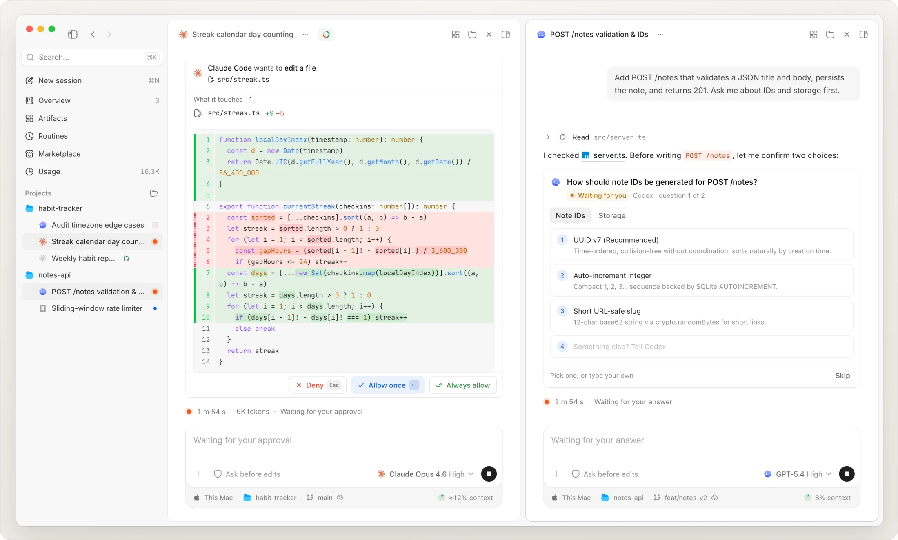
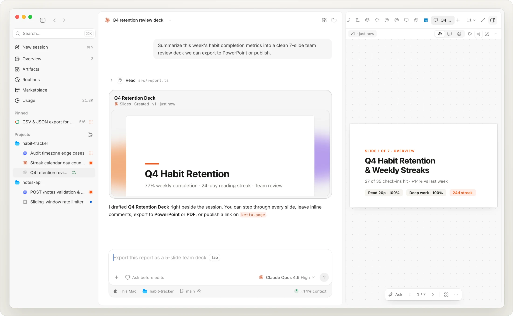
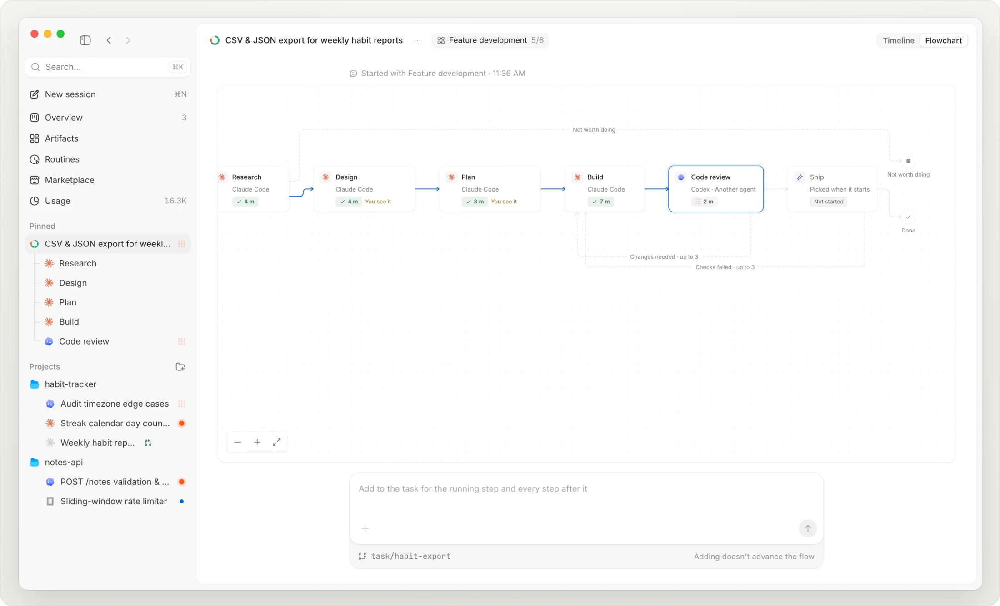
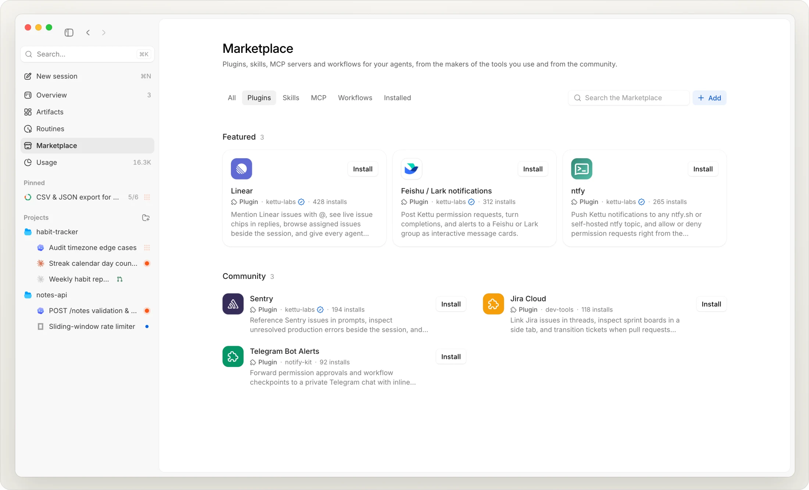
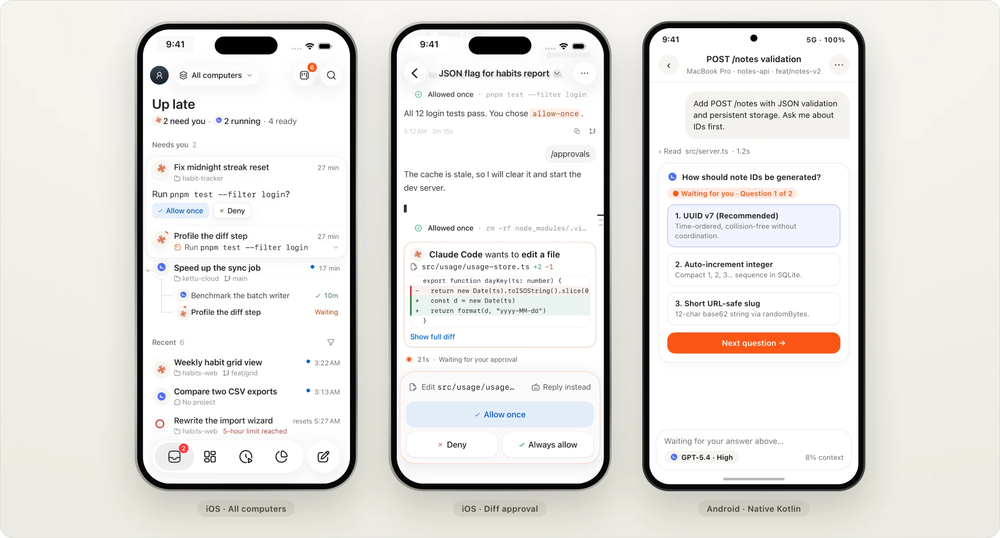

<div align="center">

<h1>
  <picture>
    <source media="(prefers-color-scheme: dark)" srcset="./assets/lockup-horizontal-dark.svg">
    
  </picture>
</h1>

<p>
  <a href="https://github.com/KettuAI/Kettu/releases/latest"></a>
  <a href="https://github.com/KettuAI/Kettu/releases"></a>
  <a href="#install"></a>
  <a href="#agents"></a>
  <a href="./LICENSE"></a>
  <a href="https://linux.do"></a>
</p>

<h3>Beauty is productivity.</h3>

<p>
  One native-feeling workbench for <b>Claude Code</b>, <b>Codex</b>, <b>OpenCode</b>, <b>Pi</b>, and 44 more coding agents —<br>
  side by side on your desktop, and in your pocket wherever you go.
</p>

<p>
  <a href="#install"><b>Download</b></a> ·
  <a href="https://app.kettu.sh">Web App</a> ·
  <a href="https://www.kettu.sh">Website</a> ·
  <a href="https://www.kettu.sh/docs/">Docs</a> ·
  <a href="https://github.com/KettuAI/relay">Self-Hosted Relay</a> ·
  <a href="./ROADMAP.md">Roadmap</a> ·
  <a href="https://www.kettu.sh/community/">Community</a> ·
  <a href="./README.zh-CN.md">简体中文</a>
</p>

</div>

<p align="center">
  <picture>
    <source media="(prefers-color-scheme: dark)" srcset="./assets/hero-dark.webp">
    
  </picture>
</p>

<a id="install"></a>

## Download & Install

Kettu is free and open source. Everything on your own computers and local network works **without an account**.

| Platform          | Target & Requirements                                                                | Download                                                                                                                                                                                                                                        |
| :---------------- | :----------------------------------------------------------------------------------- | :---------------------------------------------------------------------------------------------------------------------------------------------------------------------------------------------------------------------------------------------- |
| **macOS**         | Apple silicon & Intel · Signed and notarized `.dmg`                                  | [**Download for macOS**](https://www.kettu.sh/download/) · [GitHub Releases](https://github.com/KettuAI/Kettu/releases/latest)                                                                                                                  |
| **Windows**       | x64 & Arm64 · `setup.exe` _(unsigned preview: click **More info → Run anyway**)_     | [**Download for Windows**](https://www.kettu.sh/download/) · [GitHub Releases](https://github.com/KettuAI/Kettu/releases/latest)                                                                                                                |
| **Linux**         | x64 & Arm64 · `.AppImage` _(requires `libfuse2`, or `libfuse2t64` on Ubuntu 24.04+)_ | [**x64 `.AppImage`**](https://download.kettu.sh/latest/download/Kettu-x86_64.AppImage) · [**Arm64 `.AppImage`**](https://download.kettu.sh/latest/download/Kettu-arm64.AppImage) · [Releases](https://github.com/KettuAI/Kettu/releases/latest) |
| **iPhone & iPad** | Native SwiftUI app · Requires iOS 18+ and Kettu on a computer                        | [**Join Public Beta on TestFlight**](https://testflight.apple.com/join/zsbFyAPQ)                                                                                                                                                                |
| **Android**       | Native Kotlin app with in-app updates · Android 8.0+                                 | [**Download `Kettu.apk`**](https://download.kettu.sh/android/latest/download/Kettu.apk)                                                                                                                                                         |
| **Web**           | Any modern browser · Reach your computers from any network                           | [**Open `app.kettu.sh`**](https://app.kettu.sh)                                                                                                                                                                                                 |

<details>
<summary><b>Headless servers, Docker & self-hosted relay</b></summary>

<br>

**Daemon on a Linux or macOS dev machine** ([documentation](https://www.kettu.sh/docs/devices/daemon/)):

```sh
curl -fsSL https://kettu.sh/install | sh
```

_(You can also add any SSH machine directly from the desktop app under **Settings › Hosts** — Kettu sets itself up there automatically.)_

**Docker** (`amd64` and `arm64`, keeping host identity in the `kettu` volume and projects in `/workspace`):

```sh
docker run -d --name kettu -p 4567:4567 -v kettu:/home/node -v ~/code:/workspace ghcr.io/kettuai/kettu
docker exec kettu kettu direct add <your-server-address>:4567
docker exec -it kettu kettu pair
```

**Self-hosted relay** ([`KettuAI/relay`](https://github.com/KettuAI/relay) — run your own end-to-end encrypted relay and web client with no Kettu account):

```sh
curl -fsSL https://kettu.sh/relay/install | sudo sh -s -- --domain relay.example.com
```

</details>

## Highlights

### Run Every Agent Side by Side, Under Your Control

- **Bring your own agents**: Drives 48 coding agents — Claude Code, Codex, OpenCode, Pi, Cline, DeepSeek, Google Antigravity, and more — using the CLIs, subscriptions, and credentials already on your machine.
- **Parallel panes & Git worktrees**: Split a window into up to nine panes and isolate parallel sessions in dedicated Git worktrees that Kettu creates and cleans up. Sidebar indicators show at a glance which session is working, waiting for you, or finished.
- **Seamless hand-offs & steering**: Hand a conversation to another agent between turns with full context carried over, fork from any reply even mid-run, queue follow-ups, or steer a running turn.
- **Transparent approvals**: Inspect syntax-highlighted file diffs and flagged risky commands before anything runs. Answer multi-step agent questions in structured option cards and track live step plans in the top bar.

### A Complete Workbench Right Beside the Session

<p align="center">
  <picture>
    <source media="(prefers-color-scheme: dark)" srcset="./assets/workbench-dark.webp">
    
  </picture>
</p>

- **Unified side panel**: Files, diffs, Git status, per-session terminals, the session board, side chat, and artifacts live in one clean row of tabs right next to the thread.
- **Interactive artifacts & publishing**: Preview pages, documents, slide decks, and canvases as agents build them. Annotate elements for the agent, edit directly, export to Word or PowerPoint, or publish to `kettu.page` (private, access-code protected, or public).
- **Code, PDF & Office previews**: Browse and edit project files in tabs with built-in previews for PDFs, Word documents, and Excel spreadsheets, plus live GitHub PR and issue status badges inside replies.
- **Browser, mobile simulators & computer use**: Let agents drive a built-in browser or interact with iOS simulators, Android emulators, physical phones, and desktop apps — and take over control yourself at any moment.

### Multi-Agent Workflows, Universal Plugins & Usage Insights

<p align="center">
  <picture>
    <source media="(prefers-color-scheme: dark)" srcset="./assets/workflows-dark.webp">
    
  </picture>
</p>

<p align="center">
  <picture>
    <source media="(prefers-color-scheme: dark)" srcset="./assets/marketplace-dark.webp">
    
  </picture>
</p>

- **Visual multi-agent workflows**: Run complex tasks through multi-stage flowcharts — such as research, design, implementation on Claude Code, and cross-review on Codex — pausing automatically at human review gates, with a unified **Overview** for every active task.
- **Install once, use across every agent**: The built-in **Marketplace** brings together sandboxed Kettu plugins (Linear, Feishu / Lark, Sentry, ntfy, and more), skills, workflows, and one-click OAuth MCP servers — shared across all your agents from one place.
- **Routines & plan-limit rings**: Schedule recurring agent runs as **Routines**, and monitor token usage, daily costs, and real-time subscription rate-limit windows across every account on the **Usage** grid.

### Everywhere You Go — End-to-End Encrypted

<p align="center">
  <picture>
    <source media="(prefers-color-scheme: dark)" srcset="./assets/mobile-dark.webp">
    
  </picture>
</p>

- **Native iOS & Android apps**: Keep every computer's sessions in your pocket with needs-you requests surfaced first. Approve edits, answer questions, inspect artifacts, or start new tasks from anywhere — including lock-screen notifications.
- **Any browser, local network, or SSH**: Connect from [`app.kettu.sh`](https://app.kettu.sh) with zero port forwarding or VPN, pair directly over Wi-Fi / Tailscale / SSH with a QR code and no account, or link another desktop Kettu instance.
- **Self-hostable relay**: Need strict compliance or full infrastructure ownership? Deploy [`kettu-relay`](https://github.com/KettuAI/relay) — a single Go binary or Docker container that also serves the web client — on your own server in one command.
- **Local-first privacy**: Your code, sessions, and agent credentials stay on your own machines. Kettu collects no telemetry on your conversations or usage, and every remote connection is end-to-end encrypted so relays only forward ciphertext they cannot read. _(Download counts record version, OS, region, and IP; switch **Settings › About › Download source** to **GitHub only** to opt out.)_

<a id="agents"></a>

## Supported Agents

Kettu integrates deeply with Claude Code, Codex, OpenCode, Pi, Cline, and DeepSeek Harness through their native SDKs and servers, and supports 42 additional harnesses over the Agent Client Protocol (ACP).

<details>
<summary><b>View all 48 supported agents</b></summary>

<br>

|                                                                     |                                                                             |                                                       |                                                                                     |
| :------------------------------------------------------------------ | :-------------------------------------------------------------------------- | :---------------------------------------------------- | :---------------------------------------------------------------------------------- |
| [Claude Code](https://github.com/anthropics/claude-code)            | [Codex](https://github.com/openai/codex)                                    | [OpenCode](https://opencode.ai)                       | [Pi](https://pi.dev)                                                                |
| [DeepSeek Harness](https://github.com/deepseek-ai/deepseek-harness) | [fast-agent](https://fast-agent.ai)                                         | [Minion Code](https://github.com/femto/minion-code)   | [Auggie CLI](https://github.com/augmentcode/auggie)                                 |
| [Codebuddy Code](https://www.codebuddy.cn/cli/)                     | [DeepAgents](https://docs.langchain.com/oss/javascript/deepagents/overview) | [DimCode](https://dimagent.cn/)                       | [Dirac](https://dirac.run)                                                          |
| [GLM Agent](https://github.com/stefandevo/glm-acp-agent)            | [Nova](https://www.compassap.ai/portfolio/nova.html)                        | [Qoder CLI](https://qoder.com)                        | [siGit Code](https://github.com/getsigit/sigit)                                     |
| [Agoragentic](https://agoragentic.com)                              | [Autohand Code](https://www.autohand.ai/cli/)                               | [Cursor](https://cursor.com/docs/cli/acp)             | [Kimi Code CLI](https://moonshotai.github.io/kimi-cli/)                             |
| [Amp](https://ampcode.com)                                          | [goose](https://block.github.io/goose/)                                     | [Kilo Code](https://kilo.ai)                          | [Gemini CLI](https://github.com/google-gemini/gemini-cli)                           |
| [GitHub Copilot](https://github.com/github/copilot-cli)             | [Qwen Code](https://github.com/QwenLM/qwen-code)                            | [Grok](https://x.ai/cli)                              | [Cline](https://cline.bot/cli)                                                      |
| [Factory Droid](https://factory.ai/product/cli)                     | [OMP (Oh My Pi)](https://omp.sh)                                            | [Hermes Agent](https://hermes-agent.nousresearch.com) | [Muse Code](https://dev.meta.ai)                                                    |
| [CodeWhale](https://codewhale.net)                                  | [Bob](https://bob.ibm.com)                                                  | [MiniMax Code](https://agent.minimax.io)              | [Harn](https://harnlang.com)                                                        |
| [Kimchi](https://kimchi.dev)                                        | [Google Antigravity](https://antigravity.google)                            | [Devin](https://docs.devin.ai/cli)                    | [Cortex Code](https://docs.snowflake.com/en/user-guide/cortex-code/cortex-code-cli) |
| [Corust Agent](https://corust.ai)                                   | [crow-cli](https://github.com/crow-cli/crow-cli)                            | [Junie](https://junie.jetbrains.com)                  | [Mistral Vibe](https://github.com/mistralai/mistral-vibe)                           |
| [Poolside](https://poolside.ai)                                     | [Stakpak](https://stakpak.dev)                                              | [VT Code](https://github.com/vinhnx/VTCode)           | [Qoder CN](https://qoder.cn)                                                        |

</details>

Missing an agent you use? [Request it in an issue](https://github.com/KettuAI/Kettu/issues/new/choose).

## Open-Source Ecosystem

| Repository                                                    | Description                                                                                    |
| :------------------------------------------------------------ | :--------------------------------------------------------------------------------------------- |
| [**KettuAI/Kettu**](https://github.com/KettuAI/Kettu)         | Desktop workbench (macOS, Windows, Linux), headless daemon, and web client                     |
| [**KettuAI/relay**](https://github.com/KettuAI/relay)         | Lightweight Go self-hosted relay server (`kettu-relay`) for end-to-end encrypted remote access |
| [**KettuAI/plugins**](https://github.com/KettuAI/plugins)     | Official sandboxed plugins published to the Kettu Marketplace (`@kettu-labs`)                  |
| [**KettuAI/workflows**](https://github.com/KettuAI/workflows) | Official multi-agent workflow definitions for the Kettu Marketplace                            |
| [**KettuAI/themes**](https://github.com/KettuAI/themes)       | Community and official color themes catalog                                                    |

## Contributors

<!-- contributors:start -->

Thank you to everyone helping shape Kettu — whether through merged pull requests or through accepted bug reports, ideas, and feedback.

<p>
  <a href="https://github.com/Yezh1i" title="@Yezh1i"></a>
  <a href="https://github.com/xiaolfeng" title="@xiaolfeng"></a>
  <a href="https://github.com/isyuah" title="@isyuah"></a>
  <a href="https://github.com/kinhangliew-debug" title="@kinhangliew-debug"></a>
  <a href="https://github.com/akatsukiro" title="@akatsukiro"></a>
  <a href="https://github.com/javalover123" title="@javalover123"></a>
  <a href="https://github.com/NKUlpj" title="@NKUlpj"></a>
  <a href="https://github.com/jkoe86710" title="@jkoe86710"></a>
  <a href="https://github.com/jintongxu" title="@jintongxu"></a>
  <a href="https://github.com/liuchaowei666" title="@liuchaowei666"></a>
  <a href="https://github.com/Ne1ther" title="@Ne1ther"></a>
  <a href="https://github.com/AlkaidSTART" title="@AlkaidSTART"></a>
  <a href="https://github.com/Ariember" title="@Ariember"></a>
  <a href="https://github.com/ShaoClean" title="@ShaoClean"></a>
  <a href="https://github.com/Elijah-s" title="@Elijah-s"></a>
  <a href="https://github.com/kcyu1010" title="@kcyu1010"></a>
  <a href="https://github.com/Kongbai333" title="@Kongbai333"></a>
  <a href="https://github.com/KubaZzZo" title="@KubaZzZo"></a>
  <a href="https://github.com/Leochens" title="@Leochens"></a>
  <a href="https://github.com/maysilence" title="@maysilence"></a>
  <a href="https://github.com/RainGoal" title="@RainGoal"></a>
  <a href="https://github.com/songxff" title="@songxff"></a>
  <a href="https://github.com/sunCloud998" title="@sunCloud998"></a>
  <a href="https://github.com/w-bytes" title="@w-bytes"></a>
  <a href="https://github.com/xhbs" title="@xhbs"></a>
  <a href="https://github.com/xing-skyline" title="@xing-skyline"></a>
</p>

<!-- contributors:end -->

## Community & Contributing

- **Issues & feedback**: Open an [issue](https://github.com/KettuAI/Kettu/issues/new/choose) in any language, or use **Help › Report a Problem…** inside the app.
- **Community**: Join the user group via [kettu.sh/community](https://www.kettu.sh/community/).
- **Development & security**: See [CONTRIBUTING.md](./CONTRIBUTING.md) to build from source, and [SECURITY.md](./SECURITY.md) to report vulnerabilities privately.

## License

[AGPL-3.0](./LICENSE) (with the affectUI exception in [LICENSE-EXCEPTION](./LICENSE-EXCEPTION)). The plugin API types and examples in [`packages/plugin-api`](./packages/plugin-api) are licensed under [MIT](./packages/plugin-api/LICENSE).
