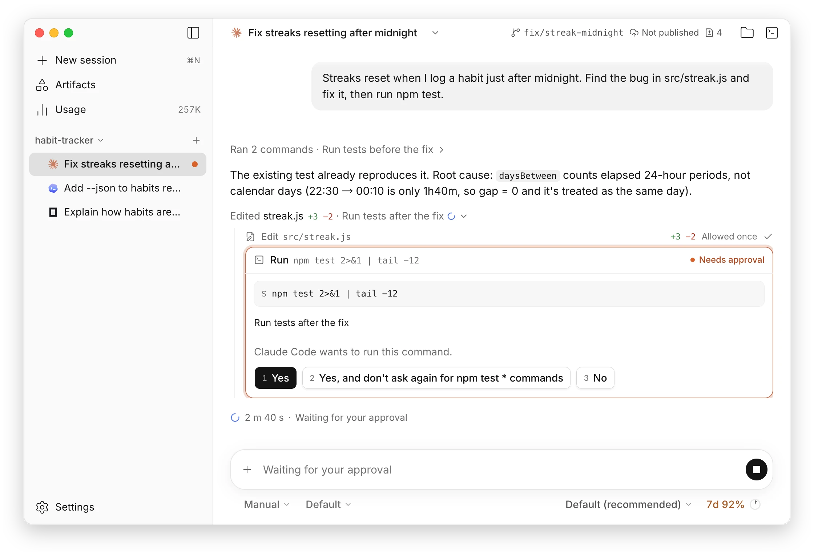

<h1>
  <picture>
    <source media="(prefers-color-scheme: dark)" srcset="./assets/lockup-horizontal-dark.svg">
    
  </picture>
</h1>

**A calm desktop workbench for terminal coding agents.**

Claude Code, Codex CLI and opencode side by side in one window, 
with readable threads, clear approvals, git and a terminal beside every session.

[**Download**](https://github.com/overbench/overbench/releases/latest) · [Roadmap](./ROADMAP.md) · [Feedback](https://github.com/overbench/overbench/issues/new/choose) · [简体中文](./README.zh-CN.md)

<picture>
  <source media="(prefers-color-scheme: dark)" srcset="./assets/screenshot-dark.webp">
  
</picture>

> [!NOTE]
> OverBench is a preview. It is built from the first milestone, M0, which is still in acceptance, so expect rough edges and please [report them](https://github.com/overbench/overbench/issues).

## What is OverBench

Coding agents like Claude Code, Codex and opencode can now plan a change, edit the code and run the tests on their own. Working with them in a terminal still means walls of scrolling text, approvals that are easy to miss, and sessions scattered across tabs and windows.

OverBench is a desktop home for that work. Every agent you use opens side by side in one window, each session sits under its project, and you can see at a glance which agent is working, which one is waiting for you and which one is done. Answers read like documents instead of logs, what the agent changed is shown as a diff, and a question from an agent comes to you as a card you answer with one key.

It drives the agents you already have, with your own installation, account and settings, so nothing about how they work changes: OverBench only gives them a better place to work in.

## Features

- **Every agent, one window** — Claude Code, Codex CLI and opencode sessions side by side in the same project. The sidebar shows which are running, which wait for you and which are done, with subagents under their parent; pin the sessions you come back to and archive the ones you are done with.
- **Threads that read well** — answers stream as Markdown with highlighted code, edits show as inline diffs, images the agent names show in place, and a run of steps folds into one line. Queue your next message while the agent works, or steer it mid-turn.
- **Approvals at a glance** — permission requests are cards you answer with a click or a number key, and a system notification tells you when a session needs you.
- **Attach anything** — paste images, attach files and folders, or mention a project file with `@`, from the first message on.
- **Artifacts** — agents publish HTML pages and multi-page canvases through OverBench's built-in artifacts service. Each one keeps its versions, opens in a viewer isolated from the app, and is collected on the Artifacts page and on New session.
- **Each agent's own controls** — mode, model and reasoning, slash commands, context usage, when the prompt cache expires and, where the agent reports them, your plan limits.
- **Usage at a glance** — tokens across every agent by day, model and project, with each plan's limits, from OverBench's own record and, if you choose, the agents' local logs.
- **Sessions that last** — every session is kept with its project, reopens with its full history, survives an agent crash, and can be imported from the agent.
- **Git, files and a terminal** — the branch, sync state and changes in the top bar, pull requests with their checks through the GitHub CLI, a files pane to read, preview and edit files, and a terminal for each project.
- **Crafted details** — light and dark themes, English and Simplified Chinese, restrained motion that honors reduce motion, and shortcuts for the common actions.

## Your agents, your data

- **Bring your own agents.** OverBench implements no agent of its own. It talks to each one over the open [Agent Client Protocol](https://agentclientprotocol.com) (ACP), so your models, settings, rules and tools stay exactly as you set them up.
- **Sign in where you always do.** Each agent signs in with its own flow, and OverBench never sees your credentials.
- **Local by default.** OverBench has no account and no server of its own and collects no telemetry. Your sessions stay on your computer, and each agent talks only to its own provider, as it does in your terminal.

## Install

Download the installer for your system from [Releases](https://github.com/overbench/overbench/releases/latest). Preview builds are not signed by Apple or Microsoft yet, so your system asks once before the first launch.

- **macOS**: open `OverBench-<version>-arm64.dmg` on Apple silicon or `OverBench-<version>-x64.dmg` on an Intel Mac, and drag OverBench to Applications. When macOS says it cannot verify the app, open System Settings › Privacy & Security and choose **Open Anyway**.
- **Windows**: run `OverBench-<version>-x64-setup.exe`, or `OverBench-<version>-arm64-setup.exe` on Arm. When SmartScreen says it protected your PC, choose **More info**, then **Run anyway**.
- **Linux**: make `OverBench-x86_64.AppImage`, or `OverBench-arm64.AppImage` on Arm, executable with `chmod +x`, then run it. AppImages need FUSE 2: `libfuse2`, or `libfuse2t64` on Ubuntu 24.04 and later.

On Windows and Linux, new versions download in the background and install when OverBench restarts; on macOS, OverBench links to the download until its builds are signed. v0.0.1 cannot find updates, so install the latest version over it once by hand.

### Agents

Install at least one of these agents first; OverBench finds it on your system.

| Agent                                                                       | How OverBench runs it                                                                                        |
| --------------------------------------------------------------------------- | ------------------------------------------------------------------------------------------------------------ |
| [Claude Code](https://github.com/anthropics/claude-code)                    | The ACP adapter `@agentclientprotocol/claude-agent-acp`, installed on first use                              |
| [Codex CLI](https://github.com/openai/codex)                                | The ACP adapter `@agentclientprotocol/codex-acp`, installed on first use                                     |
| [opencode](https://opencode.ai)                                             | Your installed `opencode`, as `opencode acp`                                                                 |
| [Pi](https://pi.dev)                                                        | The ACP adapter `pi-acp`, installed on first use, with your installed `pi`                                   |
| [Auggie CLI](https://github.com/augmentcode/auggie)                         | The ACP package `@augmentcode/auggie`, installed on first use, with `--acp` and auto-update off              |
| [Codebuddy Code](https://www.codebuddy.cn/cli/)                             | The ACP package `@tencent-ai/codebuddy-code`, installed on first use, with `--acp`                           |
| [DeepAgents](https://docs.langchain.com/oss/javascript/deepagents/overview) | The ACP package `deepagents-acp`, installed on first use                                                     |
| [DimCode](https://dimagent.cn/)                                             | The ACP package `dimcode`, installed on first use, with `acp`                                                |
| [Dirac](https://dirac.run)                                                  | The ACP package `dirac-cli`, installed on first use, with `--acp`                                            |
| [GLM Agent](https://github.com/stefandevo/glm-acp-agent)                    | The ACP package `glm-acp-agent`, installed on first use                                                      |
| [Nova](https://www.compassap.ai/portfolio/nova.html)                        | The ACP package `@compass-ai/nova`, installed on first use, with `acp`                                       |
| [Qoder CLI](https://qoder.com)                                              | The ACP package `@qoder-ai/qodercli`, installed on first use, with `--acp`                                   |
| [siGit Code](https://github.com/getsigit/sigit)                             | The ACP package `@smbcloud/sigit`, installed on first use                                                    |
| [Agoragentic](https://agoragentic.com)                                      | The ACP package `agoragentic-mcp`, installed on first use, with `--acp`                                      |
| [Autohand Code](https://www.autohand.ai/cli/)                               | The ACP package `@autohandai/autohand-acp`, installed on first use                                           |
| [Claude Code](https://github.com/anthropics/claude-code)                    | The ACP adapter `@agentclientprotocol/claude-agent-acp`, installed on first use                              |
| [Codex CLI](https://github.com/openai/codex)                                | The ACP adapter `@agentclientprotocol/codex-acp`, installed on first use                                     |
| [opencode](https://opencode.ai)                                             | Your installed `opencode`, as `opencode acp`                                                                 |
| [Pi](https://pi.dev)                                                        | The ACP adapter `pi-acp`, installed on first use, with your installed `pi`                                   |
| [Cursor](https://cursor.com/docs/cli/acp)                                   | Your installed `cursor-agent`, or Cursor's archive on first use                                              |
| [Kimi Code CLI](https://moonshotai.github.io/kimi-cli/)                     | Your installed `kimi`, or its archive on first use                                                           |
| [Amp](https://ampcode.com)                                                  | The ACP adapter `amp-acp`, downloaded on first use                                                           |
| [goose](https://block.github.io/goose/)                                     | Your installed `goose`, or its archive on first use                                                          |
| [Kilo Code](https://kilo.ai)                                                | Your installed `kilo`, or its archive on first use                                                           |
| [Gemini CLI](https://github.com/google-gemini/gemini-cli)                   | The ACP package `@google/gemini-cli`, installed on first use, with `--acp`                                   |
| [GitHub Copilot](https://github.com/github/copilot-cli)                     | The ACP package `@github/copilot`, installed on first use, with `--acp`                                      |
| [Qwen Code](https://github.com/QwenLM/qwen-code)                            | The ACP package `@qwen-code/qwen-code`, installed on first use, with `--acp`                                 |
| [Grok](https://x.ai/cli)                                                    | The ACP package `@xai-official/grok`, installed on first use, with `agent stdio`                             |
| [Cline](https://cline.bot/cli)                                              | The ACP package `cline`, installed on first use, with `--acp`                                                |
| [Factory Droid](https://factory.ai/product/cli)                             | The ACP package `droid`, installed on first use, with `exec --output-format acp-daemon` and self-updates off |

The adapters need Node.js with npm, which OverBench finds through your login shell.

## Why OverBench

It rests on one belief, **beauty is productivity**: a tool you spend whole days in should be a pleasure to look at, and that pleasure is what lets you work faster.

- **Start from the best.** Study the strongest implementations of each piece, from terminals to diff viewers, and bring them together instead of reinventing them.
- **Optimize to the limit.** Quick to start and smooth through the longest transcript, with no dropped frames.
- **Polish to the limit.** A clear hierarchy, calm typography and restrained motion, so you see what the agent changed faster than in any scrollback.

## Feedback

Early feedback shapes OverBench the most, and ideas about design and workflow are especially welcome. Open an [issue](https://github.com/overbench/overbench/issues/new/choose) to report a bug or start a conversation, in any language; a screenshot helps. Security problems go through [SECURITY.md](./SECURITY.md), never a public issue.

Want to build OverBench yourself? [CONTRIBUTING.md](./CONTRIBUTING.md) has the setup.

## License

OverBench is released under the [Apache-2.0 license](./LICENSE).

---

OverBench is an independent project and is not affiliated with or endorsed by the makers of the agents it supports. All product names are trademarks of their respective owners.
