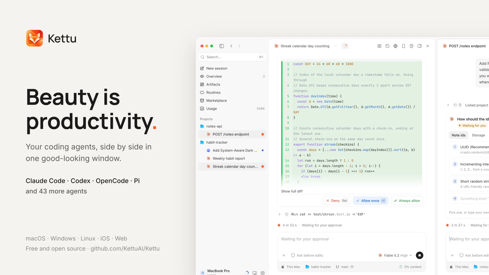
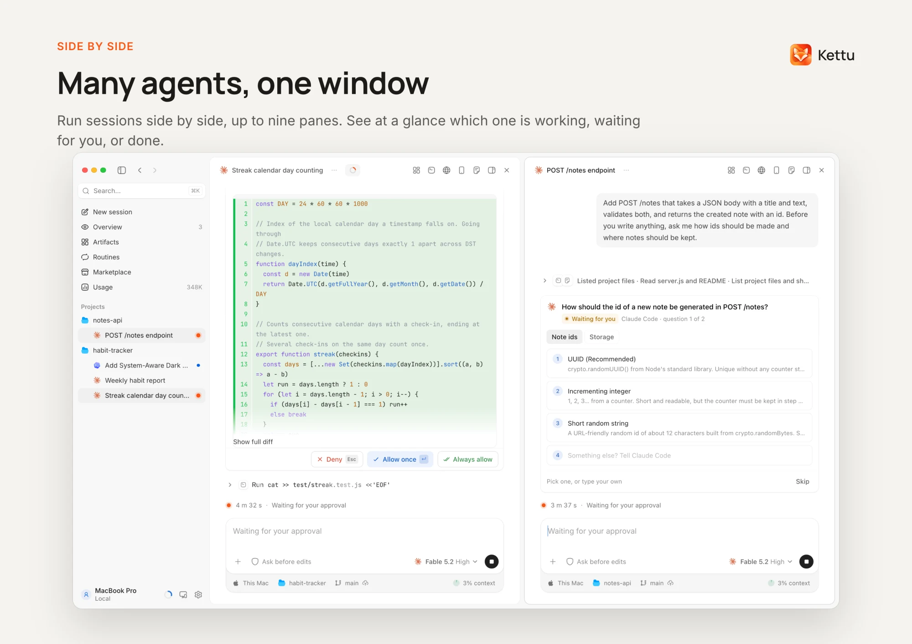
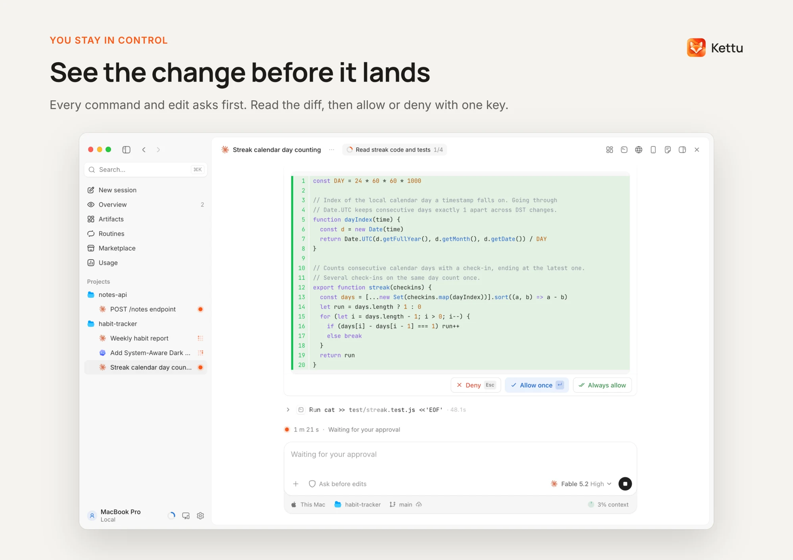
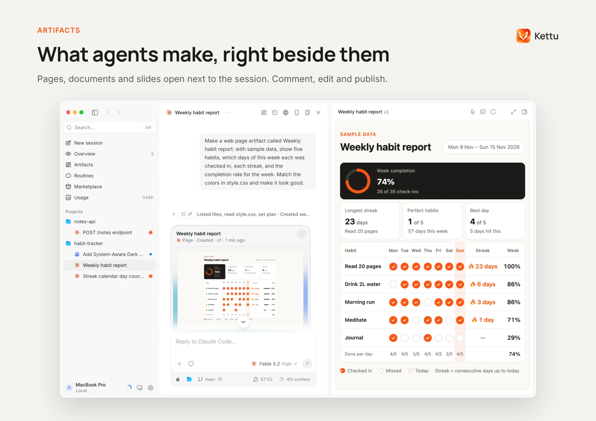
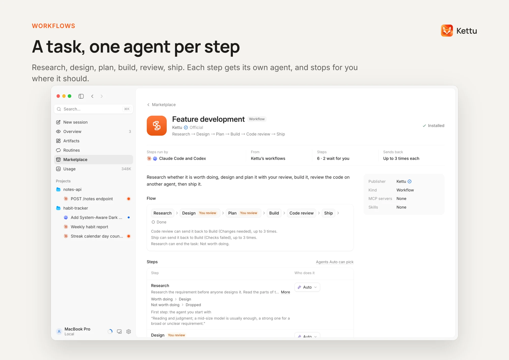
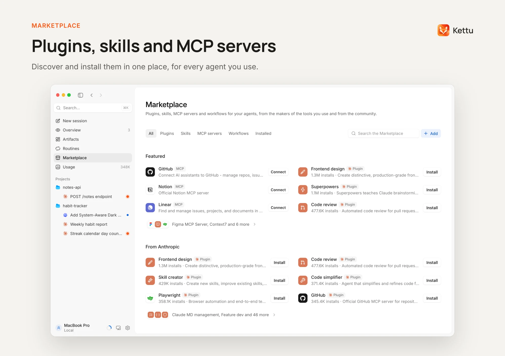
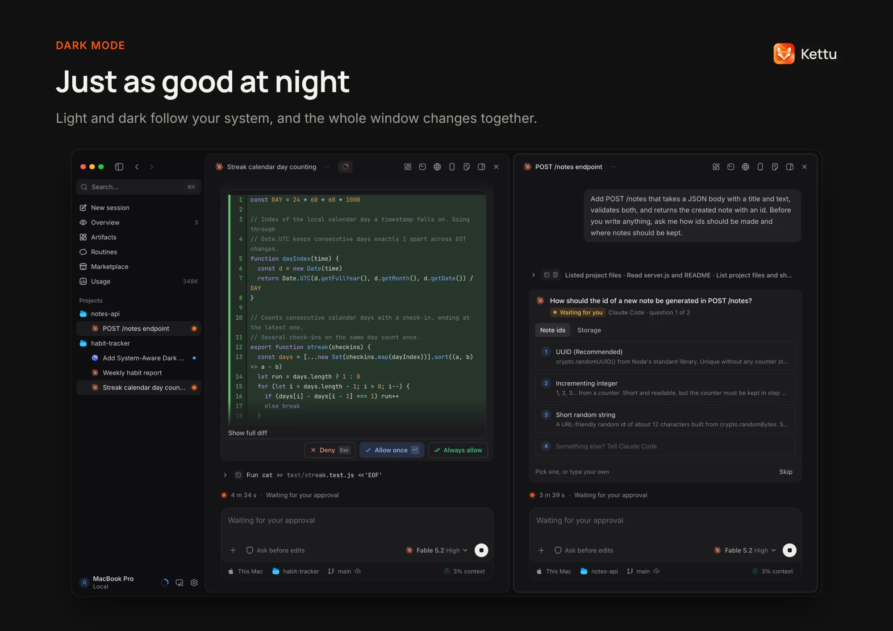
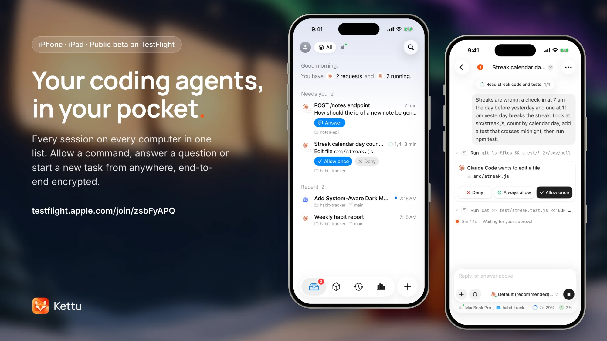

<div align="center">

<h1>
  <picture>
    <source media="(prefers-color-scheme: dark)" srcset="./assets/lockup-horizontal-dark.svg">
    
  </picture>
</h1>

[](https://github.com/KettuAI/Kettu/releases/latest)
[](https://github.com/KettuAI/Kettu/releases)
[](#install)
[](#agents)
[](./LICENSE)
[](https://linux.do)

<h3>Beauty is productivity.</h3>

All your coding agents, side by side in one window that looks good and feels right.

[**Download**](https://github.com/KettuAI/Kettu/releases/latest) · [Website](https://www.kettu.sh) · [Docs](https://www.kettu.sh/docs/) · [Roadmap](./ROADMAP.md) · [Feedback](https://github.com/KettuAI/Kettu/issues/new/choose) · [简体中文](./README.zh-CN.md)

</div>



> [!NOTE]
> Kettu is an early preview. The desktop app has found its shape, and its details still change quickly. Please [report](https://github.com/KettuAI/Kettu/issues) what you find.

## Features

<p>
  
  
</p>

<p>
  
  
</p>

<p>
  
  
</p>

### Agents and sessions

- **48 agents**: Claude Code, Codex, OpenCode, Pi and more, with your own installs, accounts and settings. Turn one off without losing its sessions.
- **Side by side**: run sessions in parallel and split the window into up to nine panes. The sidebar shows which one is working, which one is waiting for you and which one is done.
- **One-key approvals**: when an agent wants to run a command or change a file, see what it touches, then allow or deny it with one key.
- **Question cards**: an agent's questions in one card, answered one by one and sent together.
- **Plans**: the agent's plan and progress sit in the top bar.
- **Switch agents**: hand a session to another agent between turns, and the conversation carries over.
- **Subagents**: shown under their parent session, where you answer their requests too.
- **Queue and steer**: while an agent works, queue your next message or steer it mid-turn.
- **Reply to a passage**: select part of a reply and answer just that.
- **Attachments**: paste images, attach files and folders, or mention a project file with `@`.
- **Forks**: branch a new session off any reply, even while the agent is still working.
- **Pull requests and issues**: GitHub links in replies show their current state, and a session's pull requests show in the sidebar.
- **Notifications**: know when a session needs you.
- **Hand-offs**: a session can give work to another agent, such as Codex reviewing what Claude Code wrote, and gets the result back.
- **Workflows**: run a task through a flow of steps, such as research, design, build and review, with an agent session for each step and a stop wherever you should look.
- **Overview**: one page for the state of every session and task, the step it is at and what is ready for you.
- **Usage**: tokens and cost by day, model and project, and each account's plan limits as rings.

### Workbench

- **Diffs**: see which files the agent changed and how.
- **Files**: read, preview and edit project files in tabs.
- **Terminal**: every session has its own.
- **Git**: the branch, changes and pull request checks.
- **Worktrees**: a session can work in a Git worktree of its own, which Kettu creates and cleans up.
- **Built-in browser**: agents open pages, click, type and take screenshots; take over at any time.
- **Artifacts**: the pages, documents, slides and canvases agents make. Lay out a canvas's frames and mark them up for the agent, comment, edit them yourself, or export them to Word and PowerPoint.
- **Publish to Kettu**: give an artifact its own page on kettu.page, private, behind an access code or public.
- **Computer use**: once you turn it on, agents use the apps on your computer.
- **Routines**: run an agent on a schedule; every run is kept as a session.
- **Marketplace**: discover, install and manage plugins, skills, MCP servers and workflows for your agents in one place.
- **Search**: one command palette for sessions, artifacts, routines, projects, settings and actions.

### Mobile devices

- **Right beside the session**: iOS simulators, Android emulators and real iPhones and Android phones, each in a frame with its hardware buttons.
- **For you and the agent**: tap, swipe and type on the screen yourself, or let the agent open apps and pages, tap, type, switch between light and dark and take screenshots. Take over at any time.
- **Ready for app work**: the agent installs your build, launches it and reads its logs.

### Everywhere



- **Any browser, any network**: open [app.kettu.sh](https://app.kettu.sh) and reach your computers through the Kettu relay, with no VPN and no open port.
- **Your own network**: pair a phone, tablet or browser with a QR code and carry on over Wi-Fi, a VPN or an SSH forward, without an account.
- **Another computer**: use this computer's sessions from Kettu on another one.
- **Development machines**: add one by its SSH address, and Kettu sets itself up there.
- **End-to-end encrypted**: nothing in between can read your sessions, the relay included.

### iPhone and iPad

- **Your sessions in your pocket**: every session on every computer in one list, with the ones that need you first. In [public beta on TestFlight](https://testflight.apple.com/join/zsbFyAPQ).
- **Answer from anywhere**: allow or deny a command, answer an agent's questions, approve its plan, reply, or start a new session.
- **Notifications**: know when a session needs you, and answer from the lock screen.
- **Artifacts, Routines and usage**: open what your agents made, run a routine and see your plan limits.

### Android

- **Kettu on Android**: [download the app](https://download.kettu.sh/android/latest/download/Kettu.apk) to open app.kettu.sh full screen with its own icon, signed in to your Kettu account.

### Looks

- Light and dark modes that follow your system and fade across the whole window at once, themes from the catalog or your own, English and Simplified Chinese, and the frosted macOS sidebar.

### Coming soon

- **Native Android app**: after the iPhone and iPad app.

## Privacy

- Your sessions, code and files stay on your own computers. Kettu collects none of them, nor how you use it.
- Kettu keeps no copy of your agents' credentials.
- A Kettu account is optional. Everything on your own computers and network works without one; signing in adds the relay, app.kettu.sh, publishing to kettu.page and problem reports.
- A problem report leaves your computer only when you send it.
- Kettu's download service records the version, system, region and IP address of each download and update check, to count downloads. To avoid it, set Settings › About › Download source to GitHub only.

## Install

Download from [Releases](https://github.com/KettuAI/Kettu/releases/latest):

- **macOS** (Apple silicon and Intel): the `.dmg` for your chip
- **Windows** (x64 and Arm): the `setup.exe`. It is not signed yet, so when SmartScreen appears, choose **More info**, then **Run anyway**.
- **Linux** (x64 and Arm): the `.AppImage`; make it executable and run it. It needs FUSE 2 (`libfuse2`, or `libfuse2t64` on Ubuntu 24.04 and later).

On an iPhone or iPad: join the [public beta on TestFlight](https://testflight.apple.com/join/zsbFyAPQ). It needs iOS 26 or later, and Kettu on a computer.

On an Android phone or tablet: download [Kettu.apk](https://download.kettu.sh/android/latest/download/Kettu.apk) and allow the install when Android asks. It needs Android 8.0 or later with Chrome, and Kettu on a computer.

In a browser: [app.kettu.sh](https://app.kettu.sh), signed in to the same Kettu account as Kettu on your computer.

On a server or development machine ([docs](https://www.kettu.sh/docs/devices/daemon/)):

```sh
curl -fsSL https://kettu.sh/install | sh
```

Or in Docker (amd64 and Arm), which keeps Kettu's data in the `kettu` volume and your projects in `/workspace`:

```sh
docker run -d --name kettu -p 4567:4567 -v kettu:/home/node -v ~/code:/workspace ghcr.io/kettuai/kettu
docker exec kettu kettu direct add <your-server-address>:4567
docker exec -it kettu kettu pair
```

The container only knows its own address, so `direct add` gives devices your server's. `kettu pair` shows the code that adds a device. Keep the `kettu` volume: it holds the identity your devices paired with. To update, pull the new image and run the container again.

## Agents

<details>
<summary><b>All 48 agents</b></summary>

|                                                                     |                                                                             |                                                       |                                                                                     |
| ------------------------------------------------------------------- | --------------------------------------------------------------------------- | ----------------------------------------------------- | ----------------------------------------------------------------------------------- |
| [Claude Code](https://github.com/anthropics/claude-code)            | [Codex](https://github.com/openai/codex)                                    | [OpenCode](https://opencode.ai)                       | [Pi](https://pi.dev)                                                                |
| [DeepSeek Harness](https://github.com/deepseek-ai/deepseek-harness) | [fast-agent](https://fast-agent.ai)                                         | [Minion Code](https://github.com/femto/minion-code)   | [Auggie CLI](https://github.com/augmentcode/auggie)                                 |
| [Codebuddy Code](https://www.codebuddy.cn/cli/)                     | [DeepAgents](https://docs.langchain.com/oss/javascript/deepagents/overview) | [DimCode](https://dimagent.cn/)                       | [Dirac](https://dirac.run)                                                          |
| [GLM Agent](https://github.com/stefandevo/glm-acp-agent)            | [Nova](https://www.compassap.ai/portfolio/nova.html)                        | [Qoder CLI](https://qoder.com)                        | [siGit Code](https://github.com/getsigit/sigit)                                     |
| [Agoragentic](https://agoragentic.com)                              | [Autohand Code](https://www.autohand.ai/cli/)                               | [Cursor](https://cursor.com/docs/cli/acp)             | [Kimi Code CLI](https://moonshotai.github.io/kimi-cli/)                             |
| [Amp](https://ampcode.com)                                          | [goose](https://block.github.io/goose/)                                     | [Kilo Code](https://kilo.ai)                          | [Gemini CLI](https://github.com/google-gemini/gemini-cli)                           |
| [GitHub Copilot](https://github.com/github/copilot-cli)             | [Qwen Code](https://github.com/QwenLM/qwen-code)                            | [Grok](https://x.ai/cli)                              | [Cline](https://cline.bot/cli)                                                      |
| [Factory Droid](https://factory.ai/product/cli)                     | [OMP (Oh My Pi)](https://omp.sh)                                            | [Hermes Agent](https://hermes-agent.nousresearch.com) | [Muse Code](https://dev.meta.ai)                                                    |
| [CodeWhale](https://codewhale.net)                                  | [Bob](https://bob.ibm.com)                                                  | [MiniMax Code](https://agent.minimax.io)              | [Harn](https://harnlang.com)                                                        |
| [Kimchi](https://kimchi.dev)                                        | [Google Antigravity](https://antigravity.google)                            | [Devin](https://docs.devin.ai/cli)                    | [Cortex Code](https://docs.snowflake.com/en/user-guide/cortex-code/cortex-code-cli) |
| [Corust Agent](https://corust.ai)                                   | [crow-cli](https://github.com/crow-cli/crow-cli)                            | [Junie](https://junie.jetbrains.com)                  | [Mistral Vibe](https://github.com/mistralai/mistral-vibe)                           |
| [Poolside](https://poolside.ai)                                     | [Stakpak](https://stakpak.dev)                                              | [VT Code](https://github.com/vinhnx/VTCode)           | [Qoder CN](https://qoder.cn)                                                        |

</details>

Missing an agent you use? [Tell us](https://github.com/KettuAI/Kettu/issues/new/choose).

## Feedback

Open an [issue](https://github.com/KettuAI/Kettu/issues/new/choose) in any language, or send a report from **Help › Report a Problem…** in the app. Security problems go through [SECURITY.md](./SECURITY.md). To build Kettu yourself, see [CONTRIBUTING.md](./CONTRIBUTING.md).

Chinese speakers can also join the WeChat group:


## License

[AGPL-3.0](./LICENSE). The plugin API's types and sample in [`packages/plugin-api`](./packages/plugin-api) are under the [MIT license](./packages/plugin-api/LICENSE), so plugins can copy them.
