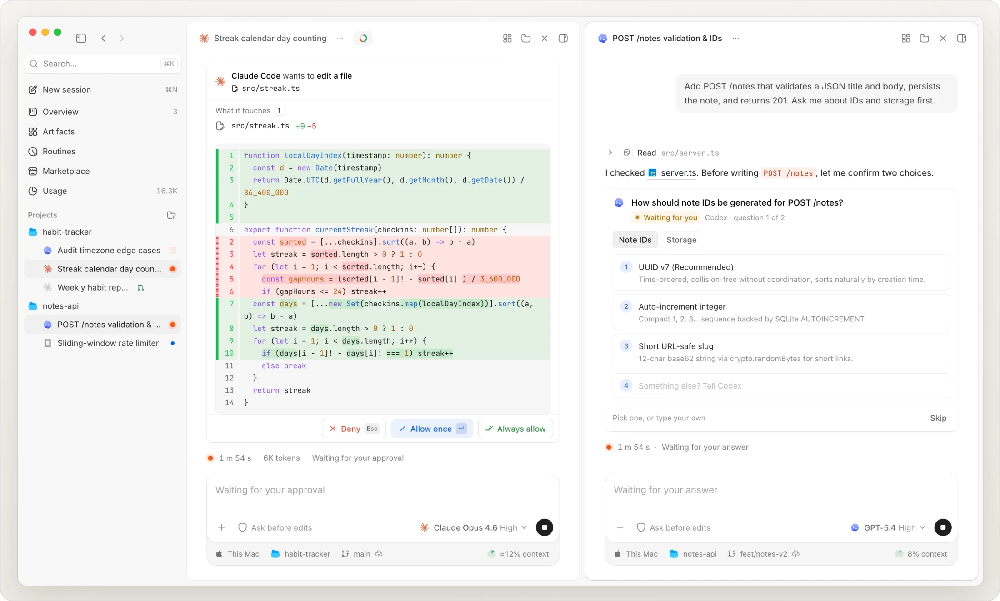
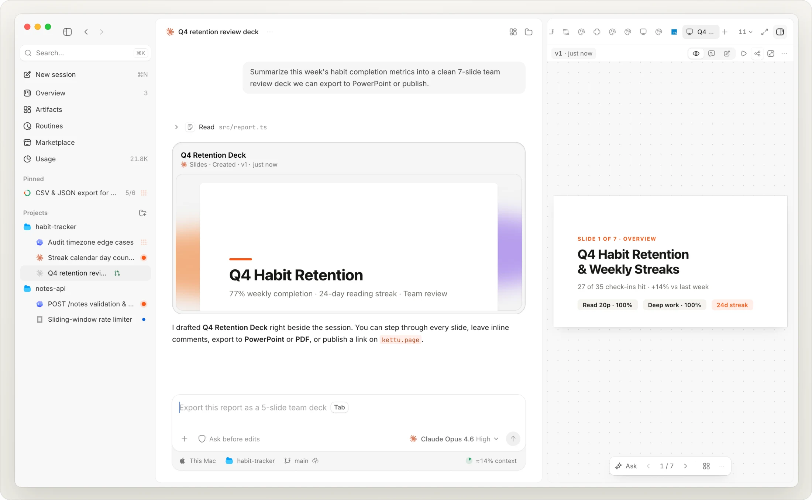
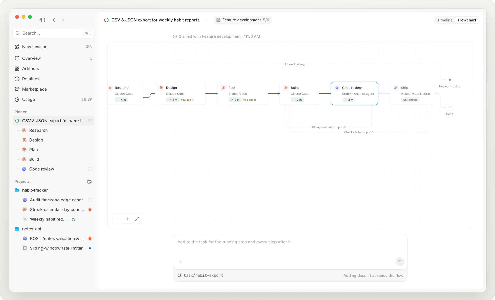
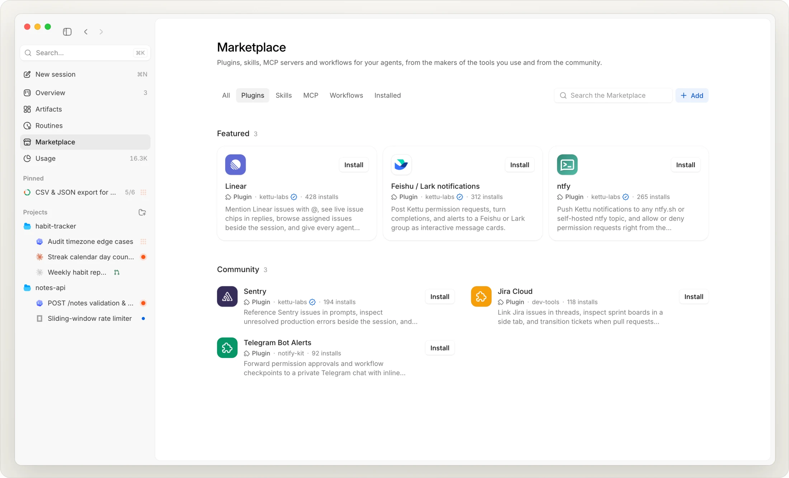
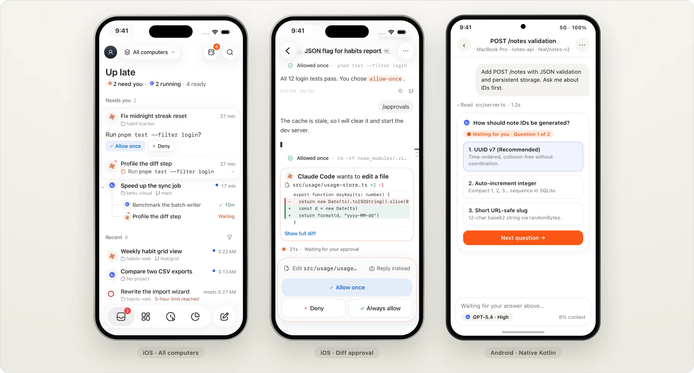

<div align="center">

<h1>
  <picture>
    <source media="(prefers-color-scheme: dark)" srcset="./assets/lockup-horizontal-dark.svg">
    
  </picture>
</h1>

<p>
  <a href="https://github.com/KettuAI/Kettu/releases/latest"></a>
  <a href="https://github.com/KettuAI/Kettu/releases"></a>
  <a href="#安装"></a>
  <a href="#支持的-agent"></a>
  <a href="./LICENSE"></a>
  <a href="https://linux.do"></a>
</p>

<h3>颜值也是生产力。</h3>

<p>
  把 <b>Claude Code</b>、<b>Codex</b>、<b>OpenCode</b>、<b>Pi</b> 等 48 款编码 Agent 放进同一个精致顺手的工作台——<br>
  在桌面并排高效协作，在手机与浏览器里随时随地接力。
</p>

<p>
  <a href="#安装"><b>立即下载</b></a> ·
  <a href="https://app.kettu.sh">网页版</a> ·
  <a href="https://www.kettu.sh/zh-CN/">官网</a> ·
  <a href="https://www.kettu.sh/zh-CN/docs/">文档</a> ·
  <a href="https://github.com/KettuAI/relay">自建中继</a> ·
  <a href="./ROADMAP.zh-CN.md">路线图</a> ·
  <a href="https://www.kettu.sh/zh-CN/community/">交流群</a> ·
  <a href="./README.md">English</a>
</p>

</div>

<p align="center">
  <picture>
    <source media="(prefers-color-scheme: dark)" srcset="./assets/hero-dark.webp">
    
  </picture>
</p>

<a id="安装"></a>

## 下载与安装

Kettu 开源免费。本机与局域网内的全部功能**无需注册账号**即可直接使用。

| 平台              | 架构与环境要求                                                                        | 获取方式                                                                                                                                                                                                                                        |
| :---------------- | :------------------------------------------------------------------------------------ | :---------------------------------------------------------------------------------------------------------------------------------------------------------------------------------------------------------------------------------------------- |
| **macOS**         | Apple 芯片 & Intel · 已签名并通过 Apple 公证的 `.dmg`                                 | [**前往官网下载**](https://www.kettu.sh/zh-CN/download/) · [GitHub Releases](https://github.com/KettuAI/Kettu/releases/latest)                                                                                                                  |
| **Windows**       | x64 & Arm64 · `setup.exe` _（暂未签名，SmartScreen 提示时点「更多信息 → 仍要运行」）_ | [**前往官网下载**](https://www.kettu.sh/zh-CN/download/) · [GitHub Releases](https://github.com/KettuAI/Kettu/releases/latest)                                                                                                                  |
| **Linux**         | x64 & Arm64 · `.AppImage` _（需 `libfuse2`，Ubuntu 24.04+ 为 `libfuse2t64`）_         | [**x64 `.AppImage`**](https://download.kettu.sh/latest/download/Kettu-x86_64.AppImage) · [**Arm64 `.AppImage`**](https://download.kettu.sh/latest/download/Kettu-arm64.AppImage) · [Releases](https://github.com/KettuAI/Kettu/releases/latest) |
| **iPhone & iPad** | 原生 SwiftUI 应用 · 需 iOS 18+，配合电脑端 Kettu 使用                                 | [**加入 TestFlight 公开测试**](https://testflight.apple.com/join/zsbFyAPQ)                                                                                                                                                                      |
| **Android**       | 原生 Kotlin 应用，支持应用内在线更新 · 需 Android 8.0+                                | [**直接下载 `Kettu.apk`**](https://download.kettu.sh/android/latest/download/Kettu.apk)                                                                                                                                                         |
| **Web 客户端**    | 任意现代浏览器 · 跨网络端到端加密连回你的电脑                                         | [**打开 `app.kettu.sh`**](https://app.kettu.sh)                                                                                                                                                                                                 |

<details>
<summary><b>远程开发机 Daemon、Docker 与开源自建中继部署</b></summary>

<br>

**Linux / macOS 服务器或无头开发机**（[查看文档](https://www.kettu.sh/zh-CN/docs/devices/daemon/)）：

```sh
curl -fsSL https://kettu.sh/install | sh
```

_（你也可以直接在桌面端「设置 › 主机」中填入 SSH 地址，Kettu 会自动在远端完成部署并接入。）_

**Docker 部署**（支持 `amd64` 与 `arm64`，主机配对身份保存在 `kettu` 卷，代码挂载于 `/workspace`）：

```sh
docker run -d --name kettu -p 4567:4567 -v kettu:/home/node -v ~/code:/workspace ghcr.io/kettuai/kettu
docker exec kettu kettu direct add <服务器地址>:4567
docker exec -it kettu kettu pair
```

**私有化自建中继**（[`KettuAI/relay`](https://github.com/KettuAI/relay) —— 在你自己的服务器上运行端到端加密中继与网页版，无需 Kettu 账号）：

```sh
curl -fsSL https://kettu.sh/relay/install | sudo sh -s -- --domain relay.example.com
```

</details>

## 核心体验

### 多 Agent 并排调度，一切尽在掌控

- **直接复用你本机的 Agent**：原生接入 Claude Code、Codex、OpenCode、Pi、Cline、DeepSeek、Google Antigravity 等 48 款编码 Agent，沿用你已有的安装、订阅账号与配置；暂不使用的 Agent 可随时关闭而不丢失历史会话。
- **最多九分屏与 Git Worktree 隔离**：多个会话并行推进，Kettu 可自动为各会话创建和清理独立 Git Worktree，避免改动互相冲突；侧边栏实时标出哪个会话正在运行、哪个在等你拍板、哪个已经完成。
- **跨 Agent 无缝交接与中途引导**：两轮对话之间可将上下文完整移交另一个 Agent（例如让 Claude Code 编写实现，再交给 Codex 做审查），支持从任意回复分叉（Fork）、运行中消息排队或即时插话。
- **清晰透明的审批与提问卡片**：修改文件前先看语法高亮 Diff，高风险命令明确标注，按一个键即可允许或拒绝；Agent 的多项提问收纳在同一张结构化选项卡片中逐步作答，执行计划常驻顶栏实时更新。

### 就在会话旁的一体化研发工作台

<p align="center">
  <picture>
    <source media="(prefers-color-scheme: dark)" srcset="./assets/workbench-dark.webp">
    
  </picture>
</p>

- **统一单行侧边面板**：文件树、代码 Diff、Git 分支与检查、每会话独立终端、后台任务面板（Board）、旁路问答（Side Chat）与 Artifacts 全部收纳在会话右侧的一排清爽标签页里，即点即开。
- **Artifacts 预览、批注与发布**：Agent 生成的网页、文档、幻灯片与画布直接在会话旁实时渲染。你可以圈选元素留言给 Agent、直接动手编辑、导出为 Word 或 PowerPoint，或一键发布到 `kettu.page`（支持仅自己可见、访问码保护或公开访问）。
- **代码、PDF 与 Office 原生预览**：多标签页阅读和编辑项目源码，直接预览 PDF、Word 与 Excel 文件；对话回复中的 GitHub PR 与 Issue 链接会实时同步最新状态。
- **内置浏览器、移动设备联调与电脑操控**：Agent 可驱动内置浏览器打开本地服务测试截图，也可直接操控同屏展示的 iOS 模拟器、Android 模拟器、手机真机乃至桌面应用（Computer Use），而你随时可以一键接管。

### 多阶段可视化工作流、跨 Agent 插件市场与额度洞察

<p align="center">
  <picture>
    <source media="(prefers-color-scheme: dark)" srcset="./assets/workflows-dark.webp">
    
  </picture>
</p>

<p align="center">
  <picture>
    <source media="(prefers-color-scheme: dark)" srcset="./assets/marketplace-dark.webp">
    
  </picture>
</p>

- **Workflows 多 Agent 流水线**：按可视化流程图一步步推进调研、设计、计划、开发与异构 Agent 交叉代码审查，在需要人工把关的节点自动停下等你审阅，并在 **总览（Overview）** 页集中掌控全部任务进度。
- **装一次、所有 Agent 通用的插件体系**：内置 **Marketplace** 汇集运行在独立 WebAssembly 沙箱中的 Kettu 插件（如 Linear、飞书 / Lark 通知、Sentry、ntfy 等）、Skills、工作流以及一键 OAuth 授权连接的 MCP 服务器——安装一次，即可赋能你使用的全部 Agent。
- **Routines 定时运行与套餐额度圆环**：按时间表自动运行巡检或日报任务；在 **用量（Usage）** 页以紧凑网格与同心圆环实时查看各账号的 5 小时 / 周套餐余量、Token 消耗与费用趋势。

### 离开电脑也能随时接力，全程端到端加密

<p align="center">
  <picture>
    <source media="(prefers-color-scheme: dark)" srcset="./assets/mobile-dark.webp">
    
  </picture>
</p>

- **原生 iOS 与原生 Android 应用**：将名下所有电脑与开发机的会话装进口袋，待你处理的请求自动置顶；支持锁屏通知提醒，随时随地审批命令、回答问题、查阅 Artifacts 或发起新任务。
- **任意浏览器、局域网直连或 SSH**：打开 [`app.kettu.sh`](https://app.kettu.sh) 无需公网端口或 VPN 即可连回电脑；也支持在同一局域网 / Tailscale / SSH 转发下免账号扫码直连，或在多台电脑的 Kettu 之间互连。
- **支持私有化自建中继**：团队有内网合规要求或希望完全自主可控？只需一条命令即可在自有服务器上部署开源的 [`kettu-relay`](https://github.com/KettuAI/relay)（单个 Go 程序或 Docker 镜像，同时托管网页版客户端）。
- **本地优先与隐私保护**：会话、代码、文件与 Agent 凭据始终留在你自己的电脑上，Kettu 不收集任何对话内容或使用行为；所有远程连接均采用端到端加密，无论官方还是自建中继都只转发无法解密的密文。_（下载服务仅记录下载与更新检查的版本、系统、地区和 IP 以统计下载量；如需关闭，可在「设置 › 关于 › 下载来源」切换为「仅 GitHub」。）_

<a id="支持的-agent"></a>

## 支持的 Agent

Kettu 通过官方原生 SDK 或专属服务接口深度驱动 Claude Code、Codex、OpenCode、Pi、Cline 与 DeepSeek Harness，并通过 Agent Client Protocol (ACP) 完整支持其余 42 款编码 Agent。

<details>
<summary><b>查看全部 48 款支持的 Agent</b></summary>

<br>

|                                                                     |                                                                             |                                                       |                                                                                     |
| :------------------------------------------------------------------ | :-------------------------------------------------------------------------- | :---------------------------------------------------- | :---------------------------------------------------------------------------------- |
| [Claude Code](https://github.com/anthropics/claude-code)            | [Codex](https://github.com/openai/codex)                                    | [OpenCode](https://opencode.ai)                       | [Pi](https://pi.dev)                                                                |
| [DeepSeek Harness](https://github.com/deepseek-ai/deepseek-harness) | [fast-agent](https://fast-agent.ai)                                         | [Minion Code](https://github.com/femto/minion-code)   | [Auggie CLI](https://github.com/augmentcode/auggie)                                 |
| [Codebuddy Code](https://www.codebuddy.cn/cli/)                     | [DeepAgents](https://docs.langchain.com/oss/javascript/deepagents/overview) | [DimCode](https://dimagent.cn/)                       | [Dirac](https://dirac.run)                                                          |
| [GLM Agent](https://github.com/stefandevo/glm-acp-agent)            | [Nova](https://www.compassap.ai/portfolio/nova.html)                        | [Qoder CLI](https://qoder.com)                        | [siGit Code](https://github.com/getsigit/sigit)                                     |
| [Agoragentic](https://agoragentic.com)                              | [Autohand Code](https://www.autohand.ai/cli/)                               | [Cursor](https://cursor.com/docs/cli/acp)             | [Kimi Code CLI](https://moonshotai.github.io/kimi-cli/)                             |
| [Amp](https://ampcode.com)                                          | [goose](https://block.github.io/goose/)                                     | [Kilo Code](https://kilo.ai)                          | [Gemini CLI](https://github.com/google-gemini/gemini-cli)                           |
| [GitHub Copilot](https://github.com/github/copilot-cli)             | [Qwen Code](https://github.com/QwenLM/qwen-code)                            | [Grok](https://x.ai/cli)                              | [Cline](https://cline.bot/cli)                                                      |
| [Factory Droid](https://factory.ai/product/cli)                     | [OMP (Oh My Pi)](https://omp.sh)                                            | [Hermes Agent](https://hermes-agent.nousresearch.com) | [Muse Code](https://dev.meta.ai)                                                    |
| [CodeWhale](https://codewhale.net)                                  | [Bob](https://bob.ibm.com)                                                  | [MiniMax Code](https://agent.minimax.io)              | [Harn](https://harnlang.com)                                                        |
| [Kimchi](https://kimchi.dev)                                        | [Google Antigravity](https://antigravity.google)                            | [Devin](https://docs.devin.ai/cli)                    | [Cortex Code](https://docs.snowflake.com/en/user-guide/cortex-code/cortex-code-cli) |
| [Corust Agent](https://corust.ai)                                   | [crow-cli](https://github.com/crow-cli/crow-cli)                            | [Junie](https://junie.jetbrains.com)                  | [Mistral Vibe](https://github.com/mistralai/mistral-vibe)                           |
| [Poolside](https://poolside.ai)                                     | [Stakpak](https://stakpak.dev)                                              | [VT Code](https://github.com/vinhnx/VTCode)           | [Qoder CN](https://qoder.cn)                                                        |

</details>

缺少你常用的 Agent？欢迎[提 Issue 告诉我们](https://github.com/KettuAI/Kettu/issues/new/choose)。

## 开源生态

| 仓库                                                          | 说明                                                                 |
| :------------------------------------------------------------ | :------------------------------------------------------------------- |
| [**KettuAI/Kettu**](https://github.com/KettuAI/Kettu)         | 桌面工作台（macOS、Windows、Linux）、服务端无头 Daemon 与 Web 客户端 |
| [**KettuAI/relay**](https://github.com/KettuAI/relay)         | 轻量级 Go 自建中继服务（`kettu-relay`），用于端到端加密远程连接      |
| [**KettuAI/plugins**](https://github.com/KettuAI/plugins)     | 发布于 Kettu Marketplace（`@kettu-labs`）的官方沙箱插件源码          |
| [**KettuAI/workflows**](https://github.com/KettuAI/workflows) | 发布于 Kettu Marketplace 的官方多 Agent 工作流模板                   |
| [**KettuAI/themes**](https://github.com/KettuAI/themes)       | 官方与社区配色主题库                                                 |

## 社区与参与贡献

- **问题反馈**：欢迎用任意语言提交 [Issue](https://github.com/KettuAI/Kettu/issues/new/choose)，或在应用内通过「帮助 › 报告问题…」直接发送诊断报告。
- **用户交流群**：访问 [kettu.sh/zh-CN/community](https://www.kettu.sh/zh-CN/community/) 获取最新微信交流群二维码。
- **源码构建与安全报告**：从源码构建请参阅 [CONTRIBUTING.md](./CONTRIBUTING.md)，安全漏洞请按 [SECURITY.md](./SECURITY.md) 私密上报。

## 许可证

采用 [AGPL-3.0](./LICENSE) 开源许可（含 [LICENSE-EXCEPTION](./LICENSE-EXCEPTION) 中的 affectUI 附加授权说明）。[`packages/plugin-api`](./packages/plugin-api) 下的插件类型定义与示例采用 [MIT 许可证](./packages/plugin-api/LICENSE)，方便插件开发者直接引用。
