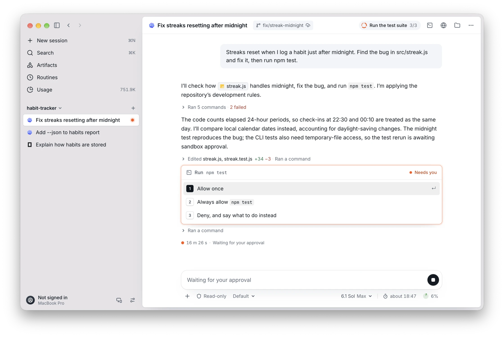

<div align="center">

<h1>
  <picture>
    <source media="(prefers-color-scheme: dark)" srcset="./assets/lockup-horizontal-dark.svg">
    
  </picture>
</h1>

[](https://github.com/KettuAI/Kettu/releases/latest)
[](https://github.com/KettuAI/Kettu/releases)
[](https://github.com/KettuAI/Kettu/actions/workflows/release.yml)
[](https://github.com/KettuAI/Kettu/releases/latest)
[](#支持的-agent)
[](https://www.kettu.sh/zh-CN/)
[](https://www.kettu.sh/zh-CN/docs/)
[](./LICENSE)

<h3>颜值也是生产力。</h3>

你所有的编码 Agent，并排在一个看着就舒服的窗口里。<br>
哪个在干活、哪个在等你、哪个做完了，一眼看清。

[**下载**](https://github.com/KettuAI/Kettu/releases/latest) · [官网](https://www.kettu.sh/zh-CN/) · [文档](https://www.kettu.sh/zh-CN/docs/) · [路线图](./ROADMAP.zh-CN.md) · [反馈](https://github.com/KettuAI/Kettu/issues/new/choose) · [English](./README.md)

</div>

<picture>
  <source media="(prefers-color-scheme: dark)" srcset="./assets/screenshot-dark.webp">
  
</picture>

> [!NOTE]
> Kettu 还是早期预览版，变化很快，难免有粗糙之处，欢迎[反馈问题](https://github.com/KettuAI/Kettu/issues)。

## Kettu 是什么

Claude Code、Codex、OpenCode 这样的编码 Agent 已经能自己规划改动、写代码、跑测试。可在终端里和它们一起干活，你得盯着不断滚动的文字，留神别错过授权请求，还要在一堆标签页和窗口之间找会话。

Kettu 给这些工作安了个家。你用的每个 Agent 都并排在一个窗口里，回答排得像文档一样清楚；Agent 需要你时，会弹出一张卡片，按一个键就能回答。

一个要整天用的工具，看着就该让人舒服。这正是 Kettu 的出发点：界面清楚、安静，你就能更快看清 Agent 做了什么，接着干下一件事。

## 亮点

- **所有 Agent，一个窗口。** Claude Code、Codex、OpenCode、Pi 和另外 42 个 Agent 并排工作，哪个会话在干活、哪个在等你、哪个做完了，侧边栏上一眼看清。
- **读起来像文档。** 回答排版清楚，代码有高亮，图片直接显示，零碎的步骤自动收起。Agent 改了什么用 diff 清楚呈现，它的计划和进度就在顶栏上。
- **按一个键就能回答。** Agent 要运行命令或改文件时，你会看到它到底要做什么，按一个键就能回答。会话需要你时有通知提醒，Kettu 从不替你回答。
- **用量心里有数。** 每个 Agent 用了多少 token、花了多少钱，按天、按模型、按项目一目了然；Agent 提供套餐额度时，还能看到额度还剩多少。
- **工具就在手边。** 终端、Git、项目文件和浏览器就在会话旁边，很少需要切出去。
- **Artifacts。** Agent 做的网页、文档和幻灯片集中保存，每个版本都在。可以在某一处留言让 Agent 改，也可以自己动手改，文档和幻灯片还能导出成 Word 和 PowerPoint。
- **Routines。** 让 Agent 按时干活，比如每天早上整理前一晚的 issue；每次运行都会留下来，随时回看。
- **换台设备接着用。** 配对手机、平板或另一台电脑，就能在那里继续你的会话，端到端加密，直接走你自己的网络。用浏览器打开就行，什么都不用装。
- **打磨过的细节。** 浅色和深色模式、主题、简体中文和英文、macOS 的毛玻璃侧边栏，处处是克制的动效。

## 你的 Agent，你的数据

- **用你已经在用的 Agent。** Kettu 运行的是你已经装好、登录好的 Agent，账号和设置都照旧，用起来和在终端里一样。还没装的，Kettu 可以帮你装。
- **数据留在你手里。** Kettu 不收集任何遥测数据，你的会话、代码和文件都留在你自己的电脑上；登录 Kettu 账号是可选的。
- **免费、开源。** Kettu 不收费，代码就在这里，以 Apache-2.0 许可证发布。

## 安装

从 [Releases](https://github.com/KettuAI/Kettu/releases/latest) 下载对应系统的安装包。

- **macOS**（Apple 芯片）：打开 `.dmg`，把 Kettu 拖进「应用程序」。
- **Windows**：运行适合你电脑的 `setup.exe`，有 x64 和 Arm 两种。Windows 版还没有签名，SmartScreen 提示「Windows 已保护你的电脑」时，点击「更多信息」，再点击「仍要运行」。
- **Linux**：给适合你电脑的 `.AppImage`（x86_64 或 Arm）加上执行权限后运行。它需要 FUSE 2：`libfuse2`，Ubuntu 24.04 及以上为 `libfuse2t64`。

Kettu 会自己保持最新：新版本在后台下载，退出时安装。

**要装在服务器或开发机上？** 一条命令就能装好，也可以在桌面应用的「**设置 › 主机**」里填这台机器的 SSH 地址添加。详见[文档](https://www.kettu.sh/zh-CN/docs/devices/daemon/)。

```sh
curl -fsSL https://kettu.sh/install | sh
```

**要在手机或另一台电脑上用？** 打开「**设置 › 远程访问**」，点击「**添加设备…**」，扫码即可。详见[远程访问](https://www.kettu.sh/zh-CN/docs/devices/remote-access/)。

## 上手

1. **添加你的 Agent**：在「**设置 › Agent**」里添加。Kettu 会用你已经装好的，没装的在「**设置 › Harness**」里点一下就能装。
2. **开一个会话**：选好项目和 Agent，说出你想做什么。
3. **在侧边栏上看着它**：它有问题要问你时，按一个键就能回答。

[文档](https://www.kettu.sh/zh-CN/docs/)介绍了应用的每个部分。

## 支持的 Agent

Kettu 现在支持 46 个 Agent，每个都有自己的账号和设置。

<details>
<summary><b>全部 46 个 Agent</b></summary>

|                                                                             |                                                       |                                                                                     |                                                          |
| --------------------------------------------------------------------------- | ----------------------------------------------------- | ----------------------------------------------------------------------------------- | -------------------------------------------------------- |
| [Claude Code](https://github.com/anthropics/claude-code)                    | [Codex](https://github.com/openai/codex)              | [OpenCode](https://opencode.ai)                                                     | [Pi](https://pi.dev)                                     |
| [fast-agent](https://fast-agent.ai)                                         | [Minion Code](https://github.com/femto/minion-code)   | [Auggie CLI](https://github.com/augmentcode/auggie)                                 | [Codebuddy Code](https://www.codebuddy.cn/cli/)          |
| [DeepAgents](https://docs.langchain.com/oss/javascript/deepagents/overview) | [DimCode](https://dimagent.cn/)                       | [Dirac](https://dirac.run)                                                          | [GLM Agent](https://github.com/stefandevo/glm-acp-agent) |
| [Nova](https://www.compassap.ai/portfolio/nova.html)                        | [Qoder CLI](https://qoder.com)                        | [siGit Code](https://github.com/getsigit/sigit)                                     | [Agoragentic](https://agoragentic.com)                   |
| [Autohand Code](https://www.autohand.ai/cli/)                               | [Cursor](https://cursor.com/docs/cli/acp)             | [Kimi Code CLI](https://moonshotai.github.io/kimi-cli/)                             | [Amp](https://ampcode.com)                               |
| [goose](https://block.github.io/goose/)                                     | [Kilo Code](https://kilo.ai)                          | [Gemini CLI](https://github.com/google-gemini/gemini-cli)                           | [GitHub Copilot](https://github.com/github/copilot-cli)  |
| [Qwen Code](https://github.com/QwenLM/qwen-code)                            | [Grok](https://x.ai/cli)                              | [Cline](https://cline.bot/cli)                                                      | [Factory Droid](https://factory.ai/product/cli)          |
| [OMP (Oh My Pi)](https://omp.sh)                                            | [Hermes Agent](https://hermes-agent.nousresearch.com) | [Muse Code](https://dev.meta.ai)                                                    | [CodeWhale](https://codewhale.net)                       |
| [Bob](https://bob.ibm.com)                                                  | [MiniMax Code](https://agent.minimax.io)              | [Harn](https://harnlang.com)                                                        | [Kimchi](https://kimchi.dev)                             |
| [Google Antigravity](https://antigravity.google)                            | [Devin](https://docs.devin.ai/cli)                    | [Cortex Code](https://docs.snowflake.com/en/user-guide/cortex-code/cortex-code-cli) | [Corust Agent](https://corust.ai)                        |
| [crow-cli](https://github.com/crow-cli/crow-cli)                            | [Junie](https://junie.jetbrains.com)                  | [Mistral Vibe](https://github.com/mistralai/mistral-vibe)                           | [Poolside](https://poolside.ai)                          |
| [Stakpak](https://stakpak.dev)                                              | [VT Code](https://github.com/vinhnx/VTCode)           |                                                                                     |                                                          |

</details>

缺了你在用的 Agent？[告诉我们](https://github.com/KettuAI/Kettu/issues/new/choose)。

## 反馈

Kettu 还很年轻，越早的反馈越能影响它最终的样子，我们尤其欢迎关于设计和工作方式的想法。发现 bug 或想聊聊，都可以提一个 [Issue](https://github.com/KettuAI/Kettu/issues/new/choose)，用什么语言都行，附上截图会很有帮助。安全问题请按 [SECURITY.md](./SECURITY.md) 报告，不要发在公开的 Issue 里。

想自己构建 Kettu？请看 [CONTRIBUTING.md](./CONTRIBUTING.md)（英文）。

## 许可证

Kettu 基于 [Apache-2.0 许可证](./LICENSE)发布。

---

<sub>Kettu 是一个独立项目，与其所支持的各个 Agent 的开发方不存在隶属或背书关系。文中提到的产品名称均为其各自所有者的商标。</sub>
