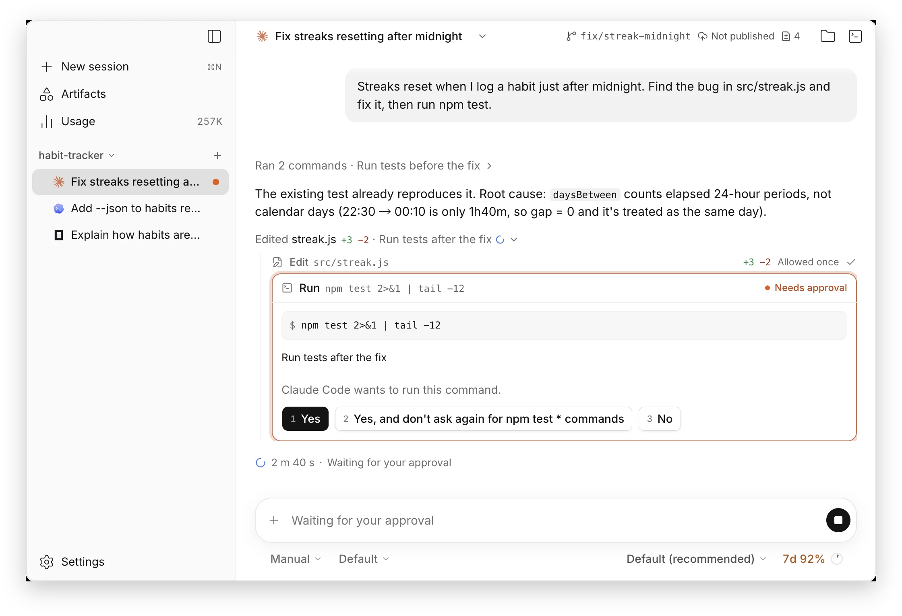

<div align="center">

<h1>
  <picture>
    <source media="(prefers-color-scheme: dark)" srcset="./docs/brand/lockup-horizontal-dark.svg">
    
  </picture>
</h1>

**为终端编码 Agent 打造的从容桌面工作台。**

Claude Code、Codex CLI 和 opencode 并排在同一个窗口里，<br>
好读的对话线程、清晰的授权请求，每个会话旁边都有 Git 和终端。

[**下载**](https://github.com/overbench/overbench/releases/latest) · [文档](./docs/README.md) · [English](./README.md)

</div>

<picture>
  <source media="(prefers-color-scheme: dark)" srcset="./docs/images/screenshot-dark.webp">
  
</picture>

> [!NOTE]
> v0.0.2 是预览版，由仍在验收中的第一个里程碑 M0 构建而来，难免还有粗糙之处，欢迎[反馈问题](https://github.com/overbench/overbench/issues)。Artifacts 和附件已在 `main` 上，将随 v0.0.3 发布。

## 功能

- **所有 Agent，一个窗口** —— 在同一个项目里并排开启 Claude Code、Codex CLI 和 opencode 会话。侧边栏标出哪些在运行、哪些在等你、哪些已完成，子 Agent 显示在父会话下；常用的会话可以置顶，做完的可以归档。
- **好读的对话线程** —— 回答以 Markdown 流式呈现，代码带语法高亮，改动以行内 diff 展示，Agent 提到的图片直接显示，连续的步骤折叠成一行。Agent 工作时可以排队下一条消息，也可以中途调整方向。
- **一眼看懂的授权请求** —— 权限请求以卡片呈现，点击或按数字键即可应答；有会话需要你时，系统通知会提醒你。
- **什么都能附上** —— 粘贴图片、附加文件和文件夹，或用 `@` 引用项目里的文件，第一条消息就可以。
- **Artifacts** —— Agent 通过 OverBench 内置的 artifacts 服务发布 HTML 页面和多页画布。每个都保留历史版本，在与应用隔离的查看器中打开，并汇总在 Artifacts 页面和新建会话页上。
- **每个 Agent 自己的控制项** —— 模式、模型与推理强度、斜杠命令、上下文用量、Prompt 缓存何时过期，以及 Agent 上报时显示的套餐额度。
- **用量一目了然** —— 按天、模型和项目统计所有 Agent 的 token 用量，并显示各套餐的额度；数据来自 OverBench 自己的记录，也可以选择读取 Agent 的本地日志。
- **会话不丢失** —— 每个会话都随项目保存，重新打开时带着完整历史，Agent 崩溃后也能恢复，还可以从 Agent 导入已有会话。
- **Git、文件与终端** —— 顶栏显示分支、同步状态和改动，通过 GitHub CLI 显示 Pull Request 及其检查状态，另有可以查看、预览和编辑文件的文件面板，每个项目一个内置终端。
- **打磨到细节** —— 浅色与深色主题、中英文界面、遵循「减少动态效果」的克制动效，以及常用操作的快捷键。

## 安装

从 [Releases](https://github.com/overbench/overbench/releases/latest) 下载对应系统的安装包。预览版还没有经过 Apple 和 Microsoft 的签名，所以首次启动前系统会询问一次。

- **macOS**：Apple 芯片打开 `OverBench-<版本>-arm64.dmg`，Intel 芯片打开 `OverBench-<版本>-x64.dmg`，把 OverBench 拖进「应用程序」。macOS 提示无法验证该应用时，打开「系统设置 › 隐私与安全性」，点击「仍要打开」。
- **Windows**：运行 `OverBench-<版本>-x64-setup.exe`，Arm 设备运行 `OverBench-<版本>-arm64-setup.exe`。SmartScreen 提示「Windows 已保护你的电脑」时，点击「更多信息」，再点击「仍要运行」。
- **Linux**：用 `chmod +x` 给 `OverBench-<版本>-x86_64.AppImage`（Arm 设备为 `OverBench-<版本>-arm64.AppImage`）加上执行权限后运行。AppImage 需要 FUSE 2：`libfuse2`，Ubuntu 24.04 及以上为 `libfuse2t64`。

在 Windows 和 Linux 上，新版本会在后台下载，并在 OverBench 重启时安装；在 macOS 上，安装包完成签名之前，OverBench 会给出新版本的下载链接。v0.0.1 无法发现更新，请手动安装一次 v0.0.2 覆盖它。

### Agent

OverBench 驱动的是你已经在用的 Agent CLI：你自己的安装、你自己的账号、你自己的配置。请先安装其中至少一个；登录走各个 Agent 自己的流程，OverBench 不会接触你的凭据。

| Agent                                                    | OverBench 如何运行它                                               |
| -------------------------------------------------------- | ------------------------------------------------------------------ |
| [Claude Code](https://github.com/anthropics/claude-code) | ACP 适配器 `@agentclientprotocol/claude-agent-acp`，首次使用时安装 |
| [Codex CLI](https://github.com/openai/codex)             | ACP 适配器 `@agentclientprotocol/codex-acp`，首次使用时安装        |
| [opencode](https://opencode.ai)                          | 你自己安装的 `opencode`，以 `opencode acp` 运行                    |

这两个适配器需要 Node.js 22 及以上版本和 npm，OverBench 会通过你的登录 shell 找到它们。

## 为什么是 OverBench

终端编码 Agent 已经能自己规划、修改和测试代码，但和它们协作依然意味着不断滚动的文字墙和散落在各个标签页里的会话。OverBench 想给它们一个适合长时间工作的家。它只是界面：自己不实现任何 Agent，通过 [Agent Client Protocol](https://agentclientprotocol.com)（ACP）与每个 Agent 通信，所以你的 Agent 会保持你配置好的样子。

它的核心信念是：**颜值也是生产力**。

- **集成最优秀的实现。** 研究每个环节最强的实现，从终端到 diff 查看器，把它们集成到一起，而不是重新造轮子。
- **极致优化。** 启动迅速，再长的对话记录也滚动顺滑，不掉帧。
- **极致 UI。** 清晰的层级、克制的字体与动效，让你比翻任何滚动记录都更快看清 Agent 改了什么。

## 路线图

- [x] 通过 ACP 接入 Claude Code、Codex CLI 和 opencode
- [x] 会话历史、多会话并行与子会话
- [x] Git 状态、Pull Request、文件与内置终端
- [x] macOS、Windows、Linux 预览版
- [x] 输入框中的附件和 `@` 文件引用
- [x] Artifacts：Agent 生成的页面和画布，保留历史版本
- [x] 所有 Agent 的 token 用量与套餐额度
- [ ] M0 在三个平台上通过验收
- [ ] 在改动面板中审阅 diff
- [ ] 在对话和文件面板中播放音频和视频
- [ ] Routines：按计划自动运行的 Agent 任务
- [ ] 跨会话搜索与命令面板
- [ ] 签名并公证的安装包

[M0 计划](./docs/milestones/m0.md)列出了包含与不包含的内容，[架构设计](./docs/architecture.md)说明了各部分如何协作（均为英文）。

## 从源码运行

需要 Node.js 22.13 及以上版本和 pnpm 10：

```bash
pnpm install
pnpm dev
```

开发运行使用独立的数据目录 `OverBench Dev`，不会改动已安装的 OverBench 的会话；用环境变量 `OVERBENCH_USER_DATA` 可以改用别的目录。

开发版还会列出一个 **Fake agent**：它不需要账号和网络，按脚本演示各种场景，例如很长的回答、一连串工具调用，或同时出现三个授权请求。在它的输入框里输入 `/` 即可查看，也可以阅读 [fake agent](./docs/design/testing.md#fake-agent) 文档（英文）。

| 命令                                                  | 作用                                              |
| ----------------------------------------------------- | ------------------------------------------------- |
| `pnpm dev`                                            | 以开发模式启动应用，支持热更新                    |
| `pnpm test`                                           | 运行单元测试、集成测试和进程测试                  |
| `pnpm lint` / `pnpm typecheck` / `pnpm format`        | 代码检查、类型检查和格式化                        |
| `pnpm build`                                          | 类型检查并把应用构建到 `out/`                     |
| `pnpm package`                                        | 在 `dist/` 中生成未打成安装包的应用，用于本地测试 |
| `pnpm dist:mac` / `pnpm dist:win` / `pnpm dist:linux` | 为各个平台构建安装包                              |

## 参与贡献

越早的反馈越能影响 OverBench 最终的样子，我们尤其欢迎关于设计和工作流的想法，可以直接提一个 [Issue](https://github.com/overbench/overbench/issues/new/choose) 来聊聊，用什么语言都行。OverBench 只接收 Issue，不接收 Pull Request；参与方式见 [CONTRIBUTING.md](./CONTRIBUTING.md)（英文）。

## 许可证

OverBench 基于 [Apache-2.0 许可证](./LICENSE)发布。

---

<sub>OverBench 是一个独立项目，与其所支持的各个 Agent 的开发方不存在隶属或背书关系。文中提到的产品名称均为其各自所有者的商标。</sub>
