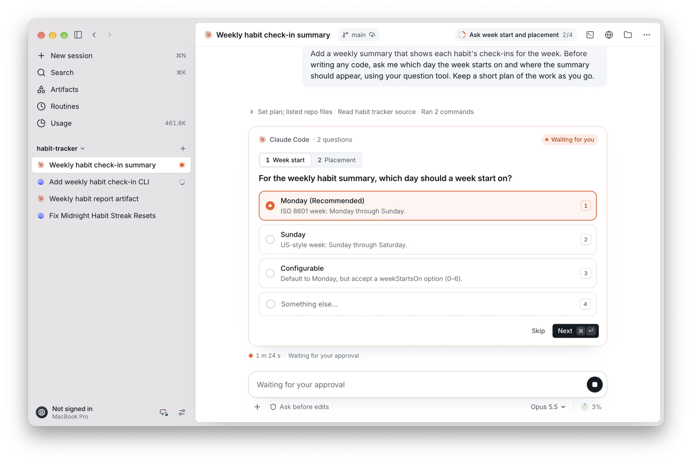
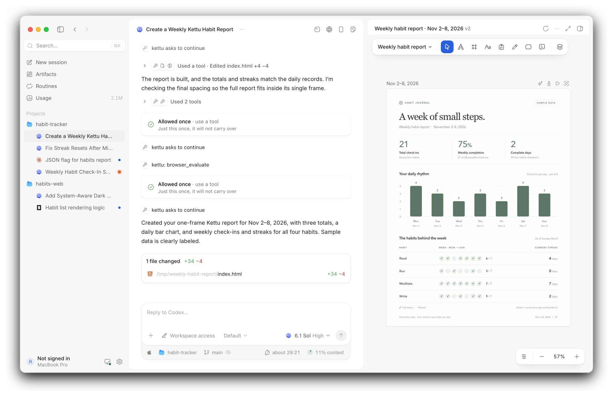
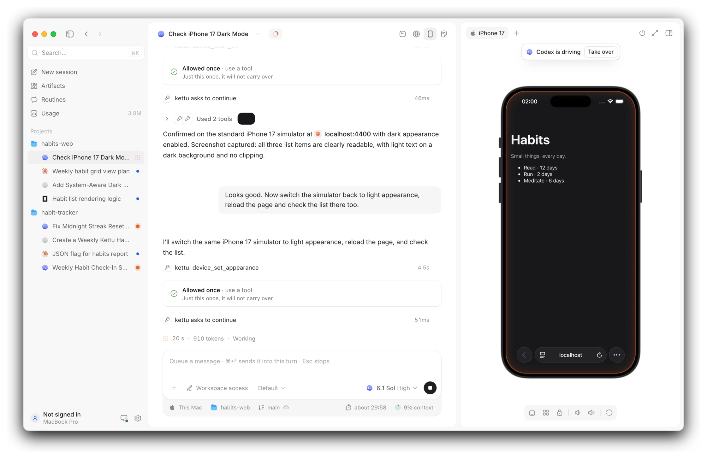
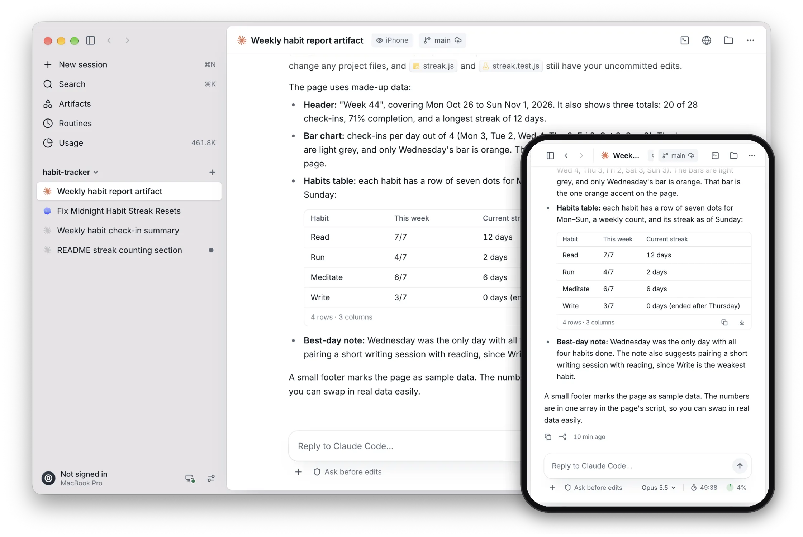

<div align="center">

<h1>
  <picture>
    <source media="(prefers-color-scheme: dark)" srcset="./assets/lockup-horizontal-dark.svg">
    
  </picture>
</h1>

[](https://github.com/KettuAI/Kettu/releases/latest)
[](https://github.com/KettuAI/Kettu/releases)
[](#安装)
[](#支持的-agent)
[](./LICENSE)

<h3>颜值也是生产力。</h3>

你所有的编码 Agent，并排在一个好看又顺手的窗口里。

[**下载**](https://github.com/KettuAI/Kettu/releases/latest) · [官网](https://www.kettu.sh/zh-CN/) · [文档](https://www.kettu.sh/zh-CN/docs/) · [路线图](./ROADMAP.zh-CN.md) · [反馈](https://github.com/KettuAI/Kettu/issues/new/choose) · [English](./README.md)

</div>

<picture>
  <source media="(prefers-color-scheme: dark)" srcset="./assets/screenshot-dark.webp">
  
</picture>

> [!NOTE]
> Kettu 还是早期预览版。桌面应用的样子已经定下来，细节还在快速变化，欢迎[反馈问题](https://github.com/KettuAI/Kettu/issues)。

## 功能

### Agent 与会话

<picture>
  <source media="(prefers-color-scheme: dark)" srcset="./assets/feature-sessions-dark.webp">
  
</picture>

- **47 个 Agent**：Claude Code、Codex、OpenCode、Pi 等，用你自己的安装、账号和设置。暂时不用的可以关掉，会话不会丢。
- **并排**：多个会话同时跑，窗口最多分成九格。侧边栏标出哪个在干活、哪个在等你、哪个做完了。
- **一键授权**：Agent 要运行命令或改文件时，先看清它碰哪些文件，再按一个键允许或拒绝。
- **问题卡片**：Agent 的多个问题在一张卡片里逐个回答，一起发出。
- **计划**：Agent 的计划和进度显示在顶栏。
- **换 Agent**：两轮之间把会话交给另一个 Agent，之前的对话一起带过去。
- **子 Agent**：显示在父会话下面，它的请求也在那里回答。
- **排队和插话**：Agent 干活时，下一条消息可以排队，也可以中途插话。
- **回复选中的段落**：选中回复里的一段，只针对这段回复。
- **附件**：粘贴图片，附加文件和文件夹，用 `@` 引用项目文件。
- **分叉**：从任意一条回复分出新会话，Agent 还在干活时也行。
- **Pull Request 和 Issue**：回复里的 GitHub 链接显示当前状态，会话的 Pull Request 显示在侧边栏。
- **通知**：会话需要你时提醒你。
- **用量**：按天、模型和项目统计 token 和费用，每个账号的套餐额度画成圆环。

### 工作台

<picture>
  <source media="(prefers-color-scheme: dark)" srcset="./assets/feature-workbench-dark.webp">
  
</picture>

- **Diff**：Agent 改了哪些文件、改了什么，一目了然。
- **文件**：用标签页查看、预览和编辑项目文件。
- **终端**：每个会话都有自己的终端。
- **Git**：分支、改动和 Pull Request 的检查状态。
- **内置浏览器**：Agent 能打开页面、点击、输入和截图，你随时可以接手。
- **Artifacts**：Agent 做的网页、文档、幻灯片和画布。画布上的画框可以排版、标注后交给 Agent，也可以留言、自己编辑，或导出成 Word 和 PowerPoint。
- **发布到 Kettu**：给 Artifact 一个 kettu.page 上的页面，可以只有自己能看、凭访问码看或公开。
- **Computer use**：打开之后，Agent 能操作你电脑上的应用。
- **Routines**：按时让 Agent 干活，每次运行都留成会话。
- **搜索**：在一个命令面板里搜会话、Artifacts、Routines、项目、设置和操作。

### 移动设备

<picture>
  <source media="(prefers-color-scheme: dark)" srcset="./assets/feature-mobile-dark.webp">
  
</picture>

- **就在会话旁边**：iOS 模拟器、Android 模拟器，以及 iPhone 和 Android 真机，各自装在带实体按键的外框里。
- **你和 Agent 都能操作**：你可以直接在屏幕上点按、滑动和输入，也可以让 Agent 打开应用和网页、点按、输入、切换浅色和深色、截图，你随时可以接手。
- **为开发应用准备**：Agent 能安装你的构建、启动它并读取日志。

### 随处可用

<picture>
  <source media="(prefers-color-scheme: dark)" srcset="./assets/feature-devices-dark.webp">
  
</picture>

- **任何浏览器、任何网络**：打开 [app.kettu.sh](https://app.kettu.sh)，经 Kettu 的中继连回你的电脑，不用 VPN，也不用开端口。
- **你自己的网络**：手机、平板或浏览器扫码配对，经 Wi-Fi、VPN 或 SSH 转发继续你的会话，不用账号。
- **另一台电脑**：在另一台电脑的 Kettu 里用这台电脑上的会话。
- **开发机**：填 SSH 地址就能加进来，Kettu 会在那边自己装好。
- **端到端加密**：中间经过的任何一方都读不到你的会话，中继也一样。

### 外观

- 跟着系统切换、整个窗口一起平滑过渡的浅色和深色模式，主题库里的主题或你自己的主题，简体中文和英文，macOS 毛玻璃侧边栏。

### 即将推出

- **iPhone 和 iPad 应用**：会话装进口袋，在锁屏上就能回应请求。
- **手机通知**：不在电脑前时，会话需要你也能知道。

## 隐私

- 不收集遥测，会话、代码和文件都留在你自己的电脑上。
- 不保留 Agent 的登录凭据。
- Kettu 账号是可选的。你自己电脑上和自己网络里的一切不登录也能用；登录后多出中继、app.kettu.sh、发布到 kettu.page 和问题报告。
- 问题报告只在你发送时才离开你的电脑。

## 安装

从 [Releases](https://github.com/KettuAI/Kettu/releases/latest) 下载：

- **macOS**（Apple 芯片）：`.dmg`
- **Windows**（x64 和 Arm）：`setup.exe`。还没有签名，SmartScreen 提示时点「更多信息」，再点「仍要运行」。
- **Linux**（x64 和 Arm）：`.AppImage`，加上执行权限后运行；需要 FUSE 2（`libfuse2`，Ubuntu 24.04 起为 `libfuse2t64`）。

在浏览器里：[app.kettu.sh](https://app.kettu.sh)，登录和你电脑上的 Kettu 同一个 Kettu 账号。

服务器或开发机（[文档](https://www.kettu.sh/zh-CN/docs/devices/daemon/)）：

```sh
curl -fsSL https://kettu.sh/install | sh
```

## 支持的 Agent

<details>
<summary><b>全部 47 个 Agent</b></summary>

|                                                                     |                                                                             |                                                       |                                                                                     |
| ------------------------------------------------------------------- | --------------------------------------------------------------------------- | ----------------------------------------------------- | ----------------------------------------------------------------------------------- |
| [Claude Code](https://github.com/anthropics/claude-code)            | [Codex](https://github.com/openai/codex)                                    | [OpenCode](https://opencode.ai)                       | [Pi](https://pi.dev)                                                                |
| [DeepSeek Harness](https://github.com/deepseek-ai/deepseek-harness) | [fast-agent](https://fast-agent.ai)                                         | [Minion Code](https://github.com/femto/minion-code)   | [Auggie CLI](https://github.com/augmentcode/auggie)                                 |
| [Codebuddy Code](https://www.codebuddy.cn/cli/)                     | [DeepAgents](https://docs.langchain.com/oss/javascript/deepagents/overview) | [DimCode](https://dimagent.cn/)                       | [Dirac](https://dirac.run)                                                          |
| [GLM Agent](https://github.com/stefandevo/glm-acp-agent)            | [Nova](https://www.compassap.ai/portfolio/nova.html)                        | [Qoder CLI](https://qoder.com)                        | [siGit Code](https://github.com/getsigit/sigit)                                     |
| [Agoragentic](https://agoragentic.com)                              | [Autohand Code](https://www.autohand.ai/cli/)                               | [Cursor](https://cursor.com/docs/cli/acp)             | [Kimi Code CLI](https://moonshotai.github.io/kimi-cli/)                             |
| [Amp](https://ampcode.com)                                          | [goose](https://block.github.io/goose/)                                     | [Kilo Code](https://kilo.ai)                          | [Gemini CLI](https://github.com/google-gemini/gemini-cli)                           |
| [GitHub Copilot](https://github.com/github/copilot-cli)             | [Qwen Code](https://github.com/QwenLM/qwen-code)                            | [Grok](https://x.ai/cli)                              | [Cline](https://cline.bot/cli)                                                      |
| [Factory Droid](https://factory.ai/product/cli)                     | [OMP (Oh My Pi)](https://omp.sh)                                            | [Hermes Agent](https://hermes-agent.nousresearch.com) | [Muse Code](https://dev.meta.ai)                                                    |
| [CodeWhale](https://codewhale.net)                                  | [Bob](https://bob.ibm.com)                                                  | [MiniMax Code](https://agent.minimax.io)              | [Harn](https://harnlang.com)                                                        |
| [Kimchi](https://kimchi.dev)                                        | [Google Antigravity](https://antigravity.google)                            | [Devin](https://docs.devin.ai/cli)                    | [Cortex Code](https://docs.snowflake.com/en/user-guide/cortex-code/cortex-code-cli) |
| [Corust Agent](https://corust.ai)                                   | [crow-cli](https://github.com/crow-cli/crow-cli)                            | [Junie](https://junie.jetbrains.com)                  | [Mistral Vibe](https://github.com/mistralai/mistral-vibe)                           |
| [Poolside](https://poolside.ai)                                     | [Stakpak](https://stakpak.dev)                                              | [VT Code](https://github.com/vinhnx/VTCode)           |                                                                                     |

</details>

缺了你在用的 Agent？[告诉我们](https://github.com/KettuAI/Kettu/issues/new/choose)。

## 反馈

欢迎提 [Issue](https://github.com/KettuAI/Kettu/issues/new/choose)，用什么语言都行；也可以在应用里用「帮助 › 报告问题…」发一份报告。安全问题请按 [SECURITY.md](./SECURITY.md) 报告。想自己构建，请看 [CONTRIBUTING.md](./CONTRIBUTING.md)。

## 许可证

[AGPL-3.0](./LICENSE)，并为 `src/renderer/src/components/affect` 中的 affectUI 组件给出了一项[附加许可](./LICENSE-EXCEPTION)。这些组件仍遵循 [affectUI 的许可](https://www.affectui.com/license)。
