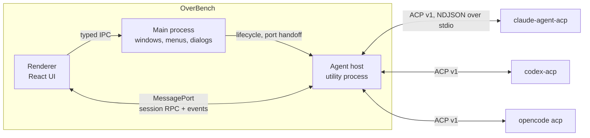
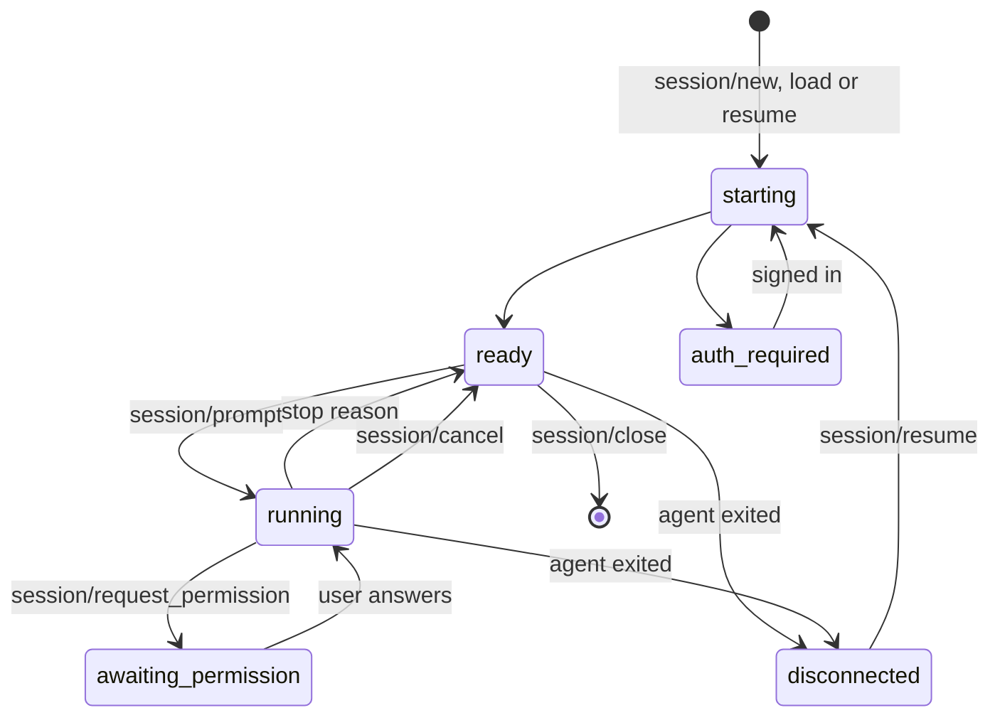
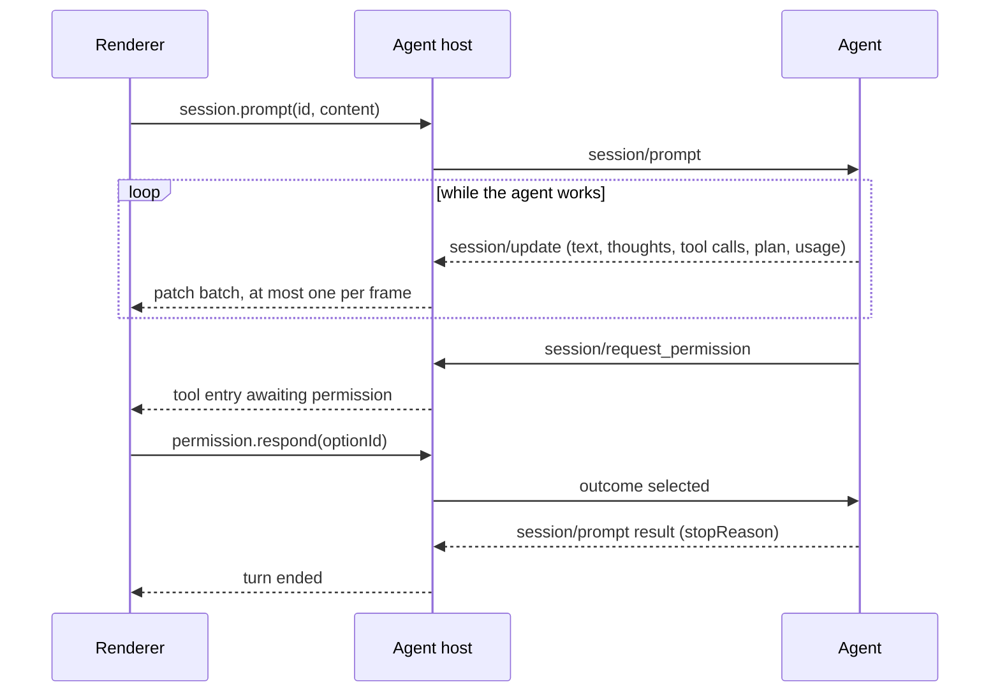

# Architecture

> Status: draft, written for [M0](./milestones/m0.md). Agent versions and capabilities below were observed on 2026-10-20.

OverBench is a GUI and nothing more. It does not implement an agent, call a model or store credentials. Every agent runs as its own process, owns its auth, models and history, and talks to OverBench over the [Agent Client Protocol](https://agentclientprotocol.com) (ACP). OverBench's job is to make that conversation fast, legible and beautiful.

This keeps the product honest to its philosophy: the agents are the best implementations of agent logic, ACP is the best existing contract for talking to them, and OverBench spends all of its effort on the experience on top.

## Process model



| Process       | Runs                                | Owns                                                                  |
| ------------- | ----------------------------------- | --------------------------------------------------------------------- |
| Main          | Electron main                       | App lifecycle, windows, menus, native dialogs, agent host supervision |
| Renderer      | Sandboxed Chromium                  | UI, view state, a replica of each open session's thread               |
| Agent host    | Electron `utilityProcess` (Node.js) | ACP connections, agent processes, live session state, persistence     |
| Agent process | One per agent, spawned by the host  | The agent itself: model calls, tools, auth, conversation storage      |

**Why a separate agent host.** Main stays thin and never touches agent traffic, so a burst of tool output or a misbehaving adapter can never stall window dragging, menus or other windows. If the host crashes, main restarts it and the UI reconnects; the window survives. This is the same split VS Code uses for its pty host and extension host.

Alternatives considered:

- **ACP in the main process**: simplest, but couples agent traffic to the process every window depends on. Rejected.
- **ACP in the renderer**: would need Node.js in the renderer, which breaks the security model. Rejected.
- **One utility process per agent**: stronger isolation, more processes and more plumbing. Revisit only if measurements show one agent's traffic starving another.

### Channels

- **Renderer to main**: the existing typed `ipcRenderer.invoke` contract in `src/shared/ipc.ts`, for things only main can do (folder picker, window controls).
- **Renderer to agent host**: a `MessagePort` created by main with `MessageChannelMain` and handed to both sides. The preload keeps the port to itself and exposes narrow, typed methods on `window.overbench.agents`, so the renderer never holds a raw channel. Session traffic skips main entirely.
- **Main to agent host**: `utilityProcess` `parentPort` messages for startup configuration, port handoff and shutdown.
- **Agent host to agents**: ACP over the agent's stdin and stdout as newline-delimited JSON-RPC, through the official [`@agentclientprotocol/sdk`](https://github.com/agentclientprotocol/typescript-sdk).

## ACP integration

### Protocol version

All three agents speak ACP **v1**, the stable protocol. ACP v2 has been in draft since 2026-07-20 and its own announcement advises clients not to enable it by default in production yet. OverBench therefore builds on the SDK's default v1 entrypoint and keeps v2 out of M0, but isolates the protocol so adding v2 later is contained:

- ACP types never leave `src/agent-host/acp/`.
- One mapper (`v1-mapper.ts`) turns ACP messages into OverBench's own thread model (see [State and data flow](#state-and-data-flow)). v2 becomes a second mapper selected by the negotiated `protocolVersion`.
- The thread model already uses v2's ideas, stable entry IDs and patches, so the renderer will not change when v2 arrives.

M0 uses only stable v1 methods. `session/fork` and other unstable features stay off until they stabilize.

### Agents

| Agent       | Launched as                                                   | Auth methods it advertises                                                                                      | Logout |
| ----------- | ------------------------------------------------------------- | --------------------------------------------------------------------------------------------------------------- | ------ |
| Claude Code | `npx -y @agentclientprotocol/claude-agent-acp@0.94.0`         | terminal: Claude subscription (`--cli auth login --claudeai`), Anthropic Console (`--cli auth login --console`) | yes    |
| Codex       | `npx -y @agentclientprotocol/codex-acp@2.2.2`                 | agent: API key, ChatGPT                                                                                         | yes    |
| OpenCode    | `opencode acp`, from the user's own installation (native ACP) | terminal: `--login`                                                                                             | no     |

- Claude Code and Codex have no native ACP mode; the official adapters from the [ACP Registry](https://agentclientprotocol.com/get-started/registry) wrap them. Versions are pinned to what the registry lists and bumped deliberately after testing.
- The adapters need Node.js 22 or later on the user's machine, because `npx` runs them. A managed install that runs them on Electron's bundled Node.js is planned after M0.
- The registry lists `claude-agent-acp` under a proprietary license. OverBench never bundles it; `npx` fetches it on the user's machine, the same way other registry clients install it.
- OverBench prefers the user's existing `opencode` so it reuses their configuration and login. The registry's OpenCode build (1.19.3) lags behind current releases (2.0.32 was tested).

What all three advertised in `initialize`:

| Capability                                                          | Claude Code | Codex | OpenCode |
| ------------------------------------------------------------------- | :---------: | :---: | :------: |
| `loadSession`                                                       |      ✓      |   ✓   |    ✓     |
| `session/list`, `session/resume`, `session/close`, `session/delete` |      ✓      |   ✓   |    ✓     |
| `additionalDirectories`                                             |      ✓      |   ✓   |    ✓     |
| Prompt `image` and `embeddedContext`                                |      ✓      |   ✓   |    ✓     |
| MCP over HTTP / SSE                                                 |    ✓ / ✓    | ✓ / – |  ✓ / –   |

Agent-specific extensions (`_meta`) such as steering, prompt queueing and auth status exist but are unstable; M0 depends on none of them.

### Client capabilities

What OverBench advertises in `initialize` for M0, and why:

| Capability                            | M0  | Reason                                                                                                                                            |
| ------------------------------------- | --- | ------------------------------------------------------------------------------------------------------------------------------------------------- |
| `fs.readTextFile`, `fs.writeTextFile` | off | OverBench has no editor buffers yet, so the agents' own file tools are the better implementation. Turned on with change tracking and checkpoints. |
| `terminal`                            | off | Agents run commands themselves and report output in tool calls. Turned on with the embedded terminal.                                             |
| `auth.terminal`                       | on  | Claude Code and OpenCode only offer login through terminal methods.                                                                               |
| `elicitation`                         | off | Structured questions come later; agents fall back to plain messages.                                                                              |

### Launching agents

- **Catalog.** `src/agent-host/catalog.ts` defines each built-in agent: id, name, icon, launch command and arguments, and how to detect it. M0 has no custom agents, so the renderer can never make the host run an arbitrary command. The only user override is the path to an agent binary, picked through a native dialog in main.
- **Shell environment.** Apps started from the Dock or a desktop launcher get a minimal `PATH`, so `npx` and `opencode` would not be found. On macOS and Linux the host resolves the user's login shell environment once at startup (`$SHELL -ilc`, with a timeout and a fallback to the inherited environment), as VS Code does. Windows inherits the user environment and spawns `npx.cmd`.
- **Lifecycle.** An agent process starts lazily with the first session that needs it. One process serves every session of that agent, across projects, because ACP multiplexes sessions by `sessionId`. If it exits, its sessions turn `disconnected`; the host restarts it with backoff and resumes the sessions with `session/resume`. Agent processes stop when the app quits, not when the last window closes, so a running turn survives closing the window on macOS.
- **First run.** `npx` downloads the adapter on first use, which can take a while. The UI shows this as a preparing state with live progress from the adapter's stderr.

### Authentication

Agents own their credentials; OverBench never sees them. Most users are already signed in through the CLI, and the adapters reuse that login.

When a request fails with `auth_required`, the session shows the agent's `authMethods`:

- **`agent` methods** (Codex): OverBench calls `authenticate` with the method `id`; the agent runs its own flow, such as opening the browser.
- **`terminal` methods** (Claude Code, OpenCode): the agent must run interactively. Until the embedded terminal lands, OverBench shows the exact command (the agent's launch command plus the method's `args`) with a copy button and a retry action.
- **Logout** appears only for agents that advertise `auth.logout`.

### Session lifecycle



- **New**: `session/new` with the project folder as `cwd` and no MCP servers in M0.
- **Reopen from history**: `session/load`, which replays the conversation as `session/update` notifications, so the thread can be rendered.
- **Reconnect after a crash**: `session/resume`, which does not replay; the host still has the thread in memory.
- **History**: OverBench keeps a small index of the sessions it created or opened. The agent's own `session/list` is used to import sessions started elsewhere, such as in the CLI.
- **Selectors**: modes, models and reasoning levels come from `configOptions` and `config_option_update`, using the `category` field (`mode`, `model`, `thought_level`) for placement. Legacy `modes` is the fallback.
- **Turns**: one prompt at a time per session in M0. Pending permission requests are answered with `cancelled` when the turn is cancelled, as the protocol requires.

### A prompt turn



## State and data flow

### Thread model

`src/shared/thread.ts` defines OverBench's own model of a conversation, independent of ACP:

- **Entries**, each with a stable id: user message, agent message (markdown), thought, tool call (kind, title, status, content, locations, and a pending permission when there is one), plan, and notice.
- **Session state**: status, title, config options, available slash commands, and context usage.
- **Patches**: append an entry, append text to an entry, update fields of an entry, update session state. Each batch carries a sequence number.
- **`applyPatches`**, a pure function shared by both sides.

The agent host is the source of truth for every live session: the mapper turns ACP messages into patches and applies them to the host's copy. The renderer holds a replica. When a view opens a session, it fetches a snapshot and then applies patches in sequence order; a gap triggers a fresh snapshot. This makes window reloads, closing and reopening the window on macOS, and future multi-window support work without special cases.

Mapping rules for ACP v1:

- Message and thought chunks with a `messageId` append to that entry. Without one, consecutive chunks of the same kind form one entry.
- `tool_call` creates an entry keyed by `toolCallId`; `tool_call_update` patches it. A permission request for a tool call the thread has not seen yet creates the entry first.
- `plan` replaces the current turn's plan entry.
- `session_info_update`, `usage_update`, `available_commands_update`, `config_option_update` and `current_mode_update` patch session state. `notice` becomes a notice entry.

### Keeping streaming smooth

- **Coalesce in the host.** Patches are queued per session and flushed at most once per animation frame (about 16 ms). Consecutive text appends to the same entry merge into one.
- **One store update per batch.** The renderer applies each batch in a single Zustand update.
- **Normalized state, narrow subscriptions.** Entries are stored by id, and each entry component selects only its own entry, so streaming into one message re-renders one component.
- **Cheap off-screen content.** Thread items use CSS `content-visibility: auto`, so the browser skips layout and paint for off-screen entries. A virtualization library is added only if measurements show it is needed.
- **Lazy heavy code.** Markdown, syntax highlighting and diff rendering load on demand.

### Renderer to agent host contract

`src/shared/agent-host.ts` defines the requests and events on the port, typed the same way as `IpcInvokeContract`:

- **Requests**: `agents.list`, `agents.check`, `agents.authenticate`, `sessions.list`, `sessions.create`, `sessions.open`, `sessions.snapshot`, `sessions.prompt`, `sessions.cancel`, `sessions.setConfigOption`, `sessions.close`, `permissions.respond`, `projects.list`, `projects.remove`.
- **Events**: `session.patches`, `session.added`, `session.removed`, `agent.status`.

The host validates every request payload before acting on it.

### Persistence

The host stores a few small JSON files in `app.getPath('userData')`, written atomically (temporary file, then rename):

- `projects.json`: recent project folders.
- `sessions.json`: the session index (OverBench id, agent id, ACP session id, project, title, timestamps).
- `settings.json`: agent binary overrides and UI preferences.

Transcripts stay with the agents, which already store them, and come back through `session/load`. OverBench does not duplicate them in M0.

For diagnostics, the host keeps the last 2,000 ACP messages and the stderr tail of each agent in memory. **Export diagnostics** writes them to a file on request. Nothing is logged to disk by default, because the traffic contains the user's code and prompts.

## Security

OverBench drives agents that edit files and run commands, so every layer assumes the one next to it can be wrong.

- **Agent output is untrusted.** Markdown is rendered sanitized, without raw HTML. The CSP blocks remote images, so content in a reply cannot load tracking pixels or leak data through image URLs. Links open in the system browser only after the `http(s)` check in main.
- **The renderer cannot run commands.** The host has no API that takes a command line. Agent launch specs come from the catalog, and binary overrides come from a native dialog in main.
- **Every request to the host is validated**, including that a project folder is an absolute path to an existing directory.
- **Permission requests are shown faithfully.** OverBench never answers one without the user, and never switches an agent into a bypass or full-auto mode by default.
- **No credentials.** OverBench stores no API keys or tokens; agents keep their own.
- The renderer keeps `sandbox`, `contextIsolation` and the narrow preload API, as described in [AGENTS.md](../AGENTS.md#security-rules).

## Directory layout

The planned layout once M0 lands; new parts are marked.

```text
src/
├── main/                  Main process
│   └── agent-host.ts      new: starts and supervises the agent host, hands out ports
├── agent-host/            new: utility process
│   ├── index.ts           Entry, port wiring
│   ├── rpc.ts             Request/event handling on renderer ports, with validation
│   ├── shell-env.ts       Login shell environment resolution
│   ├── catalog.ts         Built-in agent definitions
│   ├── agent-process.ts   Spawning, restarts, stderr capture
│   ├── acp/               SDK connection and the v1 mapper; the only place ACP types live
│   ├── sessions.ts        Live session state, permission requests
│   └── storage.ts         JSON persistence
├── preload/               Adds window.overbench.agents on top of the host port
├── renderer/src/
│   ├── features/          agents, projects, sessions (thread, composer, tool calls, permissions)
│   └── stores/            Zustand stores
└── shared/
    ├── ipc.ts             Renderer to main contract
    ├── agent-host.ts      new: renderer to agent host contract
    └── thread.ts          new: thread model and applyPatches
tools/
└── fake-agent/            new: scripted ACP agent for development and performance tests
```

`tools/fake-agent` is a small ACP agent built with the SDK's `agent()` API that replays scripted turns: long streams, many tool calls, permission requests, failures. It makes UI work deterministic, keeps tokens out of development, and is the load generator for the performance budgets.

## What we take from where

In line with the project philosophy, these are the implementations this design draws on:

| Source                                                                                                                           | What OverBench takes                                                                                     |
| -------------------------------------------------------------------------------------------------------------------------------- | -------------------------------------------------------------------------------------------------------- |
| [ACP specification](https://agentclientprotocol.com) and [TypeScript SDK](https://github.com/agentclientprotocol/typescript-sdk) | The wire protocol, method semantics and the client connection                                            |
| [ACP Registry](https://agentclientprotocol.com/get-started/registry)                                                             | Which adapter and version to launch for each agent                                                       |
| [Zed](https://zed.dev/docs/ai/external-agents)                                                                                   | External agents as separate processes, thread entries keyed by tool call, an inspectable ACP traffic log |
| VS Code                                                                                                                          | Hosting heavy work in a utility process; resolving the login shell environment for GUI launches          |
| [Harnss](https://github.com/OpenSource03/harnss), [AionUi](https://github.com/iOfficeAI/AionUi)                                  | Per-project workspaces, tool calls as cards with diffs, pending-approval badges and OS notifications     |
| shadcn/ui chat primitives                                                                                                        | `MessageScroller` for stick-to-bottom, anchoring and jump-to-latest while streaming                      |
