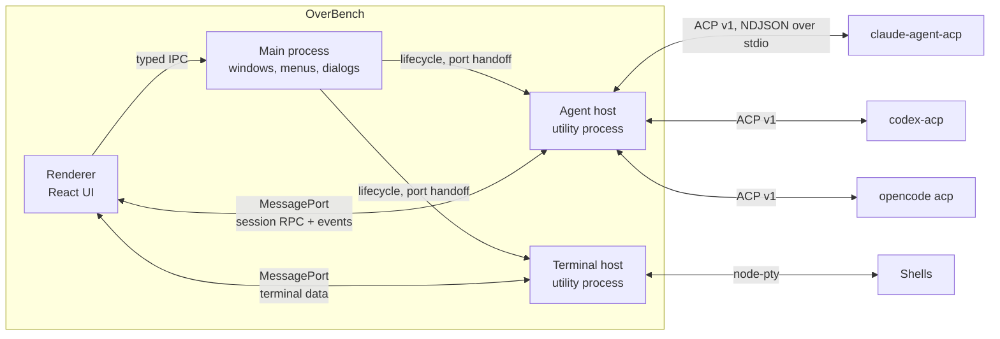
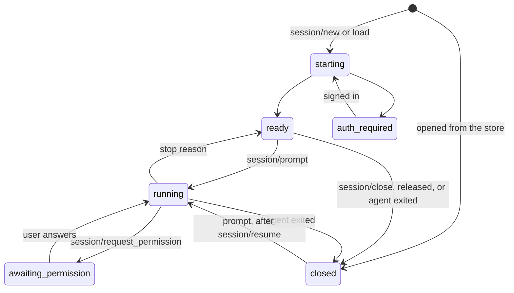
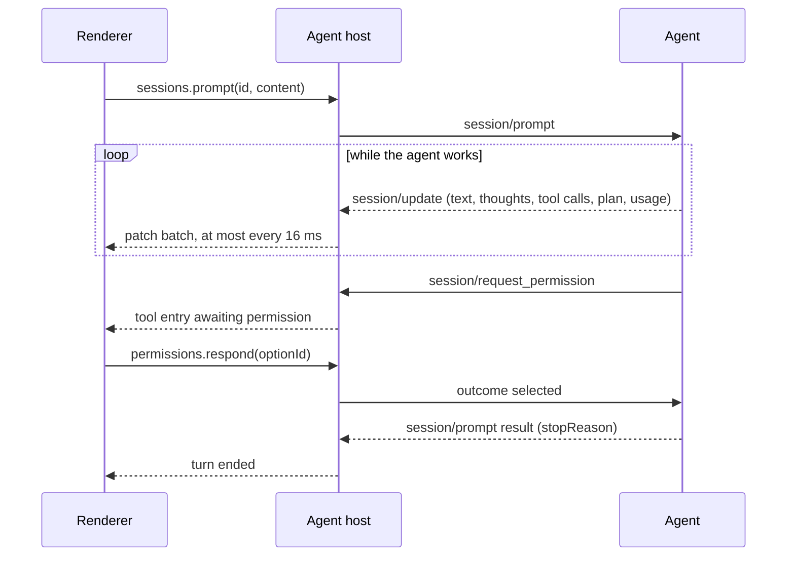

# Architecture

> Status: Draft for [M0](./milestones/m0.md) · Agent versions and capabilities were observed on 2026-10-20

OverBench is a GUI and nothing more. It does not implement an agent, call a model or store credentials. Every agent runs as its own process, owns its auth, models and history, and talks to OverBench over the [Agent Client Protocol](https://agentclientprotocol.com) (ACP). OverBench's job is to make that conversation fast, legible and beautiful. It offers the agents one service of its own: [artifacts](#artifacts), an MCP server through which they hand the user pages to look at.

This keeps the product honest to its philosophy: the agents are the best implementations of agent logic, ACP is the best existing contract for talking to them, and OverBench spends all of its effort on the experience on top.

This document is the overview and the global core design, the single source of truth for every core logic of the system ([core designs](#core-designs)). Each subsystem has a detailed design:

| Design                                     | Covers                                                                                                                              |
| ------------------------------------------ | ----------------------------------------------------------------------------------------------------------------------------------- |
| [Agent host](./design/agent-host.md)       | Startup and supervision, the agent catalog, environments, launching and stopping agents, sign-in, diagnostics, platform differences |
| [Session model](./design/session-model.md) | The thread model, patches and snapshots, the ACP v1 mapping, prompts, permissions, cancellation, session lifecycle                  |
| [Host protocol](./design/host-protocol.md) | The preload API, requests, events and validation between the renderer and the agent host                                            |
| [Persistence](./design/persistence.md)     | What is stored on disk, how it is written, versioned and recovered                                                                  |
| [Git](./design/git.md)                     | Repository status, pull requests through `gh`, and git events in the thread                                                         |
| [Terminal](./design/terminal.md)           | The terminal host, shells, flow control, rendering, and how terminals relate to projects and sessions                               |
| [Artifacts](./design/artifacts.md)         | The artifacts service agents call, storage and versions, presence, the isolated surface, the Artifacts page and the canvas viewer   |
| [Interface](./design/ui.md)                | Layout, screens, thread entries, composer, states, motion, typography and shortcuts                                                 |
| [Localization](./design/localization.md)   | English and Simplified Chinese, the Language setting, and how each process translates its own text                                  |
| [Testing](./design/testing.md)             | Unit, integration and process tests, the fake agent, CI, and how performance is measured                                            |

## Process model



| Process       | Runs                                | Owns                                                                                                                    |
| ------------- | ----------------------------------- | ----------------------------------------------------------------------------------------------------------------------- |
| Main          | Electron main                       | App lifecycle, windows, menus, native dialogs and notifications, agent host supervision, [updates](./design/updates.md) |
| Renderer      | Sandboxed Chromium                  | UI, view state, a replica of each session it shows                                                                      |
| Agent host    | Electron `utilityProcess` (Node.js) | ACP connections, agent processes, live session state, persistence, the [artifacts](#artifacts) service                  |
| Terminal host | Electron `utilityProcess` (Node.js) | Pseudo-terminals for the built-in [terminal](./design/terminal.md), started on first use                                |
| Agent process | One per agent, spawned by the host  | The agent itself: model calls, tools, auth, conversation storage                                                        |

**Why a separate agent host.** Main stays thin and never touches agent traffic, so a burst of tool output or a misbehaving adapter can never stall window dragging, menus or other windows. If the host crashes, main restarts it and the UI reconnects; the window survives. This is the same split VS Code uses for its pty host and extension host.

Alternatives considered:

- **ACP in the main process**: simplest, but couples agent traffic to the process every window depends on. Rejected.
- **ACP in the renderer**: would need Node.js in the renderer, which breaks the security model. Rejected.
- **One utility process per agent**: stronger isolation, more processes and more plumbing. Revisit only if measurements show one agent's traffic starving another.

### Channels

- **Renderer to main**: the typed `ipcRenderer.invoke` contract in `src/shared/ipc.ts`, for what only main can do: folder and file pickers, saving diagnostics, window controls.
- **Renderer to agent host**: a `MessagePort` per page, created by main. The preload keeps it in the isolated world and exposes `window.overbench.agents`, so session traffic skips main and page scripts never hold a raw channel. See [host protocol](./design/host-protocol.md).
- **Renderer to terminal host**: a second `MessagePort` per page, exposed as `window.overbench.terminals`, so terminal output never shares a queue with session patches. See [terminal](./design/terminal.md#host-protocol).
- **Main to agent host**: `utilityProcess` messages for startup, port handoff, binary overrides, notifications and shutdown. See [agent host](./design/agent-host.md#main-and-host-messages).
- **Agent host to agents**: ACP over each agent's stdin and stdout as newline-delimited JSON-RPC, through the official [`@agentclientprotocol/sdk`](https://github.com/agentclientprotocol/typescript-sdk).
- **Agents to the agent host**: the [artifacts](#artifacts) service, MCP over HTTP on `127.0.0.1`, which each session reaches with a token of its own.

### Cross-platform

OverBench treats macOS, Windows and Linux as equals. Electron covers the interface; the differences that remain sit where OverBench meets the operating system: finding executables, the environment of an app launched from a desktop shell, spawning `.cmd` shims, stopping process trees, comparing paths, and window chrome. The [agent host](./design/agent-host.md#platform-differences) and [interface](./design/ui.md#window-and-chrome) designs settle each of them, and [CI](./design/testing.md#continuous-integration) runs the process tests on all three platforms.

## ACP integration

### Protocol version

All three agents speak ACP **v1**, the stable protocol. ACP v2 has been in draft since 2026-07-20, and its announcement advises clients not to enable it by default in production yet. OverBench therefore negotiates v1 and keeps v2 out of M0, but isolates the protocol so that adding v2 later is contained:

- ACP types never leave `src/agent-host/acp/`.
- One mapper turns ACP messages into OverBench's own [session model](./design/session-model.md). v2 becomes a second mapper, selected by the negotiated `protocolVersion`.
- The session model already uses v2's ideas, stable entry IDs and patches, so the renderer will not change when v2 arrives.

M0 uses only stable v1 methods, with two exceptions that the Claude Code and Codex adapters already implement: the subagents RFD, which [sub-sessions](./design/session-model.md#subagents) depend on, and the optional `usage` field of the `session/prompt` response, which fills the [session's token totals](./design/session-model.md#prompt-turns). Their types stay inside the mapper like every other ACP type. Because the SDK validates every `session/update` against its entrypoint's schema and the stable schema drops the subagent updates, the host imports the SDK's `unstable` v1 entrypoint ([agent host](./design/agent-host.md#connecting)); it still calls only the stable methods and these two exceptions. Since M0's acceptance, `session/fork` is a third exception, used only when the agent advertises `sessionCapabilities.fork` ([session model](./design/session-model.md#how-the-host-keeps-sessions)); other unstable features stay off until they stabilize. With it goes one extension outside ACP, a fork point in the request's `_meta.jetbrains.air.fork`, which forks a session up to an agent message rather than whole ([fork from a reply](./design/session-model.md#how-the-host-keeps-sessions)). No agent advertises it, so the host sends it only to the adapters seen to honour it, by the name and version in `agentInfo`: claude-agent-acp from 0.94.0 and codex-acp from 2.2.2 (read in their source on 2026-10-22). OpenCode 2.0.32 forks only whole sessions.

The mapper also reads two adapter extensions outside ACP, for the [account and plan limits](./design/session-model.md#plan-limits): the `_auth/status_update` notification and the `_claude/rateLimit` key in `usage_update._meta`. An agent that does not send them simply shows no plan.

### Agents

| Agent       | How it speaks ACP                                       | Sign-in methods it advertises                    | Logout |
| ----------- | ------------------------------------------------------- | ------------------------------------------------ | ------ |
| Claude Code | Official adapter `claude-agent-acp`, installed from npm | terminal: Claude subscription, Anthropic Console | yes    |
| Codex       | Official adapter `codex-acp`, installed from npm        | agent: API key, ChatGPT                          | yes    |
| OpenCode    | Natively, `opencode acp`, from the user's installation  | terminal: Login with opencode                    | no     |

- Claude Code and Codex have no native ACP mode; the official adapters from the [ACP Registry](https://agentclientprotocol.com/get-started/registry) wrap them. Versions are pinned to what the registry lists and bumped deliberately after testing; the exact packages are in the [agent catalog](./design/agent-host.md#agent-catalog).
- The adapters need Node.js 22 or later with npm on the user's machine. OverBench installs the pinned version into its data directory with the user's npm on first use and runs it with the user's Node.js, and with the user's own `claude` or `codex` when it is new enough, so the CLI is not downloaded twice ([using the installed CLI](./design/agent-host.md#using-the-installed-cli)); Electron's bundled Node.js was rejected for them ([installing adapters](./design/agent-host.md#installing-adapters)).
- The registry lists `claude-agent-acp` under a proprietary license. OverBench never bundles it; the user's npm fetches it on the user's machine, the same way other registry clients install it.
- OverBench uses the user's existing `opencode`, so it reuses their configuration and login. The registry's OpenCode build (1.19.3) lags behind current releases (2.0.32 was tested).

What all three advertised in `initialize`:

| Capability                                                          | Claude Code | Codex | OpenCode |
| ------------------------------------------------------------------- | :---------: | :---: | :------: |
| `loadSession`                                                       |      ✓      |   ✓   |    ✓     |
| `session/list`, `session/resume`, `session/close`, `session/delete` |      ✓      |   ✓   |    ✓     |
| `additionalDirectories`                                             |      ✓      |   ✓   |    ✓     |
| Prompt `image` and `embeddedContext`                                |      ✓      |   ✓   |    ✓     |
| MCP over HTTP / SSE                                                 |    ✓ / ✓    | ✓ / – |  ✓ / –   |

Agent-specific extensions (`_meta`) such as steering, prompt queueing and auth status exist but are unstable. Since M0's acceptance OverBench uses one of them, `_session/steering`, where an agent advertises it and honours `idleBehavior` ([queue and steering](./design/session-model.md#queue-and-steering)); the queue itself is OverBench's own.

### Client capabilities

What OverBench advertises in `initialize` for M0, and why:

| Capability                              | M0  | Reason                                                                                                                                            |
| --------------------------------------- | --- | ------------------------------------------------------------------------------------------------------------------------------------------------- |
| `fs.readTextFile`, `fs.writeTextFile`   | off | OverBench has no editor buffers yet, so the agents' own file tools are the better implementation. Turned on with change tracking and checkpoints. |
| `terminal`                              | off | Agents run commands themselves and report output in tool calls. The built-in terminal is the user's, not the agents'.                             |
| `auth.terminal`                         | on  | Claude Code and OpenCode only offer sign-in through terminal methods.                                                                             |
| `session.notices`, `session.compaction` | on  | The thread renders notices and compaction markers.                                                                                                |
| `session.configOptions.boolean`         | on  | Boolean options render as switches.                                                                                                               |
| `elicitation`                           | off | Structured questions come later; agents fall back to plain messages.                                                                              |
| `subagents`                             | on  | Subagents the agent runs become [sub-sessions](./design/session-model.md#subagents) the user can watch and answer.                                |

### Agents and sessions at a glance

- An agent process starts with the first session that needs it and then serves all of that agent's sessions, in every project. It stops after 5 idle minutes and at quit. After a crash it is not started again until a session needs it. See [agent host](./design/agent-host.md#agent-process-lifecycle).
- Agents own their credentials. `agent` sign-in methods run through `authenticate`; `terminal` methods run their command in the built-in terminal, or show it to copy. See [sign-in](./design/agent-host.md#sign-in).
- New sessions use `session/new` with the project folder as `cwd`. Opening a session reads its stored thread and starts no agent; using it attaches it with `session/resume`, which replays nothing, also after a crash. A session with no stored thread opens with `session/load`, which replays the conversation. See [session lifecycle](./design/session-model.md#session-lifecycle).



### A prompt turn



## State and data flow

The agent host is the source of truth for every live session. Its mapper turns ACP messages into patches against OverBench's own [session model](./design/session-model.md) and applies them to its copy. The renderer holds a replica: it starts from a snapshot and applies patch batches in sequence order, refetching a snapshot on any gap. Both sides apply the same patch rules: the renderer with `applyPatches`, which shares unchanged objects, and the host in place with `applyPatchInPlace`, since it owns its copy alone and copying per patch made replays quadratic. Window reloads, closing and reopening a window on macOS, and future multi-window support all work without special cases.

### Keeping streaming smooth

- **Coalesce in the host.** Patches are queued per session and flushed at most every 16 ms. Consecutive text appends to the same entry merge into one.
- **Only what is on screen streams.** The renderer receives patches only for sessions it watches; every other session sends one small summary per change.
- **One store update per batch.** The renderer applies each batch in a single Zustand update.
- **Normalized state, narrow subscriptions.** Entries are stored by id and each entry component selects only its own entry, so streaming into one message re-renders one component.
- **Cheap off-screen content.** Thread items use CSS `content-visibility: auto`, so the browser skips layout and paint for off-screen entries. A virtualization library is added only if measurements show it is needed.
- **Heavy work off the main thread, and loaded late.** Diff highlighting runs in a worker pool; markdown, Shiki and the diff renderer load the first time a session needs them.

### Persistence

The host keeps a few small JSON files, recent projects and the session index, and main keeps the settings; all are written atomically and versioned. The host also keeps its own copy of every session's thread in a SQLite database, owned by a worker thread and read a page at a time, so a session opens without its agent; the agents keep their transcripts and the context a session continues from. Token usage has a database and worker of its own, which also reads the agents' logs when the user allows it ([usage statistics](./design/usage.md)); the end of each Claude Code session's own transcript is read either way, for when its prompt cache expires ([prompt cache](./design/session-model.md#prompt-cache)). Artifacts keep their records in the thread database and each version's HTML in the data folder ([artifacts](#artifacts)). Credentials and diagnostics are never written. See [persistence](./design/persistence.md).

## Core designs

Each core logic of OverBench has a section here: what it is, its model, its interfaces, the rules that always hold, and the decisions behind them with their dates. This is their single source of truth; the documents in [design](./design/) hold the details and link back here, and a change to a core design is written here first. The sections above cover the processes, ACP, data flow and security; subsystems designed before this rule keep their core design in their own documents until it moves here.

### Artifacts

> Decided by the maintainer on 2026-10-23 for [issue #11](https://github.com/overbench/overbench/issues/11); the store is built, the service, the surface and the interface are not yet. Details: [artifacts](./design/artifacts.md).

An artifact is a page an agent makes for the user to look at, such as a report, a slide deck or a set of design options: one HTML file, kept by OverBench with every version. Agents create and change artifacts through OverBench's own MCP service, not by writing files into the project. OverBench stores them on this machine and shows them in a surface that keeps them away from the app and the machine.

**Model**

| Object   | Holds                                                                                                                                                                            |
| -------- | -------------------------------------------------------------------------------------------------------------------------------------------------------------------------------- |
| Artifact | `id` (`art_` and a ULID), the project it belongs to, `title`, `head` (its latest version), the session that created it, when it was created and updated, and when it was deleted |
| Version  | Its number (1, 2, 3 …), the SHA-256 of its HTML, its size and page count, its author (a session, or the user), an optional one-line note, and when it was made                   |

A version's HTML is stored once per hash, so restoring a version or writing the same page again takes no space.

**Interface**

- **The service.** The agent host runs an MCP server named `overbench`, over Streamable HTTP on `127.0.0.1` at a port the system picks. Every request that attaches a session to its agent (`session/new`, `session/load`, `session/resume`, `session/fork`) passes it in `mcpServers`, with a token of that session's own in the `Authorization` header. All three agents take MCP over HTTP ([agents](#agents)), and ACP's HTTP server entry carries headers, `session/resume` included (`@agentclientprotocol/sdk` 2.0.0, checked on 2026-10-23).
- **Seven tools**, one per operation:

| Operation | Tool                       | Does                                                                                                   |
| --------- | -------------------------- | ------------------------------------------------------------------------------------------------------ |
| Create    | `create_artifact`          | Makes an artifact from a title and its HTML; returns its id and version 1                              |
| Read      | `read_artifact`            | Returns the HTML of the latest version, or of the version asked for                                    |
| Update    | `update_artifact`          | Replaces the HTML, or applies text replacements to it, as a new version, naming the version it is from |
| List      | `list_artifacts`           | The artifacts the session can reach, newest first, filtered by title                                   |
| Delete    | `delete_artifact`          | Moves an artifact to Recently deleted                                                                  |
| History   | `list_artifact_versions`   | Every version, with its time, author and note                                                          |
| Restore   | `restore_artifact_version` | Copies an earlier version as the new latest one                                                        |

- **The user** reaches the same operations in the interface, and also renames an artifact, imports an HTML file from disk as a new one, exports a version as an HTML file, and opens a version in the browser.

**Rules**

1. **Versions never change.** Each create, update and restore makes a new version, numbered one above the last; history is never rewritten.
2. **No lost writes.** An update or a restore names the version it starts from; when that is not the latest, it is refused with the latest number, and the agent reads again.
3. **A session reaches its own project.** Its token admits it to the artifacts of its project, or of its scratch folder for a session without one, through the seven tools and nothing else in OverBench. It reads and changes any of them, and deletes only to Recently deleted. The token ends when the session closes or the agent host stops.
4. **Every version is kept** while its artifact exists. A deleted artifact stays in Recently deleted for 30 days, then every version of it is removed. Deleting a session deletes none of its artifacts.
5. **One self-contained HTML file.** A version has no other files: a page inlines its styles and scripts or loads them from the [CDN list](./design/artifacts.md#network-policy).
6. **An artifact leaves the machine by three roads only**: what an agent reads or writes goes to its model, as all of its context does; a page loads scripts, styles and fonts from the CDN list, without a referrer; and the user exports a version or opens it in the browser.
7. **Isolation in five layers**:

   | Layer       | What holds it                                                                                                                                                               |
   | ----------- | --------------------------------------------------------------------------------------------------------------------------------------------------------------------------- |
   | The page    | An origin of its own, a sandboxed frame in a process of its own, the network policy, every permission denied, and the frame guard's exception for it alone                  |
   | The content | Served from OverBench's store: a page sees its own HTML and nothing on disk, not even another artifact                                                                      |
   | The service | `127.0.0.1` only, a random token per session compared in constant time, requests that carry a browser's `Origin` refused, every argument validated, limits on size and rate |
   | The scope   | A token names one session and its project; the artifacts of other projects do not exist for it                                                                              |
   | The store   | Records in the thread database and each version's HTML in a file named by its hash, removed together                                                                        |

8. **Presence is local.** A viewer shows how many places in OverBench have the artifact open, and which sessions are changing it: a session whose running turn created, updated or restored it, until that turn ends. A session shows by its title, not by its agent.

**Decisions**, made on 2026-10-23, each as recommended; the interface and surface decisions of the same day are in [artifacts](./design/artifacts.md#decisions).

| Question                       | Decided                                                                                   | Instead of                                                                                |
| ------------------------------ | ----------------------------------------------------------------------------------------- | ----------------------------------------------------------------------------------------- |
| Where artifacts come from      | OverBench's MCP service; the user can also import an HTML file                            | Finding the HTML files in the agents' edit tool calls, or both together                   |
| Whether they leave the machine | Not yet: the model and the interface leave room for sharing, which is designed on its own | Share links and other people's presence now, which need an OverBench service and accounts |
| Where they are stored          | OverBench's data folder                                                                   | The project's `.overbench/artifacts/`; the data folder with an export to the project      |
| What a session's agent reaches | Every artifact of its project, to read and change; deleting moves to Recently deleted     | Only its own session's; reading the project's and changing its own; every project         |
| How long versions are kept     | All of them, while the artifact exists                                                    | The latest 50 of each; a limit on their total size                                        |
| Files beside the HTML          | None for now                                                                              | Images, styles and scripts uploaded through the service, kept with each version           |

**Sharing later.** Ids need no server, and versions are immutable and named by their content, so a later sync can carry them as they are. Who may see or change a shared artifact needs accounts, which OverBench does not have, and is designed together with sharing.

## Security

OverBench drives agents that edit files and run commands, so every layer assumes the one next to it can be wrong.

- **Agent output is untrusted.** Markdown is rendered sanitized, without raw HTML. The CSP blocks remote images, so content in a reply cannot load tracking pixels or leak data through image URLs, and it blocks frames and plugin objects that load a URL. It allows `blob:` images, which only the app's own code can create, so an attachment opens at full size without its bytes in a `data:` URL. Links open in the system browser only after the `http(s)` check in main.
- **HTML an agent hands over runs apart from the app** (designed, not built). Agents reach [artifacts](#artifacts) only through the artifacts service, on `127.0.0.1` with their session's token, and only within their project. Main serves each version from OverBench's store through the `overbench-artifact` protocol on an origin of its own that holds nothing else; the renderer shows it in a sandboxed frame that site isolation puts in another process, with no bridge to the app, and main lets it reach only a fixed list of CDNs and denies every permission it asks for. The CSP then allows frames from that protocol alone, and the frame rule below lets a page keep its access only while its frames are artifacts main opened ([the frame guard](./design/artifacts.md#the-frame-guard)).
- **The renderer cannot run commands, except in the terminal.** The agent host has no API that takes a command line. Agent launch specs come from the catalog, and binary and shell overrides come from a native dialog in main. The built-in terminal is the one deliberate exception: what the user types there runs in a shell, so its safety rests on the renderer's integrity, and no agent output is ever written into a terminal ([terminal security](./design/terminal.md#security)).
- **Git is read-only.** The git service runs status commands and `git fetch` only; it never commits, pushes or rewrites anything, and pull requests come through the user's own `gh` sign-in ([git](./design/git.md)).
- **Every request to the host is validated**, including that a project folder is an absolute path to an existing directory. See [validation](./design/host-protocol.md#validation).
- **The window grants the clipboard and nothing else.** Electron allows every web permission in a session that has no handler, so main answers each request and check itself: only `clipboard-read` (the terminal's paste) and `clipboard-sanitized-write` (the copy buttons), only to the app's own page in its main frame. Notifications, media, geolocation, screen capture and devices are denied; the desktop notifications come from main and need no web permission.
- **A page with a frame loses its access.** The app's page creates no frames, so once a window's page has one, main refuses its IPC calls and permission requests and takes its host ports away until the main frame loads a new document.
- **Attachments are only what the user chose.** A file outside the project reaches the host only as a grant from main, for a path the system dialog returned or the preload read off a dropped or pasted `File`; the renderer never names one ([attachments](./design/session-model.md#only-what-the-user-chose)). The CSP adds `blob:` to `img-src`, so an attachment's full image shows from bytes the app already holds instead of a base64 copy; remote images stay blocked.
- **Permission requests are shown faithfully.** OverBench never answers one without the user, and never switches an agent into a bypass or full-auto mode by default.
- **No credentials.** OverBench stores no API keys or tokens; agents keep their own.
- **Diagnostics stay local** until the user exports them, and the export leaves out environment variables that could hold secrets.
- The renderer keeps `sandbox`, `contextIsolation` and the narrow preload API, as described in [AGENTS.md](../AGENTS.md#security-rules).

## Directory layout

The layout as M0 built it.

```text
src/
├── main/                  Main process
│   ├── index.ts           App lifecycle, single-instance lock
│   ├── window.ts          Main window, navigation lock
│   ├── ipc.ts             IPC handlers
│   ├── settings.ts        settings.json: validated on every change, written atomically
│   ├── agent-host.ts      Starts and supervises the agent host, hands out ports, shows notifications
│   ├── terminal-host.ts   Starts the terminal host on first use, hands out its ports
│   ├── menu.ts            The application menu
│   ├── i18n.ts            Main's own text: the menu, dialogs, the quit confirmation
│   └── updater.ts         Checks, downloads and installs updates through electron-updater
├── agent-host/            Utility process
│   ├── index.ts           Entry, port wiring
│   ├── host.ts            The host assembled: state, agents, sessions, git and the ports
│   ├── rpc.ts             Requests and events on renderer ports
│   ├── validate.ts        Request validators
│   ├── shell-env.ts       Login shell environment resolution
│   ├── catalog.ts         Built-in agent definitions
│   ├── agents.ts          Supervision: detection, lazy start, crash counting, sign-in state
│   ├── agent-process.ts   Spawning, stopping, stderr capture
│   ├── process-tree.ts    Listing and stopping process trees; main uses it too
│   ├── agent-trees.ts     The agent processes and what they leave, recorded until gone
│   ├── acp/               SDK connection and the v1 mapper; the only place ACP types live
│   ├── sessions.ts        Live session state, prompts, permissions
│   ├── projects.ts        Recent project folders
│   ├── git/               Repository status, watchers, pull requests through gh
│   ├── storage.ts         JSON persistence
│   ├── threads/           The thread database: its worker, SQLite pages, and the host's store
│   ├── artifacts/         Artifacts: their content files, ids, and the store the host serves
│   ├── usage/             Token usage: the record, the agents' log readers, its database and worker
│   ├── diagnostics.ts     Traffic and stderr ring buffers
│   └── i18n.ts            The text the host writes for the user, in the chosen language
├── terminal-host/         Utility process owning node-pty terminals
├── preload/               window.overbench, with its agents and terminals ports
├── renderer/src/
│   ├── app/               Bootstrap, actions, shortcuts, menu commands
│   ├── features/          agents, home, session (thread, composer, tool calls, permissions), sidebar, git, terminal, settings, updates, usage
│   └── stores/            Zustand stores
└── shared/
    ├── ipc.ts             Renderer to main contract
    ├── agent-host.ts      Renderer to agent host contract
    ├── host-control.ts    Main to agent host messages
    ├── terminal-host.ts   Renderer to terminal host contract
    ├── thread.ts          Session model, applyPatches and applyPatchInPlace
    ├── locale.ts          Interface languages and the Language setting's resolution
    └── locales/           Message catalogs, one folder per language
tools/
├── fake-agent/            Scripted ACP agent for development and tests
├── perf/                  Performance measurement script and its CI runner
├── screenshots/           Screenshot capture of the main screens, run in CI
├── workflow/              The pull request and release checks CI runs, and the commit title parser
└── launch.mjs             Starts a production build for perf and screenshots
```

## What we take from where

In line with the project philosophy, these are the implementations this design draws on:

| Source                                                                                                                           | What OverBench takes                                                                                                                                                                                                                                                                                                                                                          |
| -------------------------------------------------------------------------------------------------------------------------------- | ----------------------------------------------------------------------------------------------------------------------------------------------------------------------------------------------------------------------------------------------------------------------------------------------------------------------------------------------------------------------------- |
| [ACP specification](https://agentclientprotocol.com) and [TypeScript SDK](https://github.com/agentclientprotocol/typescript-sdk) | The wire protocol, method semantics and the client connection                                                                                                                                                                                                                                                                                                                 |
| [ACP Registry](https://agentclientprotocol.com/get-started/registry)                                                             | Which adapter and version to launch for each agent, and the Claude Code mark                                                                                                                                                                                                                                                                                                  |
| [Zed](https://zed.dev/docs/ai/external-agents)                                                                                   | External agents as separate processes, thread entries keyed by tool call, an inspectable ACP traffic log; one quiet, dismissible update control that appears only when an update is ready                                                                                                                                                                                     |
| VS Code                                                                                                                          | Hosting heavy work in a utility process; resolving the login shell environment for GUI launches; settings as one searchable page with a table of contents; a separate pty host with flow control and its default ANSI colors (MIT); git status without index locks (`GIT_OPTIONAL_LOCKS=0`) and branch and sync labels; the first update check 30 s after launch, then hourly |
| [xterm.js](https://xtermjs.org)                                                                                                  | The terminal emulator and its GPU renderer, as used by VS Code, Hyper and Tabby                                                                                                                                                                                                                                                                                               |
| GitHub Desktop and the GitHub CLI                                                                                                | "Last fetched" next to Fetch; pull requests through the user's own `gh` sign-in                                                                                                                                                                                                                                                                                               |
| [Harnss](https://github.com/OpenSource03/harnss), [AionUi](https://github.com/iOfficeAI/AionUi)                                  | Per-project workspaces, tool calls as cards with diffs, pending-approval badges and OS notifications                                                                                                                                                                                                                                                                          |
| [OpenCode](https://github.com/sst/opencode)                                                                                      | Subagents as child sessions of the session that started them; the OpenCode mark                                                                                                                                                                                                                                                                                               |
| [LobeHub Icons](https://github.com/lobehub/lobe-icons)                                                                           | The Codex mark in its colors                                                                                                                                                                                                                                                                                                                                                  |
| shadcn/ui chat primitives                                                                                                        | `MessageScroller` for stick-to-bottom, anchoring and jump-to-latest while streaming                                                                                                                                                                                                                                                                                           |
| [i18next](https://www.i18next.com), as AionUi, Cherry Studio and LobeHub use it                                                  | Message catalogs, plurals and switching the language live in the renderer, main and the agent host ([localization](./design/localization.md))                                                                                                                                                                                                                                 |
| [Streamdown](https://streamdown.ai) and [Diffs](https://diffs.com)                                                               | Markdown that renders correctly mid-stream, and diffs highlighted off the main thread                                                                                                                                                                                                                                                                                         |
| Claude Desktop, through the [open-claude-ui](https://github.com/Caho1/open-claude-ui) analysis                                   | The visual and interaction benchmark for the first version: surfaces, density, lines, motion, composer and approvals ([design system](./design/design-system.md#design-reference)); pull request badges on session rows and pull request chips in the thread                                                                                                                  |
