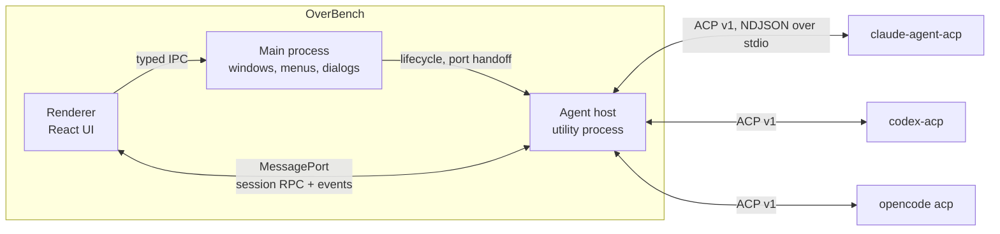
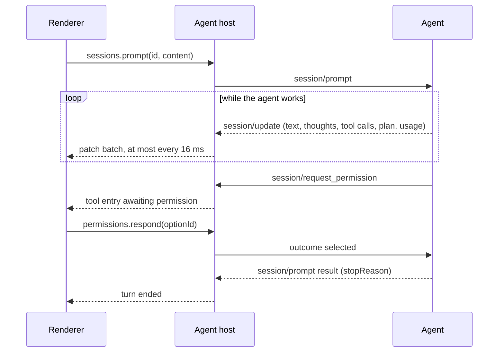

# Architecture

> Status: Draft for [M0](./milestones/m0.md) · Agent versions and capabilities were observed on 2026-10-20

OverBench is a GUI and nothing more. It does not implement an agent, call a model or store credentials. Every agent runs as its own process, owns its auth, models and history, and talks to OverBench over the [Agent Client Protocol](https://agentclientprotocol.com) (ACP). OverBench's job is to make that conversation fast, legible and beautiful.

This keeps the product honest to its philosophy: the agents are the best implementations of agent logic, ACP is the best existing contract for talking to them, and OverBench spends all of its effort on the experience on top.

This document is the overview. Each subsystem has a detailed design:

| Design                                     | Covers                                                                                                                              |
| ------------------------------------------ | ----------------------------------------------------------------------------------------------------------------------------------- |
| [Agent host](./design/agent-host.md)       | Startup and supervision, the agent catalog, environments, launching and stopping agents, sign-in, diagnostics, platform differences |
| [Session model](./design/session-model.md) | The thread model, patches and snapshots, the ACP v1 mapping, prompts, permissions, cancellation, session lifecycle                  |
| [Host protocol](./design/host-protocol.md) | The preload API, requests, events and validation between the renderer and the agent host                                            |
| [Persistence](./design/persistence.md)     | What is stored on disk, how it is written, versioned and recovered                                                                  |
| [Interface](./design/ui.md)                | Layout, screens, thread entries, composer, states, motion, typography and shortcuts                                                 |
| [Testing](./design/testing.md)             | Unit, integration and process tests, the fake agent, CI, and how performance is measured                                            |

## Process model



| Process       | Runs                                | Owns                                                                                    |
| ------------- | ----------------------------------- | --------------------------------------------------------------------------------------- |
| Main          | Electron main                       | App lifecycle, windows, menus, native dialogs and notifications, agent host supervision |
| Renderer      | Sandboxed Chromium                  | UI, view state, a replica of each session it shows                                      |
| Agent host    | Electron `utilityProcess` (Node.js) | ACP connections, agent processes, live session state, persistence                       |
| Agent process | One per agent, spawned by the host  | The agent itself: model calls, tools, auth, conversation storage                        |

**Why a separate agent host.** Main stays thin and never touches agent traffic, so a burst of tool output or a misbehaving adapter can never stall window dragging, menus or other windows. If the host crashes, main restarts it and the UI reconnects; the window survives. This is the same split VS Code uses for its pty host and extension host.

Alternatives considered:

- **ACP in the main process**: simplest, but couples agent traffic to the process every window depends on. Rejected.
- **ACP in the renderer**: would need Node.js in the renderer, which breaks the security model. Rejected.
- **One utility process per agent**: stronger isolation, more processes and more plumbing. Revisit only if measurements show one agent's traffic starving another.

### Channels

- **Renderer to main**: the typed `ipcRenderer.invoke` contract in `src/shared/ipc.ts`, for what only main can do: folder and file pickers, saving diagnostics, window controls.
- **Renderer to agent host**: a `MessagePort` per page, created by main. The preload keeps it in the isolated world and exposes `window.overbench.agents`, so session traffic skips main and page scripts never hold a raw channel. See [host protocol](./design/host-protocol.md).
- **Main to agent host**: `utilityProcess` messages for startup, port handoff, binary overrides, notifications and shutdown. See [agent host](./design/agent-host.md#main-and-host-messages).
- **Agent host to agents**: ACP over each agent's stdin and stdout as newline-delimited JSON-RPC, through the official [`@agentclientprotocol/sdk`](https://github.com/agentclientprotocol/typescript-sdk).

### Cross-platform

OverBench treats macOS, Windows and Linux as equals. Electron covers the interface; the differences that remain sit where OverBench meets the operating system: finding executables, the environment of an app launched from a desktop shell, spawning `.cmd` shims, stopping process trees, comparing paths, and window chrome. The [agent host](./design/agent-host.md#platform-differences) and [interface](./design/ui.md#window-and-chrome) designs settle each of them, and [CI](./design/testing.md#continuous-integration) runs the process tests on all three platforms.

## ACP integration

### Protocol version

All three agents speak ACP **v1**, the stable protocol. ACP v2 has been in draft since 2026-07-20, and its announcement advises clients not to enable it by default in production yet. OverBench therefore builds on the SDK's default v1 entrypoint and keeps v2 out of M0, but isolates the protocol so that adding v2 later is contained:

- ACP types never leave `src/agent-host/acp/`.
- One mapper turns ACP messages into OverBench's own [session model](./design/session-model.md). v2 becomes a second mapper, selected by the negotiated `protocolVersion`.
- The session model already uses v2's ideas, stable entry IDs and patches, so the renderer will not change when v2 arrives.

M0 uses only stable v1 methods, with one exception: the subagents RFD, which the Claude Code and Codex adapters already implement and which [sub-sessions](./design/session-model.md#subagents) depend on. Its types stay inside the mapper like every other ACP type. `session/fork` and other unstable features stay off until they stabilize.

### Agents

| Agent       | How it speaks ACP                                      | Sign-in methods it advertises                    | Logout |
| ----------- | ------------------------------------------------------ | ------------------------------------------------ | ------ |
| Claude Code | Official adapter `claude-agent-acp`, run with `npx`    | terminal: Claude subscription, Anthropic Console | yes    |
| Codex       | Official adapter `codex-acp`, run with `npx`           | agent: API key, ChatGPT                          | yes    |
| OpenCode    | Natively, `opencode acp`, from the user's installation | terminal: Login with opencode                    | no     |

- Claude Code and Codex have no native ACP mode; the official adapters from the [ACP Registry](https://agentclientprotocol.com/get-started/registry) wrap them. Versions are pinned to what the registry lists and bumped deliberately after testing; the exact packages are in the [agent catalog](./design/agent-host.md#agent-catalog).
- The adapters need Node.js 22 or later on the user's machine, because `npx` runs them. A managed install that runs them on Electron's bundled Node.js is planned after M0.
- The registry lists `claude-agent-acp` under a proprietary license. OverBench never bundles it; `npx` fetches it on the user's machine, the same way other registry clients install it.
- OverBench uses the user's existing `opencode`, so it reuses their configuration and login. The registry's OpenCode build (1.19.3) lags behind current releases (2.0.32 was tested).

What all three advertised in `initialize`:

| Capability                                                          | Claude Code | Codex | OpenCode |
| ------------------------------------------------------------------- | :---------: | :---: | :------: |
| `loadSession`                                                       |      ✓      |   ✓   |    ✓     |
| `session/list`, `session/resume`, `session/close`, `session/delete` |      ✓      |   ✓   |    ✓     |
| `additionalDirectories`                                             |      ✓      |   ✓   |    ✓     |
| Prompt `image` and `embeddedContext`                                |      ✓      |   ✓   |    ✓     |
| MCP over HTTP / SSE                                                 |    ✓ / ✓    | ✓ / – |  ✓ / –   |

Agent-specific extensions (`_meta`) such as steering, prompt queueing and auth status exist but are unstable; M0 depends on none of them.

### Client capabilities

What OverBench advertises in `initialize` for M0, and why:

| Capability                              | M0  | Reason                                                                                                                                            |
| --------------------------------------- | --- | ------------------------------------------------------------------------------------------------------------------------------------------------- |
| `fs.readTextFile`, `fs.writeTextFile`   | off | OverBench has no editor buffers yet, so the agents' own file tools are the better implementation. Turned on with change tracking and checkpoints. |
| `terminal`                              | off | Agents run commands themselves and report output in tool calls. Turned on with the embedded terminal.                                             |
| `auth.terminal`                         | on  | Claude Code and OpenCode only offer sign-in through terminal methods.                                                                             |
| `session.notices`, `session.compaction` | on  | The thread renders notices and compaction markers.                                                                                                |
| `session.configOptions.boolean`         | on  | Boolean options render as switches.                                                                                                               |
| `elicitation`                           | off | Structured questions come later; agents fall back to plain messages.                                                                              |
| `subagents`                             | on  | Subagents the agent runs become [sub-sessions](./design/session-model.md#subagents) the user can watch and answer.                                |

### Agents and sessions at a glance

- An agent process starts with the first session that needs it and then serves all of that agent's sessions, in every project. It stops after 30 idle minutes and at quit, and restarts with backoff if it crashes. See [agent host](./design/agent-host.md#agent-process-lifecycle).
- Agents own their credentials. `agent` sign-in methods run through `authenticate`; `terminal` methods show the exact command to run, until the embedded terminal lands. See [sign-in](./design/agent-host.md#sign-in).
- New sessions use `session/new` with the project folder as `cwd`. Reopening from history uses `session/load`, which replays the conversation; recovering after a crash uses `session/resume`, which does not. See [session lifecycle](./design/session-model.md#session-lifecycle).

```mermaid
stateDiagram-v2
  [*] --> starting: session/new, load or resume
  starting --> ready
  starting --> auth_required
  auth_required --> starting: signed in
  ready --> running: session/prompt
  running --> awaiting_permission: session/request_permission
  awaiting_permission --> running: user answers
  running --> ready: stop reason
  ready --> disconnected: agent exited
  running --> disconnected: agent exited
  disconnected --> starting: session/resume
  ready --> [*]: session/close
```



### A prompt turn



## State and data flow

The agent host is the source of truth for every live session. Its mapper turns ACP messages into patches against OverBench's own [session model](./design/session-model.md) and applies them to its copy. The renderer holds a replica: it starts from a snapshot and applies patch batches in sequence order, refetching a snapshot on any gap. Both sides use the same pure `applyPatches`. Window reloads, closing and reopening a window on macOS, and future multi-window support all work without special cases.

### Keeping streaming smooth

- **Coalesce in the host.** Patches are queued per session and flushed at most every 16 ms. Consecutive text appends to the same entry merge into one.
- **Only what is on screen streams.** The renderer receives patches only for sessions it watches; every other session sends one small summary per change.
- **One store update per batch.** The renderer applies each batch in a single Zustand update.
- **Normalized state, narrow subscriptions.** Entries are stored by id and each entry component selects only its own entry, so streaming into one message re-renders one component.
- **Cheap off-screen content.** Thread items use CSS `content-visibility: auto`, so the browser skips layout and paint for off-screen entries. A virtualization library is added only if measurements show it is needed.
- **Heavy work off the main thread, and loaded late.** Diff highlighting runs in a worker pool; markdown, Shiki and the diff renderer load the first time a session needs them.

### Persistence

The host keeps a few small JSON files: recent projects, the session index and agent settings, written atomically and versioned. Transcripts stay with the agents and come back through `session/load`; credentials and diagnostics are never written. See [persistence](./design/persistence.md).

## Security

OverBench drives agents that edit files and run commands, so every layer assumes the one next to it can be wrong.

- **Agent output is untrusted.** Markdown is rendered sanitized, without raw HTML. The CSP blocks remote images, so content in a reply cannot load tracking pixels or leak data through image URLs. Links open in the system browser only after the `http(s)` check in main.
- **The renderer cannot run commands.** The host has no API that takes a command line. Agent launch specs come from the catalog, and binary overrides come from a native dialog in main.
- **Every request to the host is validated**, including that a project folder is an absolute path to an existing directory. See [validation](./design/host-protocol.md#validation).
- **Permission requests are shown faithfully.** OverBench never answers one without the user, and never switches an agent into a bypass or full-auto mode by default.
- **No credentials.** OverBench stores no API keys or tokens; agents keep their own.
- **Diagnostics stay local** until the user exports them, and the export leaves out environment variables that could hold secrets.
- The renderer keeps `sandbox`, `contextIsolation` and the narrow preload API, as described in [AGENTS.md](../AGENTS.md#security-rules).

## Directory layout

The planned layout once M0 lands; new parts are marked.

```text
src/
├── main/                  Main process
│   └── agent-host.ts      new: starts and supervises the agent host, hands out ports, shows notifications
├── agent-host/            new: utility process
│   ├── index.ts           Entry, port wiring
│   ├── rpc.ts             Requests and events on renderer ports
│   ├── validate.ts        Request validators
│   ├── shell-env.ts       Login shell environment resolution
│   ├── catalog.ts         Built-in agent definitions
│   ├── agent-process.ts   Detection, spawning, stopping, restarts, stderr capture
│   ├── acp/               SDK connection and the v1 mapper; the only place ACP types live
│   ├── sessions.ts        Live session state, prompts, permissions
│   ├── storage.ts         JSON persistence
│   └── diagnostics.ts     Traffic and stderr ring buffers
├── preload/               Adds window.overbench.agents on top of the host port
├── renderer/src/
│   ├── features/          agents, projects, sessions (thread, composer, tool calls, permissions)
│   └── stores/            Zustand stores
└── shared/
    ├── ipc.ts             Renderer to main contract
    ├── agent-host.ts      new: renderer to agent host contract
    ├── host-control.ts    new: main to agent host messages
    └── thread.ts          new: session model and applyPatches
tools/
├── fake-agent/            new: scripted ACP agent for development and tests
└── perf/                  new: performance measurement script
```

## What we take from where

In line with the project philosophy, these are the implementations this design draws on:

| Source                                                                                                                           | What OverBench takes                                                                                                                                                               |
| -------------------------------------------------------------------------------------------------------------------------------- | ---------------------------------------------------------------------------------------------------------------------------------------------------------------------------------- |
| [ACP specification](https://agentclientprotocol.com) and [TypeScript SDK](https://github.com/agentclientprotocol/typescript-sdk) | The wire protocol, method semantics and the client connection                                                                                                                      |
| [ACP Registry](https://agentclientprotocol.com/get-started/registry)                                                             | Which adapter and version to launch for each agent, and the Claude Code mark                                                                                                       |
| [Zed](https://zed.dev/docs/ai/external-agents)                                                                                   | External agents as separate processes, thread entries keyed by tool call, an inspectable ACP traffic log                                                                           |
| VS Code                                                                                                                          | Hosting heavy work in a utility process; resolving the login shell environment for GUI launches; settings as one searchable page with a table of contents                          |
| [Harnss](https://github.com/OpenSource03/harnss), [AionUi](https://github.com/iOfficeAI/AionUi)                                  | Per-project workspaces, tool calls as cards with diffs, pending-approval badges and OS notifications                                                                               |
| [OpenCode](https://github.com/sst/opencode)                                                                                      | Subagents as child sessions of the session that started them; the OpenCode mark                                                                                                    |
| [LobeHub Icons](https://github.com/lobehub/lobe-icons)                                                                           | The Codex mark in its colors                                                                                                                                                       |
| shadcn/ui chat primitives                                                                                                        | `MessageScroller` for stick-to-bottom, anchoring and jump-to-latest while streaming                                                                                                |
| [Streamdown](https://streamdown.ai) and [Diffs](https://diffs.com)                                                               | Markdown that renders correctly mid-stream, and diffs highlighted off the main thread                                                                                              |
| Claude Desktop, through the [open-claude-ui](https://github.com/Caho1/open-claude-ui) analysis                                   | The visual and interaction benchmark for the first version: surfaces, density, lines, motion, composer and approvals ([design system](./design/design-system.md#design-reference)) |
