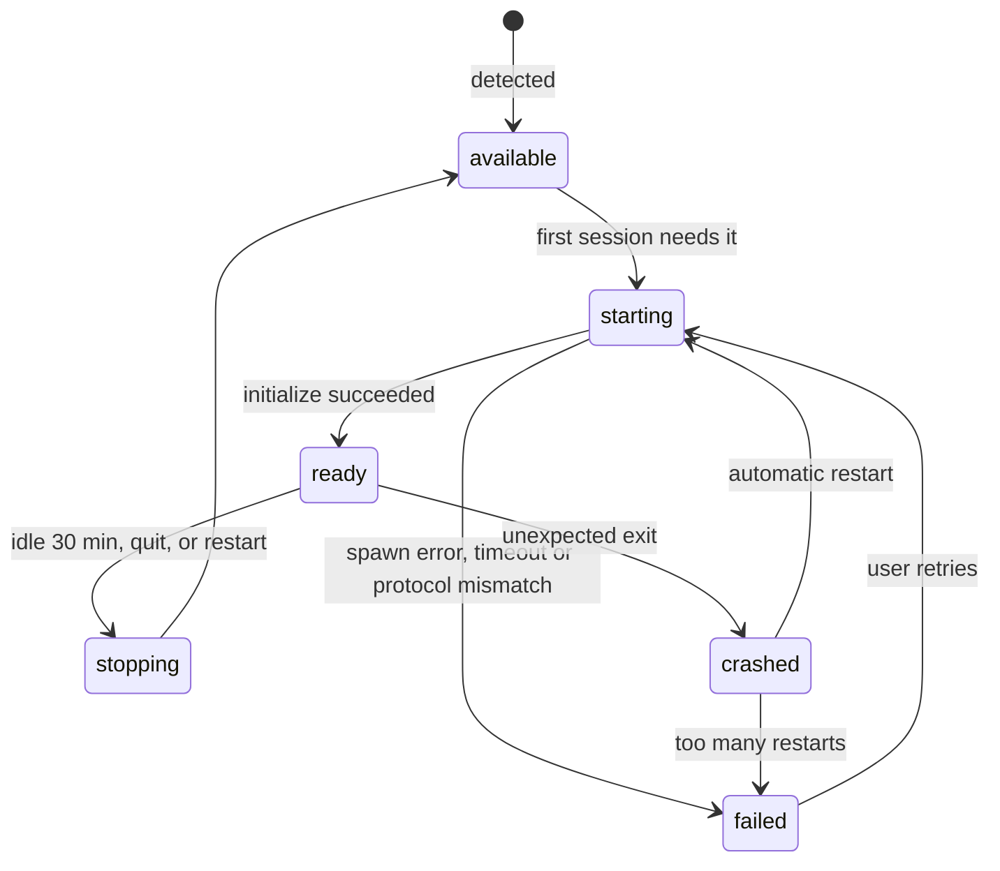

# Agent host

> Status: Draft · Part of the [architecture](../architecture.md) · Built in [M0.1](../milestones/m0.md#work-packages)

The agent host is an Electron `utilityProcess` that owns everything between the UI and the agents: agent processes, ACP connections, live sessions, permission requests, persistence and diagnostics. It renders nothing and shows no native UI; dialogs and OS notifications belong to main.

Electron itself is cross-platform, but this process is where OverBench meets the operating system directly: finding executables, environments, process trees and paths. Every rule below holds on macOS, Windows and Linux; where they differ, [Platform differences](#platform-differences) says how.

## Startup and supervision

`src/main/agent-host.ts` owns the host's lifecycle.

1. After `app.whenReady()`, main forks the host:
   ```ts
   import agentHostPath from '../agent-host/index?modulePath'

   utilityProcess.fork(agentHostPath, [], {
     serviceName: 'OverBench Agent Host',
     stdio: 'pipe',
   })
   ```
   electron-vite builds `src/agent-host/index.ts` as its own bundle because of the `?modulePath` import.
2. Main sends `host:init` (data directory, app version, platform, whether the app is packaged). The host loads its JSON state, starts resolving the shell environment in the background, and replies `host:ready`. Agents wait for the environment; listing projects and sessions does not.
3. Each renderer gets its own port. When a page loads, its preload sends `agent-host:connect`; main checks the sender with `isRendererUrl`, creates a `MessageChannelMain`, passes `port1` to the host in `host:connect` and `port2` to the page with `webContents.postMessage('agent-host:port', null, [port2])`. A reload repeats this, so a page never reuses a stale port.
4. The host's stdout and stderr are forwarded to main's log.

### Crash recovery

- When the host exits unexpectedly, main restarts it with backoff (0.5 s, 1 s, 2 s, then doubling up to 30 s; the delay resets after 60 s of healthy running), sends `host:init` again, and tells every window `agent-host:reset`. Each preload drops its port, requests a new one, and the renderer refetches snapshots for the sessions it shows.
- After five crashes within two minutes, main stops restarting. The UI shows the failure with **Restart agent host** and **Export diagnostics**.
- The host reports the process ID of every agent it starts (`host:agent-processes`). If the host dies, main terminates those process trees itself, so a crash never leaves orphaned agents behind.

### Shutdown

On `before-quit`, main delays the quit, sends `host:shutdown`, and waits for the host to stop every agent ([Stopping an agent](#stopping-an-agent)) and exit. After 6 s it kills the host and quits anyway.

### Main and host messages

Typed in `src/shared/host-control.ts`.

| Direction   | Message                | Payload                                                                    |
| ----------- | ---------------------- | -------------------------------------------------------------------------- |
| main → host | `host:init`            | `userDataPath`, `appVersion`, `platform`, `isPackaged`, `settings`         |
| main → host | `host:connect`         | `windowId`, and the port in the transfer list                              |
| main → host | `host:settings`        | `settings`, whenever the agent part changes                                |
| main → host | `host:shutdown`        | none                                                                       |
| host → main | `host:ready`           | none                                                                       |
| host → main | `host:agent-processes` | `{ agentId, pid }[]` for every running agent                               |
| host → main | `host:attention`       | `sessionId`, `kind` (`permission`, `turn-ended`, `error`), `title`, `body` |
| host → main | `host:stopped`         | none; sent just before a clean exit                                        |

`host:attention` lets main show an OS notification when no OverBench window is focused, including when every window is closed on macOS. Clicking the notification opens or focuses a window on that session.

`settings` is the agent part of the [settings](./persistence.md#settings): binary overrides and the proxy. Main owns the settings file; the host only receives this part.

The renderer never sends the host a path to an executable. Changing an agent's binary goes through a main-process IPC call that shows a native file dialog, saves the choice in settings and sends `host:settings`.

## Agent catalog

`src/agent-host/catalog.ts` is the only place that knows how to launch an agent.

```ts
type AgentId = 'claude-code' | 'codex' | 'opencode'

interface AgentDefinition {
  id: AgentId
  name: string
  registryId: string
  launch: { kind: 'npx'; package: string } | { kind: 'binary'; command: string; args: string[] }
  requiresNode?: string
  install: { hint: string; url: string }
}
```

| `id`          | `registryId` | `launch`                                             | `requiresNode` |
| ------------- | ------------ | ---------------------------------------------------- | -------------- |
| `claude-code` | `claude-acp` | `npx` `@agentclientprotocol/claude-agent-acp@0.94.0` | `>=22`         |
| `codex`       | `codex-acp`  | `npx` `@agentclientprotocol/codex-acp@2.2.2`         | `>=22`         |
| `opencode`    | `opencode`   | binary `opencode`, args `['acp']`                    | none           |

- Package versions are pinned to the ACP Registry entries and bumped deliberately, after a pass with the fake agent and the real agent.
- `opencode` is looked up on `PATH` unless the user picked a binary in settings.
- In development builds only, the catalog adds `fake-agent`, which runs `tools/fake-agent/main.ts` with Electron's own Node.js (see [testing](./testing.md#fake-agent)).
- Each agent is shown with its official mark, bundled with the app; the sources and colors are in the [design system](./design-system.md#agent-marks).

## Resolving the environment

Apps started from the Dock, Finder, a desktop launcher or the Start menu do not get the `PATH` a terminal has, so `npx` and `opencode` are often not found.

- **macOS and Linux**: the host runs the user's login shell once, the way VS Code does:
  ```text
  $SHELL -i -l -c '<electron> -p "<mark> + JSON.stringify(process.env) + <mark>"'
  ```
  with `ELECTRON_RUN_AS_NODE=1`, so Electron's binary acts as Node.js. The JSON between the random markers becomes the agent environment. It falls back to `/bin/zsh` on macOS and `/bin/sh` on Linux when `SHELL` is unset; for `csh` and `tcsh`, which reject `-i -l -c` together, it drops `-i`.
- **Windows**: GUI apps inherit the user and system environment, so the host uses `process.env` as is. A `PATH` change made after OverBench started needs an app restart, and Settings › Agents says so.
- The resolution times out after 10 s. On timeout or failure the host uses the inherited environment and Settings › Agents shows a warning.
- `ELECTRON_RUN_AS_NODE` and other `ELECTRON_*` variables are removed before the environment reaches an agent.
- A custom proxy from Settings › Advanced replaces `HTTP_PROXY`, `HTTPS_PROXY`, `NO_PROXY` and their lower-case forms; `npx` and the agents read them. With the default, **Use the environment**, nothing is added.
- The result is cached for the life of the host. **Reload environment** in Settings › Agents resolves it again, for example right after installing Node.js.

## Detecting agents

Detection never starts an agent, so it is cheap enough to run at host startup and whenever Settings › Agents asks.

- **Finding a command**: the host walks the resolved `PATH` itself. On Windows it also tries each `PATHEXT` extension, so `npx` resolves to `npx.cmd` and `opencode` to `opencode.exe`.
- **`npx` agents**: `npx` must be found, and `node --version` must satisfy `requiresNode`. Otherwise the status is `node-missing` or `node-outdated`, with the install hint.
- **Binary agents**: the command or the user's chosen binary must exist and be executable. Otherwise the status is `not-installed`.

An agent that passes detection is `available`. It becomes `ready` only after a successful `initialize`.

## Agent process lifecycle



- **Lazy start**: an agent starts with the first session that needs it.
- **Shared process**: one process serves every session of that agent across all projects; ACP multiplexes sessions by `sessionId`.
- **Idle stop**: an agent with no live sessions for 30 minutes is stopped to free memory, and starts again on demand.
- **Restarts**: if an agent exits while it has live sessions, the host restarts it with backoff (1 s, 2 s, 4 s, up to 30 s) and resumes those sessions ([session model](./session-model.md#recovering-after-a-crash)). After five failed restarts in five minutes it gives up and marks the agent `failed`; the user can retry.
- **Timeouts**: `initialize` must answer within 180 s on an agent's first launch, because `npx` may be downloading the adapter, and within 30 s afterwards.

### Spawning

```ts
spawn(command, args, {
  cwd: os.homedir(),
  env: resolvedEnv,
  stdio: ['pipe', 'pipe', 'pipe'],
  detached: process.platform !== 'win32',
  windowsHide: true,
  shell: needsShell,
})
```

- **`npx` agents** run `npx -y <package>`.
- **Working directory**: the process runs in the home directory. Each session's project folder reaches the agent as `cwd` in `session/new`, `session/load` and `session/resume`.
- **Process groups**: on macOS and Linux, `detached: true` puts the agent and everything it spawns (`npx`, Node.js, the agent CLI) in its own process group, so the whole tree can be stopped together.
- **Windows `.cmd` shims**: Node.js refuses to spawn `.cmd` and `.bat` files without a shell (CVE-2024-27980), so `needsShell` is true only for a resolved `.cmd` file. That is safe because every argument comes from the catalog; nothing the user or an agent typed ever reaches the command line.
- **stderr** goes into a 64 KB ring buffer per agent. While an agent is `starting`, its latest stderr lines are shown as progress, which makes the first `npx` download visible.

### Connecting

```ts
const app = client({ name: 'OverBench' })
  .onRequest(methods.client.session.requestPermission, (ctx) => sessions.requestPermission(ctx))
  .onNotification(methods.client.session.update, (ctx) => sessions.applyUpdate(ctx.params))

const connection = app.connect(
  ndJsonStream(Writable.toWeb(child.stdin), Readable.toWeb(child.stdout)),
)

const init = await connection.agent.request(methods.agent.initialize, {
  protocolVersion: PROTOCOL_VERSION,
  clientInfo: { name: 'OverBench', version: appVersion },
  clientCapabilities: {
    fs: { readTextFile: false, writeTextFile: false },
    terminal: false,
    auth: { terminal: true },
    session: { notices: {}, compaction: {}, configOptions: { boolean: {} } },
  },
})
```

- `PROTOCOL_VERSION`, `client`, `methods` and `ndJsonStream` come from `@agentclientprotocol/sdk`, the stable v1 entrypoint. The SDK is bundled into the host build.
- If `init.protocolVersion` is not 1, the agent is marked `failed` with "unsupported protocol version".
- The host keeps `init.agentCapabilities`, `init.authMethods` and `init.agentInfo` per agent. Every optional call is gated on these capabilities.
- Why each client capability is on or off is explained in the [architecture](../architecture.md#client-capabilities).

### Stopping an agent

The same sequence runs on idle stop, restart and quit, for every agent in parallel:

1. Close the agent's stdin. ACP agents exit when their input ends.
2. After 2 s, if it is still running: on macOS and Linux, send `SIGTERM` to its process group (`process.kill(-pid, 'SIGTERM')`); on Windows, run `taskkill /PID <pid> /T /F`.
3. After 3 more seconds on macOS and Linux, send `SIGKILL` to the group.

## Sign-in

ACP reports a missing sign-in as JSON-RPC error `-32000` (`auth_required`). The host then sets the agent's sign-in state, and every session waiting on it shows the agent's `authMethods`.

- **`agent` methods** (Codex): the host calls `authenticate` with the method `id`. The agent runs its own flow, such as opening the browser. On success the host retries what failed.
- **`terminal` methods** (Claude Code, OpenCode): the agent must run interactively. The command is the agent's launch command plus the method's `args`, for example `npx -y @agentclientprotocol/claude-agent-acp@0.94.0 --cli auth login --claudeai` or `opencode acp --login`. Until the embedded terminal exists, the UI shows that command quoted for the user's platform, with a copy button and **I've signed in, retry**.
- **Logout** is offered only when the agent advertises `agentCapabilities.auth.logout`. It calls `logout`; the agent's sessions then need sign-in again.
- OverBench never reads, stores or forwards credentials.

## Diagnostics

- For each agent, the host keeps the last 2,000 ACP messages (direction, time, method, size and the full JSON) in a ring buffer, plus the stderr ring buffer and process events (start, exit code, restarts).
- **Export diagnostics** asks the host for a bundle: app and agent versions, agent states, capabilities, the buffers, and the platform. The environment is reduced to `PATH`, `SHELL` and the detected Node.js version; other variables can hold secrets and are left out. The renderer passes the bundle to main, which writes it to a path chosen in a save dialog.
- Before exporting, the UI warns that the bundle contains prompts and code from recent sessions.
- In development, `OVERBENCH_ACP_LOG=1` also mirrors ACP traffic to the host's stdout.

## Platform differences

| Concern                   | macOS                                                                   | Linux                          | Windows                                                     |
| ------------------------- | ----------------------------------------------------------------------- | ------------------------------ | ----------------------------------------------------------- |
| Environment at launch     | Minimal `PATH`; resolve the login shell                                 | Same as macOS                  | Inherited user and system environment                       |
| Finding commands          | `PATH`                                                                  | `PATH`                         | `PATH` with `PATHEXT` (`npx.cmd`, `opencode.exe`)           |
| Spawning                  | Direct                                                                  | Direct                         | `.cmd` shims through a shell, with catalog-only arguments   |
| Process tree              | Own process group (`detached`)                                          | Own process group (`detached`) | No groups; `taskkill /T`                                    |
| Stopping                  | EOF, `SIGTERM`, `SIGKILL` to the group                                  | Same as macOS                  | EOF, then `taskkill /T /F`                                  |
| Path comparison           | Canonicalize with `fs.realpath.native`; volumes may be case-insensitive | Canonicalize; case-sensitive   | Canonicalize; case-insensitive, drive letters and UNC paths |
| Line endings from tools   | LF                                                                      | LF                             | Often CRLF; normalized before rendering                     |
| Data directory            | `~/Library/Application Support/OverBench`                               | `~/.config/OverBench`          | `%APPDATA%\OverBench`                                       |
| Shell quoting for display | POSIX single quotes                                                     | POSIX single quotes            | `cmd.exe` double quotes                                     |

Paths are always compared after canonicalizing with `path.resolve` and `fs.realpath.native`, never as raw strings.

## Alternatives considered

- **One agent process per session**: stronger isolation, but every session pays the startup cost and the memory. ACP already multiplexes sessions, so M0 shares one process per agent.
- **Running the adapters on Electron's Node.js** (`ELECTRON_RUN_AS_NODE`): removes the Node.js requirement, but OverBench would need its own install and update pipeline for the adapters. Planned after M0.
- **Bundling adapters in the installer**: rejected; `claude-agent-acp` is proprietary and adapters update faster than OverBench releases.
