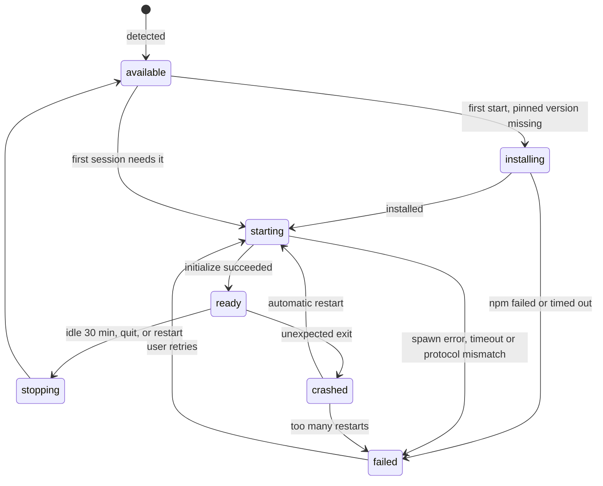

# Agent host

> Status: Draft · Part of the [architecture](../architecture.md) · Built in [M0.1](../milestones/m0.md#work-packages)

The agent host is an Electron `utilityProcess` that owns everything between the UI and the agents: agent processes, ACP connections, live sessions, permission requests, persistence and diagnostics. It renders nothing and shows no native UI; dialogs and OS notifications belong to main.

Electron itself is cross-platform, but this process is where OverBench meets the operating system directly: finding executables, environments, process trees and paths. Every rule below holds on macOS, Windows and Linux; where they differ, [Platform differences](#platform-differences) says how.

## Startup and supervision

`src/main/agent-host.ts` owns the host's lifecycle, through the supervisor in `src/main/utility-host.ts` that also runs the [terminal host](./terminal.md#processes).

1. After `app.whenReady()` and once the settings are read, main forks the host:
   ```ts
   import agentHostPath from '../agent-host/index?modulePath'

   utilityProcess.fork(agentHostPath, [], {
     serviceName: 'OverBench Agent Host',
     stdio: 'pipe',
   })
   ```
   electron-vite builds `src/agent-host/index.ts` as its own bundle because of the `?modulePath` import.
2. Main sends `host:init` (data directory, app version, platform, whether the app is packaged, Electron's executable, the fake agent's path and the agent part of the settings). The host loads its JSON state, sends `host:projects`, starts resolving the shell environment in the background, and replies `host:ready`. Agents wait for the environment; listing projects and sessions does not. Messages from main that arrive while the state loads wait for it; a port's messages queue in the port until then. A host that sends no `host:ready` within 20 s is killed and counts as a crash.
3. Each renderer gets its own port. When a page loads, its preload sends `agent-host:connect`; main checks that the sender is the main frame of one of its windows with `isRendererUrl`, creates a `MessageChannelMain`, passes `port1` to the host in `host:connect` and `port2` to the page with `webContents.postMessage('agent-host:port', null, [port2])`. A reload repeats this, so a page never reuses a stale port. A request that arrives while the host starts or restarts waits and is answered once it is ready.
4. The host's stdout and stderr are forwarded to main's log, line by line, as info and warnings.

### Crash recovery

- When the host exits unexpectedly, main tells every window `agent-host:reset` with `{ failed: false }` at once, restarts the host with backoff (0.5 s, 1 s, 2 s, then doubling up to 30 s; the delay resets after 60 s of healthy running) and sends `host:init` again. Each preload drops its port, rejects what was in flight with `host_restarted`, reports `reconnecting`, and requests a new port, which arrives once the new host is ready; then it reports `connected` and the renderer refetches snapshots for the sessions it shows.
- After five crashes within two minutes, main stops restarting and sends `agent-host:reset` with `{ failed: true }`; the preload reports `failed` and rejects requests until the host runs again. The UI shows the failure with **Restart agent host**, which calls `window.overbench.agents.restart()` (`agent-host:restart`), and **Export diagnostics**. A restart clears the crash count; in any other state it does nothing.
- The host reports the process ID of every agent it starts (`host:agent-processes`). If the host dies without `host:stopped`, main terminates those process trees itself, as in [stopping an agent](#stopping-an-agent): `SIGTERM` to each process group and `SIGKILL` 2 s later if it is still there, or `taskkill /PID <pid> /T /F` on Windows. A crash never leaves orphaned agents behind; after a clean stop the host has stopped them already.
- Main keeps the last 100 supervision events (start, ready, crash with exit code, scheduled restart, failure, user restart) of both hosts for [diagnostics](#diagnostics).

### Shutdown

On `before-quit`, main delays the quit and runs its quit flow (`src/main/quit.ts`), which also serves the restart to [update](./updates.md#restarting) and, on Windows and Linux, closing the last window:

1. Unless the system is shutting down, and while **Ask before quitting while agents or terminal commands are running** is on, main asks both hosts what is working (`host:busy-request`, and `terminal-host:busy-request` if the terminal host runs), waiting at most 2 s for each; a host that does not answer counts as idle.
2. If something is working, main sends `app:confirm-quit` (`QuitRequest`) to the focused window, or the first one, and waits for `app:respond-quit`. A page with no `onConfirmQuit` listener, a page that reloads or closes meanwhile, and a quit with no window at all get a native `dialog.showMessageBox` instead, naming the sessions and terminal commands. Cancelling ends the flow; nothing has stopped.
3. Main sends `host:shutdown` and `terminal-host:shutdown` and waits for both hosts to stop every agent and terminal ([Stopping an agent](#stopping-an-agent)) and exit. After 6 s it kills a host that is still running.
4. Main flushes `settings.json`, `window-state.json` and `app-state.json`, then quits, or calls `quitAndInstall` for an update.

### Main and host messages

Typed in `src/shared/host-control.ts`.

| Direction   | Message                | Payload                                                                                                                                   |
| ----------- | ---------------------- | ----------------------------------------------------------------------------------------------------------------------------------------- |
| main → host | `host:init`            | `userDataPath`, `appVersion`, `platform`, `isPackaged`, `electronPath`, `fakeAgentPath`, `settings`                                       |
| main → host | `host:connect`         | `windowId`, and the port in the transfer list                                                                                             |
| main → host | `host:settings`        | `settings`, whenever the agent part changes                                                                                               |
| main → host | `host:busy-request`    | `requestId`, before quitting                                                                                                              |
| main → host | `host:shutdown`        | none                                                                                                                                      |
| host → main | `host:ready`           | none                                                                                                                                      |
| host → main | `host:agent-processes` | `{ agentId, pid }[]` for every running agent, whenever that set changes                                                                   |
| host → main | `host:projects`        | The project paths, whenever the list changes; main relays them to the [terminal host](./terminal.md#shells)                               |
| host → main | `host:auth-commands`   | The terminal sign-in commands it built; main relays them to the terminal host, which runs only these ([terminal](./terminal.md#security)) |
| host → main | `host:attention`       | `sessionId`, `kind` (`permission`, `turn-ended`, `error`), `title`, `body`                                                                |
| host → main | `host:badge`           | `count`: pending permission requests across all sessions, whenever it changes                                                             |
| host → main | `host:busy`            | `requestId`, and the sessions that are `running` or `awaiting_permission`                                                                 |
| host → main | `host:log`             | `level`, `message`: every entry of the host log, such as a corrupt state file                                                             |
| host → main | `host:stopped`         | none; sent just before a clean exit                                                                                                       |

`fakeAgentPath` is `tools/fake-agent/main.ts` under the app path in development, and `OVERBENCH_FAKE_AGENT` (or null) in a packaged build.

`host:attention` lets main show an OS notification when no OverBench window is focused, including when every window is closed on macOS. Each kind follows its switch in Settings › Notifications, and **Play a sound** decides `silent`. A session has at most one notification at a time: a newer one replaces it. Clicking the notification focuses a window, or opens one, and sends it `app:command` `{ kind: 'open-session', sessionId }`; a page that has not subscribed yet receives the command when it does. The host sends `error` attention only for sessions in the index; a failed create is reported by the rejected request instead.

`host:badge` puts the count where the platform shows one, while Settings › Notifications › **Show a count on the Dock icon** is on:

- **macOS**: `app.setBadgeCount` on the Dock icon.
- **Windows**: an overlay icon on each window's taskbar button (`setOverlayIcon`), a white count on a red disc, the color of the macOS badge. Main draws it at runtime (`src/main/badge-image.ts`, encoded as PNG at 16 and 32 px for 100% and 200% scaling), "1" to "9" and then "9+", so the app ships no image per count and the badge stays sharp at every scale.
- **Linux**: `app.setBadgeCount`, which only launchers that support counts, such as Unity's, show; elsewhere it does nothing.

The badge clears when the host stops or crashes, until the new host reports again.

`settings` is the agent part of the [settings](./persistence.md#settings): binary overrides, the proxy and background fetch. Main owns the settings file; the host only receives this part. A new `host:settings` applies at once: changed binary overrides run detection again for those agents, the proxy applies to agents started from then on and to the git service, and background fetch goes to the git service. A running agent keeps the environment it started with.

On `host:shutdown` the host flushes pending patches, stops every agent with the sequence below, stops the git service, writes pending state, closes the ports, and sends `host:stopped` before it exits.

The renderer never sends the host a path to an executable. Changing an agent's binary goes through a main-process IPC call that shows a native file dialog, saves the choice in settings and sends `host:settings`.

## Agent catalog

`src/agent-host/catalog.ts` is the only place that knows how to launch an agent.

```ts
type AgentId = 'claude-code' | 'codex' | 'opencode' | 'fake-agent'

interface AgentDefinition {
  id: AgentId
  name: string
  registryId: string
  launch:
    | { kind: 'package'; package: string; version: string } // installed from npm, run on the user's Node.js
    | { kind: 'binary'; command: string; args: string[] }
    | { kind: 'node-script'; script: string } // the fake agent, on Electron's Node.js
  requiresNode?: string
  install: { hint: string; url: string }
}
```

| `id`          | `registryId` | `launch`                                                          | `requiresNode` |
| ------------- | ------------ | ----------------------------------------------------------------- | -------------- |
| `claude-code` | `claude-acp` | package `@agentclientprotocol/claude-agent-acp`, version `0.94.0` | `>=22`         |
| `codex`       | `codex-acp`  | package `@agentclientprotocol/codex-acp`, version `2.2.2`         | `>=22`         |
| `opencode`    | `opencode`   | binary `opencode`, args `['acp']`                                 | none           |

- Package versions are pinned to the ACP Registry entries and bumped deliberately, after a pass with the fake agent and the real agent. OverBench [installs](#installing-adapters) the pinned version on first use.
- `opencode` is looked up on `PATH` unless the user picked a binary in settings.
- In development builds only, the catalog adds `fake-agent`, which runs `tools/fake-agent/main.ts` with Electron's own Node.js (see [testing](./testing.md#fake-agent)). It exists exactly when `host:init` carries a `fakeAgentPath`; the host runs `<electronPath> <fakeAgentPath>` with `ELECTRON_RUN_AS_NODE=1`, so it needs no Node.js on the machine.
- Both pinned packages were checked to exist on npm with `npm view` on 2026-10-20.
- Each agent is shown with its official mark, bundled with the app; the sources and colors are in the [design system](./design-system.md#agent-marks).

## Resolving the environment

Apps started from the Dock, Finder, a desktop launcher or the Start menu do not get the `PATH` a terminal has, so `node`, `npm` and `opencode` are often not found.

- **macOS and Linux**: the host runs the user's login shell once, the way VS Code does:
  ```text
  $SHELL -i -l -c '<electron> -p "<mark> + JSON.stringify(process.env) + <mark>"'
  ```
  with `ELECTRON_RUN_AS_NODE=1`, so Electron's binary acts as Node.js. The JSON between the random markers becomes the agent environment. It falls back to `/bin/zsh` on macOS and `/bin/sh` on Linux when `SHELL` is unset or not absolute. `csh` and `tcsh` accept `-l` only as their sole flag, so they run `-ic` instead, as in VS Code; `pwsh` runs `-Login -Command` with PowerShell quoting and `nu` prefixes the command with `^`. The shell runs detached, without a controlling terminal, so an interactive profile cannot wait for input; on timeout its whole process group is killed.
- **Windows**: GUI apps inherit the user and system environment, so the host uses `process.env` as is. A `PATH` change made after OverBench started needs an app restart, and Settings › Agents says so.
- The resolution times out after 10 s. On timeout or failure the host uses the inherited environment and Settings › Agents shows a warning.
- `ELECTRON_RUN_AS_NODE` and other `ELECTRON_*` variables are removed before the environment reaches an agent.
- A custom proxy from Settings › Advanced replaces `HTTP_PROXY`, `HTTPS_PROXY`, `NO_PROXY` and their lower-case forms; npm and the agents read them. With the default, **Use the environment**, nothing is added.
- The result is cached for the life of the host. **Reload environment** in Settings › Agents resolves it again, for example right after installing Node.js.

## Detecting agents

Detection never starts an agent, so it is cheap enough to run at host startup and whenever Settings › Agents asks.

- **Finding a command**: the host walks the resolved `PATH` itself. On Windows it also tries each `PATHEXT` extension, so `node` resolves to `node.exe`, `npm` to `npm.cmd` and `opencode` to `opencode.exe`.
- **Package agents**: `node` must be found, and `node --version` must satisfy `requiresNode`. Otherwise the status is `node-missing` or `node-outdated`, with the install hint. Detection also reports whether the pinned version is [installed](#installing-adapters). Until it is, `npm` must be found too, or the status is `not-installed` with "npm was not found" as `detail`; an installed adapter runs without npm.
- **Binary agents**: the command or the user's chosen binary must exist and be executable. Otherwise the status is `not-installed`.

An agent that passes detection is `available`. It becomes `ready` only after a successful `initialize`.

## Installing adapters

OverBench installs the pinned Claude Code and Codex adapters once, into its data directory, with the user's npm, and runs them with the user's Node.js. A launch then costs no registry round trip. `npx -y` revalidated the package with the registry on every launch, which took about 1 s of each agent start (2026-10-21, macOS arm64, median time to the `initialize` answer):

| Launch                                  | Claude Code | Codex    |
| --------------------------------------- | ----------- | -------- |
| `npx -y <package>@<version>`            | 1,563 ms    | 1,411 ms |
| `node <entry>` of the installed package | 211 ms      | 151 ms   |

The approach follows Zed's registry agents (`agent_server_store.rs`), which install into the app's data directory and run `node <bin>`. Zed runs `npm install` with a version range before every launch; OverBench pins exact versions, so it installs only when the pinned version changes.

- **Where**: `<userData>/agents/<agentId>/<version>/`, with the package under `node_modules`, the `package.json` and `package-lock.json` npm works from, and `installed.json` (package, version, Node.js and npm versions, install time), which is written last. A version directory without `installed.json` does not count as installed.
- **When**: at the first start of an agent whose pinned version is not installed, whether a session, the New session screen's early start or **Check plan limits** asked for it. Detection never installs. Meanwhile the agent is `installing`, with npm's latest output as `progress`, and every start that waits on it shares the one install.
- **Installing**: in a fresh `.partial-<random>` directory beside the version directories, the host writes a `package.json` that depends on exactly the pinned version, then runs `npm install --omit=dev --ignore-scripts --no-audit --no-fund --no-update-notifier --loglevel=http` there with the agent environment, after `npm --version` for `installed.json`. npm reads the user's `.npmrc`, so a registry mirror, a token and npm's own proxy settings apply, and it reuses the npm cache that `npx` filled before. When npm exits with 0 and the package's entry exists, the host writes `installed.json` and renames the directory to `<version>`, which is atomic on one volume; otherwise it deletes the directory. Every argument is a constant and the location is the working directory, so the [`.cmd` rule](#spawning) holds for `npm.cmd` too. `.partial-*` directories older than the time limit, left by a quit or a crash, are deleted before the next install, so another instance's install in progress is never touched.
- **Install scripts**: neither pinned adapter nor any of its dependencies has an install script; both bring their native binary (Claude Code's CLI, Codex) as platform-specific optional dependencies (checked 2026-10-21). `--ignore-scripts` keeps it so: a version bump whose install needs a script fails its pass with the real agent instead of running unreviewed code.
- **Dependencies**: the adapter's own dependencies resolve within its ranges at install time, as they did with `npx`, and stay fixed until the next install. The lock file and `installed.json` record what was installed, and Export diagnostics includes both.
- **Time limit**: an install that has not finished after 15 minutes is stopped with its process tree, the way an [agent is stopped](#stopping-an-agent). Quitting stops a running install the same way.
- **Running**: the host reads `bin` from the installed package's `package.json`, taking its only entry or the one named after the package without its scope, requires the resolved path to stay inside the package folder, and spawns `<node> <entry>` with the absolute `node` path that detection found, never through a shell. Inside the adapter, `process.execPath` is then the user's Node.js, which codex-acp uses to start Codex.
- **Updates**: a release that bumps a pinned version installs the new one at the agent's first start after the update. Once the new version answers `initialize`, the agent's older version directories are deleted in the background. If the install fails while another version is installed, the host starts the newest of those instead, says so in `detail` ("Running 0.93.0: 0.94.0 could not be installed. …") and tries the install again at the next start, so updating while offline does not take an agent away. With no older version, the agent is `failed` with npm's last error lines as `detail`, and **Retry** installs again.
- **Reinstall**: Settings › Agents offers **Reinstall** for an installed adapter (`agents.reinstall`), for an install damaged on disk. It is refused while a session uses the agent; otherwise it stops the agent, deletes the installed version and installs it again at once. It claims the agent before its first step, so a start asked for meanwhile waits and then runs the new install.
- **Measured** on 2026-10-21 (macOS arm64, npm 11.19.1, with npm's cache filled by earlier `npx` runs): installing took 11.4 s for Claude Code and 8.5 s for Codex, mostly npm revalidating package metadata with the registry, and about 3 s once the cache was current. The first start after an install takes longer once, 2 to 6 s for Codex, likely macOS checking the new native binary on its first run; later starts initialize in about 0.2 s.
- **Disk**: each adapter takes about 330 MB (2026-10-21), almost all of it the native binary. The copies under `~/.npm/_npx` that earlier builds' `npx` left belong to npm and are left alone.

## Agent process lifecycle



- **Lazy start**: an agent starts with the first session that needs it, or earlier when the New session screen shows it as the chosen agent (`agents.start`), so the first send waits for the session alone. An agent started that way and never used is stopped by the idle stop.
- **Shared process**: one process serves every session of that agent across all projects; ACP multiplexes sessions by `sessionId`.
- **Idle stop**: an agent with no live sessions for 30 minutes is stopped to free memory, and starts again on demand.
- **Restarts**: if an agent exits while it has live sessions, the host restarts it with backoff (1 s, 2 s, 4 s, up to 30 s) and resumes those sessions ([session model](./session-model.md#recovering-after-a-crash)). After five failed restarts in five minutes it gives up and marks the agent `failed`; the user can retry. Crashes and failed restarts both count toward the five. A start on demand that fails marks the agent `failed` at once, with the reason as `detail`.
- **Live sessions** are those the host holds that are `starting`, `auth_required`, `ready`, `running`, `awaiting_permission` or `disconnected`; they decide both restarts and the idle stop.
- **Timeouts**: `initialize` must answer within 30 s. Installing is a step of its own before the launch, with its own [time limit](#installing-adapters), so a launch never waits for a download.

### Spawning

```ts
spawn(command, args, {
  cwd: os.homedir(),
  env: resolvedEnv,
  stdio: ['pipe', 'pipe', 'pipe'],
  detached: process.platform !== 'win32',
  windowsHide: true,
  shell: needsShell,
})
```

- **Package agents** run `<node> <entry>`, both absolute paths ([installing adapters](#installing-adapters)).
- **Working directory**: the process runs in the home directory. Each session's project folder reaches the agent as `cwd` in `session/new`, `session/load` and `session/resume`.
- **Process groups**: on macOS and Linux, `detached: true` puts the agent and everything it spawns (Node.js, the agent CLI and the commands it runs) in its own process group, so the whole tree can be stopped together.
- **Windows `.cmd` shims**: Node.js refuses to spawn `.cmd` and `.bat` files without a shell (CVE-2024-27980), so `needsShell` is true only for a resolved `.cmd` file, such as `npm.cmd` during an install or an `opencode.cmd` shim. That is safe because every argument comes from the catalog; nothing the user or an agent typed ever reaches the command line.
- **stderr** goes into a 64 KB ring buffer per agent. While an agent is `installing` or `starting`, the latest lines of npm's output or of the agent's stderr are shown as progress.

### Connecting

```ts
const app = client({ name: 'OverBench' })
  .onRequest(methods.client.session.requestPermission, (ctx) => sessions.requestPermission(ctx))
  .onNotification(methods.client.session.update, (ctx) => sessions.applyUpdate(ctx.params))

const connection = app.connect(
  ndJsonStream(Writable.toWeb(child.stdin), Readable.toWeb(child.stdout)),
)

const init = await connection.agent.request(methods.agent.initialize, {
  protocolVersion: PROTOCOL_VERSION,
  clientInfo: { name: 'OverBench', version: appVersion },
  clientCapabilities: {
    fs: { readTextFile: false, writeTextFile: false },
    terminal: false,
    auth: { terminal: true },
    session: { notices: {}, compaction: {}, configOptions: { boolean: {} } },
  },
})
```

- `PROTOCOL_VERSION`, `client`, `methods` and `ndJsonStream` come from the SDK's `@agentclientprotocol/sdk/unstable` entrypoint, not the stable one. The SDK's client validates every `session/update` against its entrypoint's schema before any handler runs, and the stable schema has no `subagent_update` or `session_message`, so sub-sessions would never arrive. Nothing else unstable is advertised or called: the client capabilities add only `subagents: {}`, and the prompt response's `usage` is read when present. The SDK is bundled into the host build.
- An update variant the schema does not know would fail that validation and be logged by the SDK, so the host's stream tap drops variants outside the mapper's list before the SDK sees them and records each in the agent's diagnostics.
- Updates for a session id nobody registered yet, such as the commands an agent sends right after answering `session/new`, wait in a bounded buffer (32 sessions, 2,000 updates, 60 s) and are delivered when the session registers. Updates for a session OverBench closed are dropped and recorded instead.
- If `init.protocolVersion` is not 1, the agent is marked `failed` with "unsupported protocol version".
- The host keeps `init.agentCapabilities`, `init.authMethods` and `init.agentInfo` per agent. Every optional call is gated on these capabilities.
- Why each client capability is on or off is explained in the [architecture](../architecture.md#client-capabilities).

### Stopping an agent

The same sequence runs on idle stop, restart and quit, for every agent in parallel:

1. Close the agent's stdin. ACP agents exit when their input ends.
2. After 2 s, if it is still running: on macOS and Linux, send `SIGTERM` to its process group (`process.kill(-pid, 'SIGTERM')`); on Windows, run `taskkill /PID <pid> /T /F`.
3. After 3 more seconds on macOS and Linux, send `SIGKILL` to the group.

## Sign-in

ACP reports a missing sign-in as JSON-RPC error `-32000` (`auth_required`). The host then sets the agent's sign-in state, and every session waiting on it shows the agent's `authMethods`.

- **`agent` methods** (Codex): the host calls `authenticate` with the method `id`. The agent runs its own flow, such as opening the browser. On success the host retries what failed.
- **`terminal` methods** (Claude Code, OpenCode): the agent must run interactively. The command is the agent's launch command plus the method's `args`, with its `env` and the launch's variables as a prefix (`NAME=value …` on macOS and Linux, `set "NAME=value" && …` on Windows), for example `<node> <userData>/agents/claude-code/0.94.0/node_modules/@agentclientprotocol/claude-agent-acp/dist/index.js --cli auth login --claudeai` or `opencode acp --login`. **Sign in in terminal** runs that command in the built-in [terminal](./terminal.md#working-with-the-session) and retries when it finishes. The command is also shown quoted for the user's platform, with a copy button and **I've signed in, retry**, for those who prefer their own terminal.
- **Logout** is offered only when the agent advertises `agentCapabilities.auth.logout`. It calls `logout`; the agent's sessions then need sign-in again.
- Claude Code and Codex also push `_auth/status_update`, an adapter extension that names the account and plan ("Claude Max", "ChatGPT Plus"). It sets the sign-in state without waiting for a failed request, and the plan label heads the [plan limits](./session-model.md#plan-limits).
- OverBench never reads, stores or forwards credentials.

## Diagnostics

- For each agent, the host keeps the last 2,000 ACP messages (direction, time, method, size and the full JSON) in a ring buffer, plus the stderr ring buffer and process events (start, exit code, restarts).
- **Export diagnostics** asks the host for a bundle: app and agent versions, agent states, capabilities, the buffers, and the platform. The environment is reduced to `PATH`, `SHELL` and the detected Node.js version; other variables can hold secrets and are left out. The renderer passes the bundle to main (`diagnostics:save`), which adds its own section under `main` and writes pretty JSON to a path chosen in a save dialog, `overbench-diagnostics-<date>-<time>.json` in Downloads by default. Main's section holds the app, Electron, Chromium, Node.js and V8 versions, the platform, architecture and OS version, the launch time to the first interactive frame, the state and supervision events of both hosts, and main's last 500 log records.
- Before exporting, the UI warns that the bundle contains prompts and code from recent sessions.
- In development, `OVERBENCH_ACP_LOG=1` also mirrors ACP traffic to the host's stdout; packaged builds ignore it.
- The buffers are bounded by size as well as count: the traffic of one agent holds at most 8 MB of JSON, a message over 256 KB is kept as a truncated preview, each agent keeps its last 500 process events, and the host log its last 2,000 entries. Messages are stored as JSON text, which costs far less memory than the parsed objects.

## Project files

- The Files pane lists, reads and searches a project's files through `files.list`, `files.read` and `files.search` ([host protocol](./host-protocol.md#requests)). `src/agent-host/files.ts` does it for a registered project, at its canonical path; the renderer has no file system access of its own.
- **Listing**: `git ls-files --cached --others --exclude-standard`, minus the tracked files deleted on disk, so ignored files stay out. Without git, or outside a repository, a breadth-first walk reads at most 20 levels, skips `.git` and `node_modules`, and does not follow links to folders. Paths are relative with `/` on every platform and sorted by code unit; the list stops at 50,000 files and says so with `truncated`.
- **Reading**: a file up to 1 MiB comes back as UTF-8 text. A NUL byte in its first 8,000 bytes makes it `binary`, and a larger file is `too-large`; neither is sent.
- **Searching**: `git grep -F -i` with `--untracked --exclude-standard` finds literal text, ignoring case, in the files git would list. Outside a repository the host reads the walk's first 5,000 files, skipping binary ones and those over 1 MiB. Results stop at 500 matches, each line cut to 300 characters, and `truncated` says more exist.
- **Containment**: a path with `..`, a NUL, or an absolute form is refused, and a read resolves the path with `realpath` and requires the result inside the project folder by the platform's [path rules](#platform-differences), so a symbolic link cannot lead out of the project.
- Git runs through the same runner as the [git service](./git.md): never a shell, a 10 s timeout, the agent environment, and it stops with the host.

## Platform differences

| Concern                   | macOS                                                                   | Linux                          | Windows                                                       |
| ------------------------- | ----------------------------------------------------------------------- | ------------------------------ | ------------------------------------------------------------- |
| Environment at launch     | Minimal `PATH`; resolve the login shell                                 | Same as macOS                  | Inherited user and system environment                         |
| Finding commands          | `PATH`                                                                  | `PATH`                         | `PATH` with `PATHEXT` (`node.exe`, `npm.cmd`, `opencode.exe`) |
| Spawning                  | Direct                                                                  | Direct                         | `.cmd` shims through a shell, with catalog-only arguments     |
| Process tree              | Own process group (`detached`)                                          | Own process group (`detached`) | No groups; `taskkill /T`                                      |
| Stopping                  | EOF, `SIGTERM`, `SIGKILL` to the group                                  | Same as macOS                  | EOF, then `taskkill /T /F`                                    |
| Path comparison           | Canonicalize with `fs.realpath.native`; volumes may be case-insensitive | Canonicalize; case-sensitive   | Canonicalize; case-insensitive, drive letters and UNC paths   |
| Line endings from tools   | LF                                                                      | LF                             | Often CRLF; normalized before rendering                       |
| Data directory            | `~/Library/Application Support/OverBench`                               | `~/.config/OverBench`          | `%APPDATA%\OverBench`                                         |
| Shell quoting for display | POSIX single quotes                                                     | POSIX single quotes            | `cmd.exe` double quotes                                       |

Paths are always compared after canonicalizing with `path.resolve` and `fs.realpath.native`, never as raw strings. On Windows only drive paths (`C:\…`) and UNC paths count as absolute; a path such as `\src` depends on the host's current drive and is refused.

## Alternatives considered

- **One agent process per session**: stronger isolation, but every session pays the startup cost and the memory. ACP already multiplexes sessions, so M0 shares one process per agent.
- **Running the adapters on Electron's Node.js** (`ELECTRON_RUN_AS_NODE`): rejected on 2026-10-21. It would remove the Node.js requirement, but the variable reaches every command the agent runs, so an Electron app the agent starts, such as `pnpm dev` in an Electron project, runs as plain Node.js instead (a child `electron --version` printed `v24.22.0`). Removing it for the adapter's children breaks codex-acp, which starts Codex through `process.execPath`. A wrapper around `process.execPath` that restores it is fragile, and on Windows a `.cmd` wrapper cannot be spawned without a shell. The user's Node.js starts the adapters as fast (211 ms against 213 ms for Claude Code's `initialize`).
- **Keeping `npx`**: `npx --prefer-offline` skips the registry check but still took 557 ms (Claude Code) and 476 ms (Codex) to `initialize`, and its cache is npm's to evict, which turns a launch into a silent download.
- **Bundling adapters in the installer**: rejected; `claude-agent-acp` is proprietary and adapters update faster than OverBench releases.
