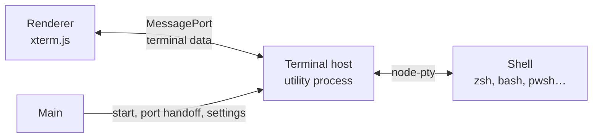

# Terminal

> Status: Draft · Part of the [architecture](../architecture.md) · Built in [M0.5](../milestones/m0.md#work-packages) · Observed on 2026-10-20: `@xterm/xterm` 6.0.0, `node-pty` 1.1.0

Working with an agent still means running things yourself: the dev server, the tests the agent claims pass, a quick `git log`. The built-in terminal keeps that next to the session, in the project's folder and with the user's own shell, so nobody has to switch windows. The interface is in [ui.md](./ui.md#terminal).

The reference opens its terminal as a panel on the right. OverBench puts it at the bottom instead, where VS Code, JetBrains IDEs and Zed have trained developers to look for it, and keeps the right side for the Changes panel that comes later, so both can be open at once. The thread is a narrow centred column, so a bottom panel takes height the thread has to spare at most window sizes.

## Processes



- A third utility process, the **terminal host** (`src/terminal-host/`), owns every pty. It starts the first time a terminal opens, not at launch, so startup pays nothing for it.
- It is separate from the agent host for the reason VS Code has a separate pty host: `node-pty` is a native module, and a crash in it must not take the agents down. Terminal output also gets its own port, so a flood of build output never delays session patches.
- Main supervises it like the agent host ([startup and supervision](./agent-host.md#startup-and-supervision)): restart on crash with the same backoff, a port per page. After a crash, open terminals show **Terminal stopped unexpectedly** with **Restart**; their output stays on screen.
- `node-pty` uses ConPTY on Windows and forkpty on macOS and Linux. It is built against N-API, so one build works across Electron versions; electron-builder rebuilds it only when no prebuilt binary matches.

## Shells

| Platform | Default shell                                          | Arguments |
| -------- | ------------------------------------------------------ | --------- |
| macOS    | `$SHELL`, else `/bin/zsh`                              | `-l`      |
| Linux    | `$SHELL`, else `/bin/bash`                             | `-l`      |
| Windows  | `pwsh.exe` when it is on `PATH`, else `powershell.exe` | none      |

- A login shell builds `PATH` from the user's profile, so the terminal sees the same tools as the user's own terminal app, also when OverBench was started from the Dock or the Start menu.
- **Settings › Terminal › Shell** replaces the default with a program picked in a native file dialog, the same way agent binaries are overridden; the renderer never sends a path to an executable.
- The environment is main's, without `ELECTRON_*` variables, plus `TERM=xterm-256color`, `COLORTERM=truecolor`, `TERM_PROGRAM=OverBench` and `TERM_PROGRAM_VERSION`. On macOS, when `LANG` is unset, as it is for apps started from the Dock, it is set to `en_US.UTF-8` so programs print UTF-8.
- The working directory is the project folder. The terminal host checks it against the project list that main relays from the agent host (`host:projects`), so a terminal opens only in a known project.

## Data flow

- **Output**: pty data is buffered for 5 ms and posted as one string per batch, so a burst of output costs one message per frame rather than one per chunk.
- **Flow control**, with VS Code's constants (MIT): the renderer acknowledges every 5,000 characters it has written to xterm.js, using `write`'s callback. When more than 100,000 characters are unacknowledged, the host pauses the pty and resumes it below 5,000. A command that prints megabytes slows to what the screen can draw instead of piling up in memory.
- **Input**: keystrokes and pastes go to the pty as strings. A paste of more than one line is wrapped in bracketed-paste sequences when the shell enabled them, as xterm.js does by default.
- **Resize**: the panel's size gives columns and rows through the fit addon, debounced by 50 ms while the panel is dragged.

## Rendering

- xterm.js is imported with dynamic `import()` the first time a terminal opens, together with its addons: `@xterm/addon-fit`, `@xterm/addon-webgl` and `@xterm/addon-web-links`.
- The WebGL renderer draws on the GPU. If the WebGL context is lost, the terminal falls back to xterm.js's DOM renderer without losing its buffer.
- Scrollback holds 10,000 lines per terminal.
- Font: Geist Mono at the terminal font size (12, 13 or 14 px; 13 by default), line height 1.2. The cursor is a bar that blinks only while the terminal has focus.
- Colors come from the [terminal tokens](./design-system.md#terminal), read from CSS when the theme changes, so a theme switch recolors running terminals at once.
- Links: `http(s)` URLs are underlined on hover and open in the system browser with `Mod`+click, through main's external-link check.

## Terminals and projects

Terminals belong to a project, not to a session, because the sessions of a project share its folder.

- Switching to another session of the same project keeps the same terminals. Switching to another project shows that project's terminals, and processes in the others keep running.
- Each terminal is a tab. Its title follows the foreground process (`zsh`, `node`, `pnpm`), which `node-pty` reports on macOS and Linux; on Windows it follows the title the shell sets.
- A tab that prints while it is not shown gets an activity dot, the same neutral dot as an unread session.
- When the shell exits, the tab keeps its output and shows **Exited with code 0** and **Restart**.
- Closing a tab ends its shell. If a child process is still running, a confirmation names it ("`pnpm dev` is still running").
- Terminals do not survive quitting the app in M0. Quitting while a terminal runs a command asks first, together with running agents.

## Working with the session

- **Send to composer**: with text selected in the terminal, `Mod+L` puts the selection into the session's composer as a fenced code block and focuses it, so you can ask the agent about an error in one step. The selection's context menu has the same item.
- **Run in terminal**: an `execute` tool card has a menu item that types its command into a new terminal of the project, without pressing Enter, so you can rerun or tweak what the agent ran.
- **Sign-in**: an agent's `terminal` sign-in method ([sign-in](./agent-host.md#sign-in)) opens a terminal tab and runs its login command there, as if pasted. When the command finishes and the shell is in the foreground again, the session retries; **I've signed in, retry** stays for the cases this cannot see.

## Host protocol

The terminal host has its own port with the same envelope as the [host protocol](./host-protocol.md#envelope), exposed as `window.overbench.terminals`.

| Method or event    | Params or payload             | Result               | Notes                                                        |
| ------------------ | ----------------------------- | -------------------- | ------------------------------------------------------------ |
| `terminals.create` | `{ projectPath, cols, rows }` | `TerminalInfo`       | The project must be known; the shell comes from settings     |
| `terminals.list`   | `{ projectPath }`             | `TerminalInfo[]`     | After a reload, to reattach                                  |
| `terminals.attach` | `{ id }`                      | `{ replay: string }` | The last 1 MB of output, to refill the screen after a reload |
| `terminals.input`  | `{ id, data }`                | none                 | At most 64 KB per call                                       |
| `terminals.resize` | `{ id, cols, rows }`          | none                 | Each between 1 and 1,000                                     |
| `terminals.ack`    | `{ id, chars }`               | none                 | Flow control                                                 |
| `terminals.kill`   | `{ id }`                      | none                 |                                                              |
| `terminal.data`    | `{ id, data }`                |                      | Event                                                        |
| `terminal.info`    | `TerminalInfo`                |                      | Event: title, running state or exit                          |

```ts
interface TerminalInfo {
  id: string
  projectPath: string
  shell: string // the program name, such as "zsh" or "pwsh"
  title: string // the foreground process, or the title the shell set
  busy: boolean // a process other than the shell is in the foreground
  exitCode: number | null // set once the shell has exited
}
```

## Security

The terminal is a deliberate exception to "the renderer cannot run commands": whatever is typed into it runs in a shell. Its safety rests on the renderer being trustworthy, which the existing rules provide: no remote code, a strict CSP, agent output rendered without raw HTML, and no Node.js in the renderer. Beyond that:

- The terminal host accepts input only for terminals it created, in known projects, with the shell from settings.
- No agent output is ever written into a terminal. **Run in terminal** types a command without running it; only the user presses Enter.
- The sign-in command is the one the agent host builds from its catalog (`AgentStatus.authMethods`), not text the renderer composes.

## Alternatives considered

- **A panel on the right, as in the reference**: it would compete with the Changes panel for the same space, and most developers expect the terminal at the bottom. Rejected.
- **The pty in the agent host**: one process fewer, but a native crash or an output flood would hit every agent. Rejected.
- **A custom renderer instead of xterm.js**: xterm.js is what VS Code, Hyper and Tabby use, handles every escape sequence, and has a GPU renderer. Nothing would be gained. Rejected.
