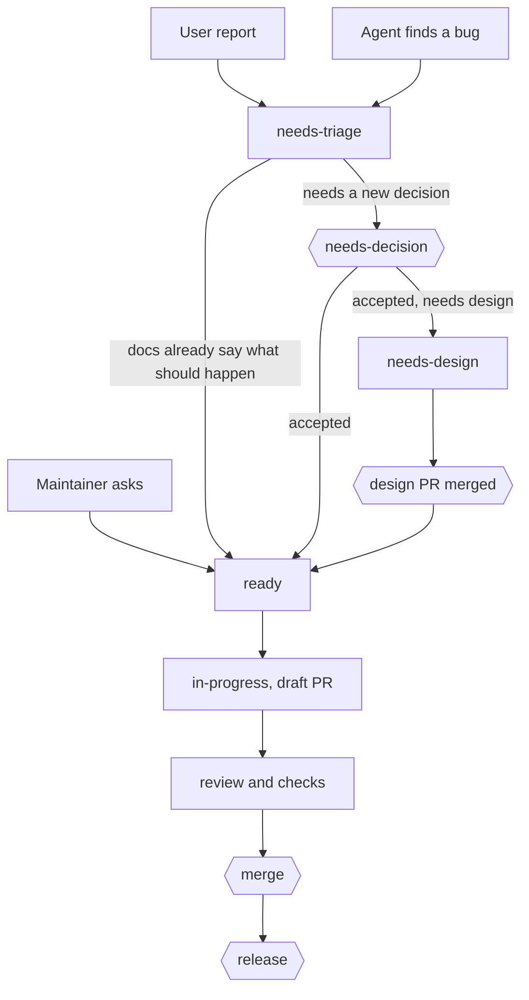

# Development workflow

> Status: Draft · [Contributing](../CONTRIBUTING.md) · [All docs](./README.md)

How work travels from an idea or a report to a release. Since v0.0.1, every change goes through an issue and a pull request: the maintainer's own features, users' reports and the bugs coding agents find. Coding agents do most of the work, so this document is written for them as much as for people; [CONTRIBUTING.md](../CONTRIBUTING.md) is the short version for outside contributors.

## Principles

- **One path for every change**: issue, branch, pull request, squash into `main`. Nothing is pushed to `main` directly, and a ruleset enforces it.
- **Each record has one job.** An issue says what is wrong or wanted and why. A pull request says how it was done and how it was checked. The design docs say how the system works. They link to each other instead of repeating each other.
- **The maintainer decides; agents do the rest.** The maintainer is asked only at the [gates](#gates). Everything else goes ahead and is reported with a link.
- **Small units.** One issue is one pull request. Work that needs more becomes a parent issue with sub-issues.
- **Short, in the right language.** An issue or a pull request says its point and stops. Issues we open and all pull requests are English; replies on an issue use the language its reporter wrote in.

## Who takes part

- **The maintainer** sets direction, accepts features and designs, merges and releases.
- **Coding agents** file and triage issues, design, build and review. They act through the maintainer's `gh` account, so their issues and pull requests appear as the maintainer's. GitHub never lets an account approve its own pull request, so the merge itself is the maintainer's approval.
- **Outside contributors** report bugs and ask for features through the issue forms. They do not send code; see [outside contributions](#outside-contributions).

## The pipeline

Hexagons are the maintainer's [gates](#gates).

### 1. Intake

| Source                                                                        | Filed by                                                           | Starts as                                                                       |
| ----------------------------------------------------------------------------- | ------------------------------------------------------------------ | ------------------------------------------------------------------------------- |
| The maintainer asks, in a chat with an agent or on GitHub                     | The agent, right away, with the maintainer's request as the reason | `state:ready`, or `state:needs-design` for a feature that needs a design first  |
| A user reports a bug or asks for a feature                                    | The user, through an [issue form](#forms)                          | `state:needs-triage`, set by the form                                           |
| An agent finds a bug while doing something else: a test, CI, a perf run, code | That agent, without dropping its own task                          | `state:needs-triage`, or `state:ready` when the agent has reproduced it already |

Before filing, search for an existing issue: `gh issue list --state all --search "<words>"`. An agent never folds a fix for something it found into the pull request it is working on, unless that pull request cannot work without it; it files an issue instead.

### 2. Triage

An agent takes each `state:needs-triage` issue through these steps:

1. **Duplicates.** A duplicate gets a comment, `Duplicate of #N`, and `state:needs-decision`; closing it is a [gate](#gates).
2. **Reproduce.** A bug is reproduced with the [fake agent](./design/testing.md#fake-agent), a test or the steps given, and the issue records how. When it cannot be reproduced, the issue gets `state:needs-info` and a comment asking for what is missing.
3. **Classify.** Set the type, one or more `area:` labels, a `platform:` label when only some platforms are affected, and `urgent`, `regression` or `upstream` when they apply.
4. **Route** by one rule. When the design docs already say what should happen, the issue is a bug or a gap in following them: `state:ready`. When it needs a decision nobody has made yet (new behavior, a changed design, a trade-off, a case the docs do not cover), it gets `state:needs-decision` and a comment with the options and a recommendation.
5. **Plan.** A ready bug goes into the current milestone; `urgent` goes to the top. A feature gets its milestone when the maintainer accepts it.

### 3. Design

A `state:needs-design` issue goes through the [design process](./design/design-process.md): the rules first, the best existing implementations, options to try, then the docs. The result is a pull request that changes docs only, linked with `Refs #N`, with the options in its description. Merging it is the acceptance: the issue then moves to `state:ready`, and work that needs more than one pull request is split into sub-issues.

### 4. Build

1. **Pick** a `state:ready` issue in the current milestone, `urgent` first, then the oldest. Skip one that already has an open pull request.
2. **Claim** it: replace `state:ready` with `state:in-progress`.
3. **Branch** from the latest `origin/main`, in a worktree of its own: one issue, one session, one worktree, one branch. The branch name follows [branches](#branches).
4. **Build** to the definition of done in [AGENTS.md](../AGENTS.md#definition-of-done). A bug fix starts with a test that fails.
5. **Open a draft pull request** after the first push, so CI starts early and the claim is visible.
6. **Mark it ready for review** once the definition of done holds, and report the link.

An agent that stops before the end comments what is left and puts the issue back to `state:ready`.

### 5. Review and merge

- Every pull request is reviewed by an agent that did not write it, for correctness and against the design rules and their checklists, as review comments. The author fixes or answers each one.
- The required `CI` check must pass on all three platforms.
- A change under `src/` also runs the Screenshots workflow, whose captures show it on each platform.
- The maintainer merges, on GitHub or by naming the pull requests to merge in a chat with an agent.
- The merge is a squash: the pull request's title becomes the commit subject on `main`, the branch is deleted, and `Closes #N` in its description closes the issue.

A pull request that does only part of an issue says `Refs #N` instead, and the issue stays open with a comment on what is left.

### 6. Release

A release goes out when one of four triggers fires, not on a fixed day and not for every merged issue. Fixes should not pile up, and each update, which every user downloads and installs on restart, should be worth it.

| Trigger | Fires when                                                                                       |
| ------- | ------------------------------------------------------------------------------------------------ |
| Urgent  | A fix for an `urgent` issue merges                                                               |
| Count   | 10 user-visible changes have merged since the last release                                       |
| Time    | 7 days have passed since the last release, and at least one user-visible change has merged since |
| Asked   | The maintainer asks for a release                                                                |

- **User-visible change**: a squash commit on `main` of type `feat`, `fix` or `perf`. Docs, CI, refactors and other tasks never trigger a release; they ship with the next one.
- **At most one a day.** A count or time release comes at least 24 hours after the previous release, so a burst of merges ships as one update. Urgent and asked releases go out at once.
- **The numbers**: 10 changes are about what one look at the release notes can take in, and 7 days is the longest a fix waits when little is merging. Both get revisited once a few releases show how fast work lands.
- **Checked by CI**: a `Release check` workflow runs on every push to `main` and once a day. When a trigger has fired and no release is open, it opens a Task issue, "Release vX.Y.Z", that names the trigger. An agent takes it through the steps below; an asked release starts the same way, from the maintainer's words.
- **Versions**: a patch by default. When a milestone's last issue has closed, the release is that milestone's minor version. Before 1.0, a minor version completes a design milestone (`v0.1.0` completes [M0](./milestones/m0.md), `v0.2.0` will be M1), and the patches in between are previews.
- **How**: an agent opens `chore(release): vX.Y.Z`, which bumps `package.json`; its description is the release notes, grouped by type and drafted from the squash commits since the last tag. After it merges come CI and Screenshots green on all three platforms for that commit, the tag, the [Release workflow](../.github/workflows/release.yml)'s draft, which the maintainer can install and try, and then publishing. The notes live on the GitHub release only.

## Gates

| Gate    | When                                                                                     | The maintainer                                                                    |
| ------- | ---------------------------------------------------------------------------------------- | --------------------------------------------------------------------------------- |
| Accept  | An issue in `state:needs-decision`                                                       | Accepts it (it moves to `ready` or `needs-design`, with a milestone) or closes it |
| Design  | A design pull request                                                                    | Tries the options, then merges it or asks for changes                             |
| Merge   | Every pull request                                                                       | Merges it or asks for changes                                                     |
| Close   | Closing an issue without a merged pull request: a duplicate, not planned, not reproduced | Confirms                                                                          |
| Release | Each version                                                                             | Confirms the release pull request, the tag and the publication                    |

A bug needs no gate before work starts. The docs already decided what should happen, and the merge gate sees the fix.

## Issues

### Types

Every issue has one of the organization's issue types, which replace type labels:

- **Bug**: OverBench does not do what its docs say, or what a user can reasonably expect.
- **Feature**: new or changed behavior.
- **Task**: work that changes no behavior, such as docs, CI, refactors, dependencies and releases.

A parent issue with sub-issues tracks larger work (`gh issue create --parent N`, `gh issue edit N --add-sub-issue M`). It closes once all of its sub-issues have closed.

### Labels

Every label carries a description on GitHub, which agents read with `gh label list`.

| Label                                                                                                                                                                                                                                                                             | Meaning                                                                                                     |
| --------------------------------------------------------------------------------------------------------------------------------------------------------------------------------------------------------------------------------------------------------------------------------- | ----------------------------------------------------------------------------------------------------------- |
| `state:needs-triage`, `state:needs-info`, `state:needs-decision`, `state:needs-design`, `state:ready`, `state:in-progress`, `state:blocked`                                                                                                                                       | Where an open issue stands: exactly one at a time. `blocked` names what it waits for                        |
| `area:agents`, `area:session`, `area:thread`, `area:composer`, `area:sidebar`, `area:top-bar`, `area:home`, `area:settings`, `area:git`, `area:terminal`, `area:files`, `area:usage`, `area:updates`, `area:design-system`, `area:i18n`, `area:window`, `area:build`, `area:docs` | The part of OverBench it concerns: one or more                                                              |
| `platform:macos`, `platform:windows`, `platform:linux`                                                                                                                                                                                                                            | Only when some platforms are affected and others are not                                                    |
| `urgent`                                                                                                                                                                                                                                                                          | A released version crashes, loses data or has a security problem: fix it first, and release the fix at once |
| `regression`                                                                                                                                                                                                                                                                      | It worked in an earlier version                                                                             |
| `upstream`                                                                                                                                                                                                                                                                        | The cause lies in an agent, an adapter, Electron or a library; the issue links upstream                     |
| `performance`, `accessibility`                                                                                                                                                                                                                                                    | Cross-cutting concerns, next to the area                                                                    |

`area:agents` covers the agent host, adapters and ACP; `area:session` the session lifecycle, history and persistence; `area:thread` the thread's entries and Markdown; `area:window` the main process, windows, menus and shortcuts; `area:build` CI, packaging, releases and `tools/`. GitHub's default labels go: types replace `bug`, `enhancement`, `question` and `documentation`, and close reasons replace `duplicate`, `invalid` and `wontfix`.

### Titles and descriptions

Say the core problem and stop. Many issues are one sentence and a screenshot; none needs headings unless it is long.

- **Titles** are in sentence case, without prefixes, tags or emoji, and up to about 70 characters. A bug's title states the problem as seen ("Choosing a model does not close the model menu"); a feature's or task's states the outcome ("Rename sessions inline").
- **Descriptions** give the problem in a sentence or two, with a screenshot when one shows it. Steps, the environment, logs or "done when" are added only when someone needs them to act.
- **Language**: issues we open are English. A reporter's title and text stay as written, and every reply on an issue uses the language its reporter wrote in, so a Chinese report gets Chinese replies.
- `gh issue create` skips the forms, so agents set the type themselves (`--type Bug`).
- Design docs are linked by their section anchors, and code by path.

### Forms

`.github/ISSUE_TEMPLATE/` holds two short forms, both adding `state:needs-triage`:

- `bug.yml` (type Bug): what happened, where a screenshot is welcome, plus the OverBench version and the OS, which decide where to look. The agent, steps and logs are optional.
- `feature.yml` (type Feature): one field, what you want and why.

`config.yml` turns blank issues off and points security reports to private vulnerability reporting. There is no task form, because tasks come from the maintainer and agents.

### Milestones

One milestone per version, as in [release](#6-release). Its description names the design milestone and links its document. An open issue without a milestone is in the backlog.

Discussions stay off for now, so issues are the one place to report. When outside traffic makes the issue list noisy, ideas and questions move to Discussions and the accepted ones are promoted to issues.

## Branches and pull requests

### Branches

- Named `<type>/<issue>-<slug>`, with a Conventional Commits type and a kebab-case slug, such as `fix/123-model-menu-close`. This is a convention; nothing enforces it.
- Short-lived, branched from the latest `main`, and deleted when merged. `main` is the only long-lived branch; a release branch appears only when an old version needs a patch while `main` has moved on.

### Pull requests

- **Title**: Conventional Commits, `type(scope): subject`, imperative, lowercase and at most 50 characters, because it becomes the commit subject on `main`. CI checks it.
- **Description**: one or two sentences on what changes and why, `Closes #N` (or `Refs #N`), and one line on how it was checked, with screenshots in light and dark for a UI change. No headings or checklists; a sentence on a non-obvious decision only when there is one. `.github/pull_request_template.md` holds just those lines, and CI checks that the description links an issue.
- **Language**: English, always.
- **Size**: one issue each. Split a pull request that grows past what one review can hold; as a rough guide, 400 changed lines, not counting generated files and the lockfile.
- **Commits** inside a branch follow Conventional Commits as before, but only the squash commit lands on `main`. Its subject is the pull request's title with `(#N)`, and its body is empty: the pull request it links holds the why, the testing and the review.
- No tool-generated trailers or attribution lines, in commits, pull requests or issues.

### Protecting main

A ruleset on `main`:

- requires a pull request, with no required approvals, because the maintainer cannot approve pull requests from their own account;
- allows squash merges only and keeps history linear;
- blocks force pushes and deletion;
- requires one combined check, `CI`, which passes when the three platform jobs and the pull request checks pass, so that renaming a matrix job never breaks protection;
- does not require branches to be up to date before merging, because parallel pull requests would keep rebasing each other. A merge queue comes in if `main` starts breaking from changes that pass alone and clash together;
- has no bypass. In an emergency, the maintainer turns the rule off and says why in the pull request.

## Agents

- **One issue, one session, one worktree, one branch.** The main checkout stays on a clean `main` and is only pulled. Sessions sharing one checkout used to take the same feedback number and the same dev ports; separate worktrees end that. Parallel sessions take issues in different areas, so that two sessions never touch the same files.
- **Roles.** A session plays one role at a time, and may play several in a row, such as triage and then build for the same bug. It never reviews its own pull request.

| Role    | Takes                                        | Produces                                       | Never                                          |
| ------- | -------------------------------------------- | ---------------------------------------------- | ---------------------------------------------- |
| Triage  | `state:needs-triage` issues                  | Labels, states, reproductions, comments        | Closes an issue or changes code                |
| Design  | `state:needs-design` issues                  | A docs pull request with options to try        | Builds beyond prototypes                       |
| Build   | `state:ready` issues                         | A pull request                                 | Works outside the issue's scope                |
| Review  | Pull requests ready for review               | Review comments                                | Approves, merges or pushes to the branch       |
| Release | A release issue, or the maintainer's request | The release pull request and the draft release | Tags or publishes without the maintainer's yes |

- **Reporting.** An agent reports every issue, pull request and comment it creates, with its link, and asks at every [gate](#gates).
- **Not yet.** Agents run in sessions the maintainer starts. Event-driven bots on GitHub (triage on open, stale and duplicate bots) wait until volume asks for them; the first step then is a scheduled triage run over `state:needs-triage`.

## Outside contributions

OverBench takes issues from outside, not code: fixes and features are written by the project.

- **Reports and requests** are welcome through the [forms](#forms), in any language.
- **Pull requests** can be opened by collaborators only. The repository has been set that way since 2026-10-22 (`pull_request_creation_policy: collaborators_only`); anyone can still read and comment on them.
- **Security** problems go to GitHub's private vulnerability reporting, described in `SECURITY.md`, and never to a public issue: OverBench runs agents that run shell commands.

## Adoption

A parent issue tracks the move, with one sub-issue per step:

1. Make the Windows tests reliable. `pnpm test` failed on Windows in three of the eight latest CI runs on 2026-10-22, and the check is about to gate every merge.
2. Labels and milestone `v0.1.0`, with M0's remaining work.
3. Issue forms, the pull request template, `SECURITY.md`, and updates to `CONTRIBUTING.md`, `AGENTS.md` and the [docs index](./README.md).
4. CI: the combined `CI` check, the title and issue-link check, Screenshots on pull requests, and the `Release check` workflow.
5. Repository settings: squash merges only, with the pull request's title and an empty body; delete branches on merge; private vulnerability reporting; then the ruleset, once steps 1 and 4 have landed. Pull requests were limited to collaborators on 2026-10-22.
6. The 22 problems in [M0 feedback](./milestones/m0-feedback.md) that are open or partly fixed become issues in `v0.1.0`, each naming its old number. The document is then frozen, linking to the milestone.

## To decide

- Whether merging a pull request also approves closing the issues it names with `Closes`. This draft assumes it does.
- Whether a bug skips the accept gate. This draft assumes it does.
- Whether milestones are named by version, with `v0.1.0` completing M0.
- How CI checks titles and issue links: a short script in the repository, or `amannn/action-semantic-pull-request`, which is a new dependency.
- Whether the squash commit's body stays empty or takes the pull request's description.
- Whether Discussions stay off.
